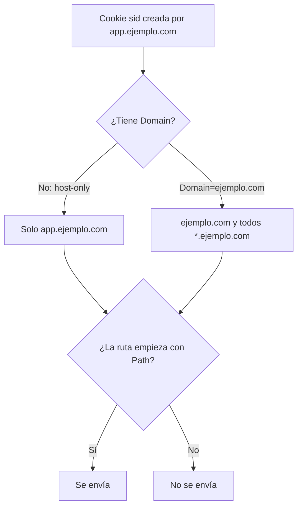

# Cookies - Domain y Path

Parte de: [[02-Fundamentos/04 Cookies/_Índice Cookies|Cookies]]

> [!info] Cómo avanzar
> `progreso`: **pendiente** → **viendo** (estudiando) → **visto** (contestaste la autoevaluación sin abrir las respuestas) → **dominado** (hiciste el laboratorio o lo aplicaste de verdad).

## Contenido

### Qué es
`Domain` y `Path` son los atributos que definen el **alcance** de una cookie: a qué hosts y a qué rutas de URL el navegador la adjunta. Junto con el nombre forman la identidad de la cookie: `sid` con `Domain=ejemplo.com; Path=/` es una cookie distinta de `sid` host-only con `Path=/admin`.

### Cómo funciona
**Domain.**
- **Sin `Domain`** la cookie es **host-only**: solo se envía al host exacto que la creó. Si la creó `app.ejemplo.com`, no viaja a `api.ejemplo.com` ni a `ejemplo.com`. Es la opción más restrictiva y la más segura.
- **Con `Domain=ejemplo.com`** la cookie se envía a `ejemplo.com` **y a todos sus subdominios**: `app.`, `api.`, `blog.`, `legacy.ejemplo.com`. El punto inicial (`.ejemplo.com`) es una costumbre antigua; los navegadores modernos lo ignoran y el efecto es el mismo.
- Un host solo puede poner `Domain` igual a sí mismo o a un dominio "padre" suyo. `app.ejemplo.com` puede poner `Domain=ejemplo.com`, pero no `Domain=otro.com` ni `Domain=api.ejemplo.com`.
- No se puede poner `Domain` en un sufijo público (`com.mx`, `azurewebsites.net`, `github.io`), porque la Public Suffix List lo impide; si no, cualquier sitio podría plantar cookies a todos los demás (ver [[Mismo origen, mismo sitio y mismo dominio]]).

**Path.**
- La cookie se envía si la ruta de la petición **empieza** con el `Path` (a nivel de segmentos). `Path=/admin` coincide con `/admin` y `/admin/usuarios`, pero no con `/administracion` ni `/`.
- Si no se pone, el navegador usa como valor por defecto el "directorio" de la URL que la creó (para `/cuenta/login` sería `/cuenta`). Por eso conviene poner `Path=/` explícito y evitar sorpresas.



**`Path` no es seguridad.** Solo decide cuándo se envía la cookie, no quién la puede leer. Una página en `/publico` del mismo origen puede abrir un iframe a `/admin` y leer `document.cookie` desde ahí, porque la política de mismo origen le da acceso al documento. El aislamiento entre partes de una aplicación se logra con orígenes distintos (subdominios host-only), no con rutas.

### Ejemplo
Supón Xolotl.Hecate (identidad) en `id.xolotl.mx` e Itzamna.Clio en `app.xolotl.mx`, más un blog en WordPress de un proveedor en `blog.xolotl.mx`.

```http
Opción A (host-only, solo id.xolotl.mx la recibe):
Set-Cookie: __Host-idsesion=...; Path=/; Secure; HttpOnly; SameSite=Lax

Opción B (compartida: id., app. y también blog.xolotl.mx la reciben):
Set-Cookie: sesion=...; Domain=xolotl.mx; Path=/; Secure; HttpOnly; SameSite=Lax
```

Con la opción B, si el blog tiene una vulnerabilidad, el atacante recibe la cookie de sesión en sus logs, o puede **sobrescribirla** desde `blog.xolotl.mx` con una cookie del mismo nombre (*cookie tossing*). La opción A, con el prefijo `__Host-`, garantiza que la cookie no tenga `Domain` y no pueda ser sobrescrita desde subdominios. Para compartir sesión entre `id.` y `app.` es mejor que cada app tenga su propia cookie host-only y que la identidad se propague con OIDC (ver [[Cookies y SSO]] y [[Cookies entre sistemas propios (subdominios y dominios distintos)]]).

En ASP.NET Core, el dominio se controla con `CookieOptions.Domain` o, para la cookie de autenticación, `o.Cookie.Domain`. Si no lo asignas, la cookie es host-only, que es lo deseable casi siempre.

### Cuándo usarlo y cuándo no
- **Deja `Domain` vacío** (host-only) por defecto, sobre todo en cookies de sesión.
- **Usa `Domain=padre`** solo cuando de verdad varios subdominios **propios y confiables** necesitan la misma cookie, y todos están bajo tu control.
- **Usa `Path=/`** casi siempre. Rutas más específicas sirven para evitar enviar una cookie grande a rutas que no la necesitan (por ejemplo, un token antiforgery solo en `/api`), no para proteger.

### Errores comunes
1. **Poner `Domain` "por si acaso".** Amplía la superficie de ataque a cualquier subdominio, incluso a los que montan terceros (marketing, landing pages).
2. **Creer que `Path` aísla.** Pasa porque "si no se envía, no se puede leer"; pero el mismo origen puede leerla. Separa por origen.
3. **No poder borrar la cookie.** Pasa al borrar sin el mismo `Domain`/`Path` con que se creó. Usa siempre los mismos valores.
4. **`Path` implícito.** Si la cookie se crea en `/cuenta/login` sin `Path`, no llega a `/api`. Pon `Path=/` explícito.
5. **Intentar `Domain` en un sufijo público** (`azurewebsites.net`): el navegador la rechaza y parece que "no se guarda".

### Para profundizar
- [MDN: Definir dónde se envían las cookies](https://developer.mozilla.org/en-US/docs/Web/HTTP/Guides/Cookies#define_where_cookies_are_sent)
- [RFC 6265, secciones 5.1.3 y 5.1.4 (coincidencia de dominio y ruta)](https://www.rfc-editor.org/rfc/rfc6265#section-5.1.3)
- [Public Suffix List](https://publicsuffix.org/)

## Autoevaluación

Contesta primero en voz alta o en papel; luego despliega la respuesta.

> [!question]- ¿Qué pasa si no pones `Domain` en una cookie?
> Es **host-only**: solo se envía al host exacto que la creó (`app.ejemplo.com`), no a sus subdominios.

> [!question]- Pones `Domain=ejemplo.com`. ¿A qué hosts se envía?
> A `ejemplo.com` y **todos** sus subdominios (`app.`, `api.`, `blog.ejemplo.com`). Amplía la superficie: un subdominio comprometido puede leerla o sobrescribirla.

> [!question]- ¿`Path` sirve como medida de seguridad?
> No. Solo controla en qué rutas se envía; una página del mismo origen en otra ruta puede leerla de todas formas (por ejemplo con un iframe). Es para organización, no aislamiento.

## Práctica

- [[Lab 1 - Cookies y CORS en el navegador con DevTools]]

