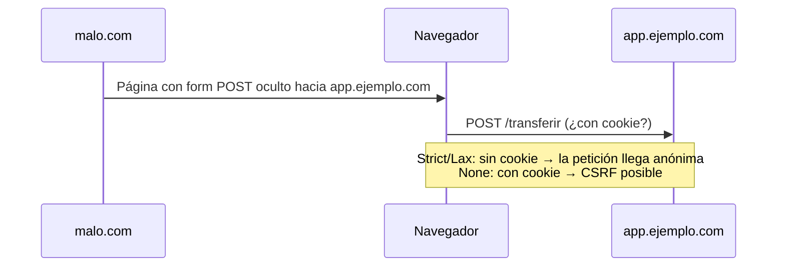

# Cookies - SameSite

Parte de: [[02-Fundamentos/04 Cookies/_Índice Cookies|Cookies]]

> [!info] Cómo avanzar
> `progreso`: **pendiente** → **viendo** (estudiando) → **visto** (contestaste la autoevaluación sin abrir las respuestas) → **dominado** (hiciste el laboratorio o lo aplicaste de verdad).

## Contenido

### Qué es
`SameSite` indica si el navegador debe enviar la cookie cuando la petición se origina **desde otro sitio**. Es la principal defensa del navegador contra CSRF y contra parte del rastreo entre sitios. El concepto de "sitio" aquí es esquema + dominio registrable, no origen (ver [[Mismo origen, mismo sitio y mismo dominio]]): `app.ejemplo.com` y `api.ejemplo.com` son el mismo sitio.

### Cómo funciona
Tiene tres valores:

| Valor | Se envía en peticiones del mismo sitio | Se envía en navegación de nivel superior `GET` desde otro sitio (clic en enlace) | Se envía en `POST`, `fetch`, iframes, imágenes desde otro sitio |
|---|---|---|---|
| `Strict` | Sí | **No** | No |
| `Lax` | Sí | **Sí** | No |
| `None` | Sí | Sí | **Sí** (exige `Secure`) |

- **`Strict`**: máxima protección. Desventaja: si llegas a tu banco desde un enlace en un correo, la primera carga no lleva la cookie y parece que no tienes sesión.
- **`Lax`**: equilibrio. Los enlaces normales funcionan, pero formularios `POST`, `fetch` e iframes desde otros sitios no llevan la cookie. Es el valor razonable para la sesión de casi cualquier app.
- **`None`**: la cookie viaja siempre. Necesaria para contenido embebido en otro sitio (widgets en iframe) o para flujos que regresan con `POST` desde otro sitio. Los navegadores rechazan `SameSite=None` sin `Secure`.

**Valor por defecto.** Chrome y Edge tratan una cookie sin `SameSite` como `Lax` (con una excepción temporal de unos minutos para `POST` de nivel superior en cookies recién creadas, pensada para no romper logins antiguos). Firefox y Safari tienen comportamientos propios y han cambiado entre versiones. Conclusión práctica: **escribe siempre `SameSite` explícito**.



### Ejemplo
El caso típico del ejercicio: Itzamna.Clio inicia sesión con un proveedor OIDC externo usando `response_mode=form_post`. El proveedor regresa al usuario con un **`POST`** a `https://app.itzamna.mx/signin-oidc`. Ese `POST` viene **de otro sitio** (`login.proveedor.com`), así que una cookie de correlación con `SameSite=Lax` **no se envía**, y el middleware falla con "Correlation failed".

Por eso ASP.NET Core emite sus cookies de correlación y nonce de OIDC con `SameSite=None; Secure`. Tu cookie de sesión principal puede quedarse en `Lax`, porque se crea **después** del callback.

```csharp
builder.Services.AddAuthentication(o =>
{
    o.DefaultScheme = CookieAuthenticationDefaults.AuthenticationScheme;
    o.DefaultChallengeScheme = OpenIdConnectDefaults.AuthenticationScheme;
})
.AddCookie(o => o.Cookie.SameSite = SameSiteMode.Lax)   // sesión de la app
.AddOpenIdConnect(o =>
{
    o.Authority = builder.Configuration["Oidc:Authority"];
    o.ClientId = builder.Configuration["Oidc:ClientId"];
    o.ResponseType = "code";
    // Correlación y nonce ya usan SameSite=None; Secure por defecto
});
```

Si ves "Correlation failed" en desarrollo, revisa que estés en HTTPS (sin `Secure`, la cookie `None` se rechaza) y la pestaña Application de DevTools, que marca las cookies bloqueadas por `SameSite`.

**¿Reemplaza a CSRF?** No del todo:
- Un subdominio vulnerable (`blog.ejemplo.com`) es **mismo sitio** y puede forjar peticiones con la cookie.
- `Lax` permite `GET` de nivel superior; si tienes `GET` que cambian estado, sigue siendo explotable.
- Navegadores o clientes antiguos pueden no respetarlo.

Por eso se mantienen los tokens antiforgery en operaciones sensibles (ver [[Cookies y CSRF]]).

### Cuándo usarlo y cuándo no
- **`Lax`**: cookie de sesión de una app web normal.
- **`Strict`**: cookies de operaciones muy sensibles (panel administrativo, confirmación de transferencias) donde perder la sesión al llegar desde un enlace es aceptable. Un patrón es tener dos cookies: una `Lax` para navegar y una `Strict` exigida para acciones críticas.
- **`None; Secure`**: solo cuando la cookie debe viajar en contexto de tercero (iframes, correlación de login con `form_post`), sabiendo que las restricciones a cookies de terceros pueden bloquearla igual (ver [[Restricciones a cookies de terceros en navegadores]]).

### Errores comunes
1. **`SameSite=None` sin `Secure`.** El navegador rechaza la cookie. Siempre juntos.
2. **Poner `Strict` en la sesión y romper los enlaces entrantes.** El usuario llega desde Teams o el correo y aparece deslogueado. Usa `Lax`.
3. **Confundir sitio con origen.** `api.ejemplo.com` llamando a `app.ejemplo.com` es mismo sitio: `SameSite` no la bloquea, aunque CORS sí aplique.
4. **Dejarlo implícito.** El comportamiento difiere por navegador; especifícalo.
5. **Asumir que con `SameSite` ya no hace falta antiforgery.** Mantén defensa en profundidad.

### Para profundizar
- [web.dev: SameSite cookies explained](https://web.dev/articles/samesite-cookies-explained)
- [MDN: Set-Cookie, atributo SameSite](https://developer.mozilla.org/en-US/docs/Web/HTTP/Reference/Headers/Set-Cookie#samesitesamesite-value)
- [Microsoft Learn: trabajar con SameSite en ASP.NET Core](https://learn.microsoft.com/aspnet/core/security/samesite)

## Autoevaluación

Contesta primero en voz alta o en papel; luego despliega la respuesta.

> [!question]- ¿Qué valores tiene `SameSite` y qué hacen?
> `Strict`: solo se envía en peticiones originadas en el mismo sitio. `Lax`: también en navegaciones de nivel superior con `GET` desde otro sitio (clic en un enlace). `None`: siempre, pero exige `Secure`.

> [!question]- ¿Qué valor por defecto aplican los navegadores modernos si no se especifica?
> Chrome y Edge tratan la cookie como `Lax` por defecto. Firefox y Safari tienen comportamientos propios; especifícalo siempre de forma explícita.

> [!question]- Tu login con un proveedor externo usa `POST` de regreso (form_post) y la cookie de correlación se pierde. ¿Por qué?
> Con `Lax`, un `POST` entre sitios no lleva la cookie. Esa cookie necesita `SameSite=None; Secure` (ASP.NET Core ya lo hace para sus cookies de correlación de OIDC).

> [!question]- ¿`SameSite` reemplaza la protección CSRF?
> Reduce mucho el riesgo, pero no lo elimina (subdominios del mismo sitio, `Lax` permite `GET`, navegadores viejos). Mantén tokens antiforgery en operaciones sensibles.

## Práctica

- [[Lab 1 - Cookies y CORS en el navegador con DevTools]]

