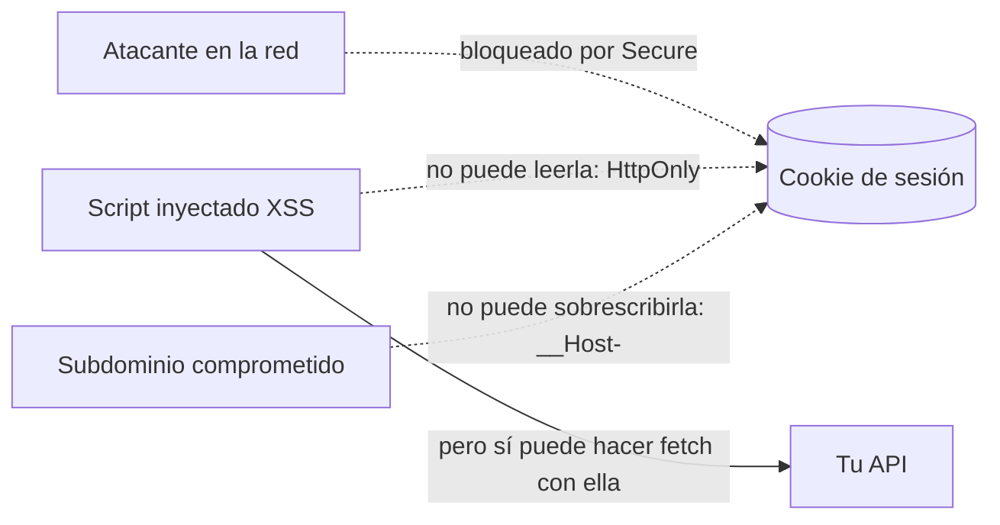

# Cookies - Secure y HttpOnly

Parte de: [[02-Fundamentos/04 Cookies/_Índice Cookies|Cookies]]

> [!info] Cómo avanzar
> `progreso`: **pendiente** → **viendo** (estudiando) → **visto** (contestaste la autoevaluación sin abrir las respuestas) → **dominado** (hiciste el laboratorio o lo aplicaste de verdad).

## Contenido

### Qué es
`Secure` y `HttpOnly` son dos banderas (atributos sin valor) que protegen a la cookie de dos formas de robo distintas:
- **`Secure`**: la cookie solo viaja por **HTTPS**. Protege contra quien escucha la red.
- **`HttpOnly`**: la cookie no es accesible desde **JavaScript** (`document.cookie`, Cookie Store API). Protege contra el robo por XSS.

Se complementan con los **prefijos de nombre** `__Secure-` y `__Host-`, que el navegador hace cumplir y que impiden que la cookie se cree sin ciertas garantías.

### Cómo funciona
**Secure.**
- El navegador no adjunta la cookie a peticiones `http://` y, en navegadores modernos, un sitio `http://` no puede crear ni sobrescribir cookies `Secure`.
- Excepción práctica: `localhost` se trata como contexto seguro, así que en desarrollo funciona incluso con `http://localhost`.
- Importa aunque tu sitio "siempre use HTTPS": basta con que un enlace o una imagen apunte a `http://tusitio` para que, sin `Secure`, la cookie salga en claro antes de que la redirección a HTTPS ocurra.

**HttpOnly.**
- La cookie se sigue enviando en cada petición, pero los scripts no la ven. Si un atacante logra inyectar JavaScript (XSS), no puede leer la cookie de sesión para mandársela a su servidor.
- **Límite importante**: `HttpOnly` mitiga el **robo**, no el **abuso**. El script inyectado corre en tu página y puede hacer `fetch('/api/transferencias', {method:'POST'})`; el navegador adjunta la cookie igual. El daño se limita a lo que el atacante haga mientras la víctima tiene la página abierta, pero existe. La defensa de fondo es prevenir el XSS (codificar salidas, CSP, no usar `innerHTML` con datos de usuario).

**Prefijos.**
| Prefijo | Requisitos que exige el navegador | Efecto |
|---|---|---|
| `__Secure-` | Atributo `Secure` y creada desde HTTPS | Nadie puede plantarla por HTTP |
| `__Host-` | `Secure`, `Path=/` y **sin** `Domain` | Queda atada al host exacto; un subdominio no puede crearla ni sobrescribirla |

Si el `Set-Cookie` no cumple los requisitos del prefijo, el navegador **la rechaza**. Por eso `__Host-` es la mejor opción para la cookie de sesión de una app que vive en un solo host: evita el *cookie tossing* desde `blog.tudominio.com`.



### Ejemplo
Configuración de la cookie de autenticación en el `Program.cs` de una app de Itzamna:

```csharp
builder.Services
    .AddAuthentication(CookieAuthenticationDefaults.AuthenticationScheme)
    .AddCookie(o =>
    {
        o.Cookie.Name = "__Host-itzamna";               // prefijo: exige Secure, Path=/ y sin Domain
        o.Cookie.HttpOnly = true;                       // JS no la ve
        o.Cookie.SecurePolicy = CookieSecurePolicy.Always; // siempre Secure, incluso detrás de un proxy
        o.Cookie.SameSite = SameSiteMode.Lax;
        o.Cookie.Path = "/";
        // No asignar o.Cookie.Domain: __Host- lo prohíbe
    });
```

`CookieSecurePolicy.Always` importa en Azure App Service o detrás de un balanceador: la app recibe la petición por HTTP desde el proxy, y con `SameAsRequest` emitiría la cookie sin `Secure`. Lo correcto es `Always` más `UseForwardedHeaders` para que la app sepa que el cliente usó HTTPS.

Respuesta resultante:

```http
Set-Cookie: __Host-itzamna=CfDJ8...; path=/; secure; samesite=lax; httponly
```

### Cuándo usarlo y cuándo no
- **`Secure`: siempre**, en todas las cookies de un sitio con HTTPS. No hay razón para omitirlo.
- **`HttpOnly`: en toda cookie que el front no necesite leer**, sobre todo sesión, refresh tokens y antiforgery de cookie. Omítelo solo en cookies de preferencias que JavaScript debe leer (tema, idioma) y que no son sensibles.
- **`__Host-`**: para la sesión de una app de un solo host. Si necesitas compartir con subdominios, no se puede usar (exige no tener `Domain`); usa `__Secure-` y evalúa el riesgo.

### Errores comunes
1. **Pensar que `HttpOnly` resuelve el XSS.** Solo evita el robo de la cookie; el atacante puede actuar como el usuario. Prevén el XSS.
2. **`Secure` desactivado "porque detrás del proxy es HTTP".** La cookie viaja sin protección en el tramo cliente-proxy si algún enlace usa HTTP. Usa `Always` y forwarded headers.
3. **Usar `__Host-` con `Domain`.** El navegador rechaza la cookie en silencio y el login "no funciona". Revisa la pestaña Application o la consola de DevTools, que avisa del rechazo.
4. **Guardar el token de acceso en una cookie sin `HttpOnly` para leerlo desde JS.** Pierdes la protección; mejor el patrón BFF (ver [[Cookies vs localStorage vs sessionStorage]]).
5. **Olvidar `SameSite`.** `Secure` y `HttpOnly` no protegen contra CSRF (ver [[Cookies - SameSite]]).

### Para profundizar
- [MDN: Restringir el acceso a cookies (Secure y HttpOnly)](https://developer.mozilla.org/en-US/docs/Web/HTTP/Guides/Cookies#restrict_access_to_cookies)
- [MDN: Prefijos de cookies en Set-Cookie](https://developer.mozilla.org/en-US/docs/Web/HTTP/Reference/Headers/Set-Cookie#cookie_prefixes)
- [OWASP: Session Management Cheat Sheet](https://cheatsheetseries.owasp.org/cheatsheets/Session_Management_Cheat_Sheet.html)

## Autoevaluación

Contesta primero en voz alta o en papel; luego despliega la respuesta.

> [!question]- ¿Qué hace `Secure`?
> La cookie solo se envía por HTTPS (excepción: `localhost`). Evita que viaje en claro si alguna petición sale por HTTP.

> [!question]- ¿Qué hace `HttpOnly` y de qué protege?
> Impide leerla desde JavaScript (`document.cookie`). Si hay un XSS, el atacante no puede **robar** la cookie de sesión.

> [!question]- ¿`HttpOnly` evita por completo el daño de un XSS?
> No. El script inyectado puede hacer peticiones desde la página de la víctima y el navegador adjunta la cookie igual. Mitiga el robo, no el abuso; hay que prevenir el XSS.

> [!question]- ¿Qué son los prefijos `__Host-` y `__Secure-`?
> `__Secure-` exige `Secure`. `__Host-` exige `Secure`, `Path=/` y **sin** `Domain`, así queda atada al host exacto y un subdominio no puede sobrescribirla.

## Práctica

- [[Lab 1 - Cookies y CORS en el navegador con DevTools]]

