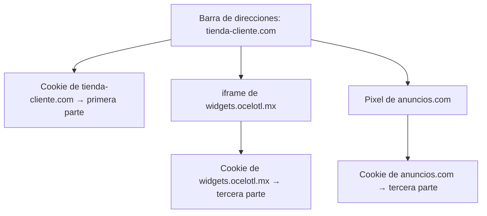

# Cookies de primera y tercera parte

Parte de: [[02-Fundamentos/04 Cookies/_Índice Cookies|Cookies]]

> [!info] Cómo avanzar
> `progreso`: **pendiente** → **viendo** (estudiando) → **visto** (contestaste la autoevaluación sin abrir las respuestas) → **dominado** (hiciste el laboratorio o lo aplicaste de verdad).

## Contenido

### Qué es
La distinción entre cookie de **primera parte** (first-party) y de **tercera parte** (third-party) no depende de la cookie en sí, sino del **contexto** en que se usa:
- Es de **primera parte** cuando pertenece al **sitio que aparece en la barra de direcciones**.
- Es de **tercera parte** cuando pertenece a **otro sitio** cuyo contenido está embebido en la página: un iframe, un script, una imagen, un `fetch` a otro sitio.

La misma cookie de `widgets.ocelotl.mx` es de primera parte cuando visitas `widgets.ocelotl.mx` directamente, y de tercera cuando su iframe aparece dentro de `tienda-cliente.com`.

### Cómo funciona
"Sitio" aquí es esquema + dominio registrable (ver [[Mismo origen, mismo sitio y mismo dominio]]). Una petición desde `app.itzamna.mx` a `api.itzamna.mx` es de **primera parte** (mismo sitio), aunque sean orígenes distintos.



**Por qué las de tercera parte están en la mira.** Un mismo tercero embebido en miles de sitios (un pixel de publicidad, un botón social) recibe su cookie en todos ellos y puede armar un historial de navegación del usuario entre sitios. Por privacidad, los navegadores las **bloquean o las particionan** (ver [[Restricciones a cookies de terceros en navegadores]]):
- Safari las bloquea por defecto.
- Firefox las particiona por sitio de nivel superior por defecto.
- Chrome las sigue permitiendo por defecto tras abandonar su plan de eliminarlas; el usuario puede bloquearlas y en modo incógnito se bloquean.

Para que una cookie pueda enviarse en contexto de tercero, como mínimo necesita **`SameSite=None; Secure`**; con `Lax` o `Strict` no viaja en iframes ni en `fetch` entre sitios (ver [[Cookies - SameSite]]).

### Ejemplo
Ocelotl.Iris ofrece un **widget de seguimiento de pedidos** que los clientes embeben en sus tiendas con un iframe:

```html
<!-- En https://tienda-cliente.com -->
<iframe src="https://widgets.ocelotl.mx/seguimiento?tienda=42"></iframe>
```

El widget inicia sesión del comprador y guarda una cookie. Síntoma reportado: "en Safari y Firefox el widget no mantiene la sesión; cada recarga pide login". Lista de revisión:

1. **Atributos de la cookie**: debe ser `SameSite=None; Secure`. Con `Lax` no viaja en el iframe en ningún navegador.
2. **Bloqueo de terceros**: aunque esté bien configurada, Safari la bloquea y Firefox la particiona. Revisa DevTools > Application > Cookies y los avisos de la consola.
3. **Alternativas**:
   - **Cookies particionadas (CHIPS)**: agregar `Partitioned` hace que la cookie funcione dentro de `tienda-cliente.com`, en un bote separado por sitio de nivel superior. Sirve si no necesitas compartir la sesión entre tiendas distintas.
   ```http
   Set-Cookie: __Host-widget=...; Path=/; Secure; HttpOnly; SameSite=None; Partitioned
   ```
   - **Storage Access API**: el iframe pide con `document.requestStorageAccess()` acceso a sus cookies de primera parte, tras un gesto del usuario; el navegador puede mostrar un aviso.
   - **Tokens en lugar de cookies**: el widget recibe un token de corta vida por `postMessage` desde la página anfitriona (que lo obtuvo de su backend) y llama a la API con `Authorization: Bearer`.
   - **Servirlo como primera parte**: un subdominio del cliente (`seguimiento.tienda-cliente.com`) que apunta a tu servicio por CNAME.

### Cuándo usarlo y cuándo no
- **Diseña como primera parte** siempre que puedas: mismo sitio para front, API e identidad.
- **Cookies de tercera parte** solo para productos embebidos, y asumiendo que pueden fallar: ten un plan B (CHIPS, Storage Access, tokens).
- **No** construyas analítica o personalización que dependa de seguir al usuario entre sitios.

### Errores comunes
1. **Pensar que "tercera parte" es una propiedad de la cookie.** Es del contexto; la misma cookie cambia de categoría según la página.
2. **Usar dominios por defecto de Azure para front y API.** `*.azurewebsites.net` son sitios distintos: tus cookies quedan como de tercera parte entre tus propias apps.
3. **Olvidar `Secure` con `SameSite=None`.** La cookie se rechaza.
4. **Probar solo en Chrome.** Chrome es el más permisivo; Safari y Firefox revelan el problema.
5. **Confundir mismo sitio con mismo origen.** `api.` y `app.` del mismo dominio son primera parte entre sí, aunque necesiten CORS.

### Para profundizar
- [MDN: Storage Access API](https://developer.mozilla.org/en-US/docs/Web/API/Storage_Access_API)
- [WebKit: Tracking Prevention en Safari](https://webkit.org/tracking-prevention/)

## Autoevaluación

Contesta primero en voz alta o en papel; luego despliega la respuesta.

> [!question]- ¿Qué hace que una cookie sea de primera o de tercera parte?
> Depende del contexto: es de **primera parte** si pertenece al sitio que aparece en la barra de direcciones; es de **tercera parte** si pertenece a otro sitio cuyo contenido está embebido (iframe, script, imagen).

> [!question]- ¿Por qué las cookies de tercera parte están en la mira?
> Permiten seguir al usuario entre sitios (publicidad y rastreo). Por eso los navegadores las bloquean o restringen.

> [!question]- Tu widget en iframe dentro del sitio de un cliente no mantiene la sesión. ¿Qué revisas?
> Que su cookie sea `SameSite=None; Secure` y que el navegador no esté bloqueando cookies de terceros. Alternativas: Storage Access API, cookies particionadas (CHIPS) o un flujo basado en tokens.

## Práctica

- [[Lab 1 - Cookies y CORS en el navegador con DevTools]]

