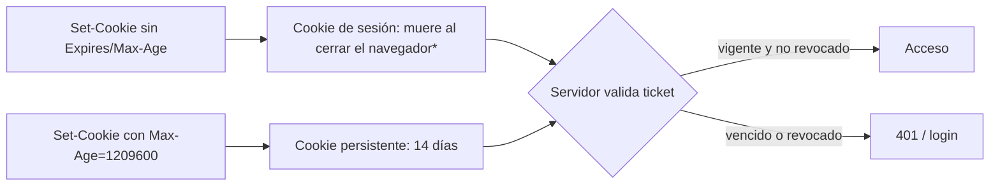

# Cookies de sesión y persistentes

Parte de: [[02-Fundamentos/04 Cookies/_Índice Cookies|Cookies]]

> [!info] Cómo avanzar
> `progreso`: **pendiente** → **viendo** (estudiando) → **visto** (contestaste la autoevaluación sin abrir las respuestas) → **dominado** (hiciste el laboratorio o lo aplicaste de verdad).

## Contenido

### Qué es
Es una clasificación por **duración** en el navegador:
- **Cookie de sesión** (session cookie): no lleva `Expires` ni `Max-Age`. El navegador la descarta cuando termina la sesión del navegador, normalmente al cerrarlo.
- **Cookie persistente**: lleva `Expires` o `Max-Age` y sobrevive al cierre del navegador hasta la fecha indicada (ver [[Cookies - Expires y Max-Age]]).

Ojo con el nombre: "cookie de sesión" se refiere a la vida en el navegador, **no** a que contenga la sesión de login. La cookie de autenticación puede ser persistente ("Recordarme") y una cookie de sesión del navegador puede guardar cualquier cosa (un token antiforgery, un paso de un asistente).

### Cómo funciona
1. El servidor emite `Set-Cookie` sin caducidad → cookie de sesión, se guarda normalmente solo en memoria.
2. Con caducidad → se escribe a disco y sigue enviándose tras reiniciar el navegador.
3. **Matiz importante**: navegadores con "Continuar donde lo dejaste" o "restaurar pestañas" pueden **conservar las cookies de sesión** al reabrir. Por eso "cerrar el navegador" no es un mecanismo confiable de cierre de sesión.
4. En cualquier caso, lo que decide si la sesión de login sigue viva es el **servidor**: el ticket firmado tiene su propia expiración y el servidor puede revocarlo.



\* salvo restauración de sesión del navegador.

### Ejemplo
"Recordarme" seguro en una app de Itzamna con ASP.NET Core:

```csharp
builder.Services
    .AddAuthentication(CookieAuthenticationDefaults.AuthenticationScheme)
    .AddCookie(o =>
    {
        o.Cookie.Name = "__Host-itzamna";
        o.Cookie.HttpOnly = true;
        o.Cookie.SecurePolicy = CookieSecurePolicy.Always;
        o.Cookie.SameSite = SameSiteMode.Lax;
        o.ExpireTimeSpan = TimeSpan.FromDays(14); // vida máxima del ticket
        o.SlidingExpiration = true;               // se renueva si el usuario sigue activo
        o.Events.OnValidatePrincipal = ValidadorSesion.ValidarAsync; // revocación
    });

// En el endpoint de login:
await HttpContext.SignInAsync(principal, new AuthenticationProperties
{
    IsPersistent = cmd.Recordarme // false: cookie de sesión; true: persistente
});
```

Elementos del "Recordarme" seguro:
1. **Cookie persistente** con vencimiento razonable (días o pocas semanas, no años).
2. **`HttpOnly`, `Secure`, `SameSite`** y valor **firmado y cifrado** (Data Protection).
3. **Revocable en el servidor**: guardar en el ticket un identificador de sesión o un "sello de seguridad" (`SecurityStamp` en ASP.NET Core Identity) y compararlo en `OnValidatePrincipal`; al cambiar la contraseña o cerrar sesión en todos los dispositivos, el sello cambia y las cookies viejas dejan de valer.
4. **Reautenticación para acciones sensibles**: aunque la cookie siga viva, pedir contraseña o MFA para cambiar el correo o ver datos financieros.

Un validador mínimo con una tabla de sesiones, usando Dapper y un procedimiento almacenado:

```csharp
public static class ValidadorSesion
{
    public static async Task ValidarAsync(CookieValidatePrincipalContext ctx)
    {
        var sid = ctx.Principal?.FindFirst("sid")?.Value;
        var repo = ctx.HttpContext.RequestServices.GetRequiredService<ISesionVigente>();
        if (sid is null || !await repo.EstaVigenteAsync(sid))
        {
            ctx.RejectPrincipal(); // fuerza nuevo login
            await ctx.HttpContext.SignOutAsync();
        }
    }
}
```

### Cuándo usarlo y cuándo no
- **Cookie de sesión del navegador**: login en equipos compartidos, apps internas con datos sensibles, cookies de correlación y de asistentes.
- **Persistente**: "Recordarme" explícito del usuario, preferencias, consentimiento.
- No hagas persistente la sesión por defecto sin que el usuario lo pida en apps con datos sensibles.

### Errores comunes
1. **Confundir "cookie de sesión" con "cookie de login".** Lleva a creer que la cookie de login siempre muere al cerrar el navegador.
2. **Confiar en que cerrar el navegador cierra la sesión.** La restauración de pestañas la conserva; ofrece "Cerrar sesión" y expira en el servidor.
3. **"Recordarme" sin revocación.** Si roban la cookie, vale hasta que expire. Agrega sello de seguridad o tabla de sesiones.
4. **Vencimientos larguísimos.** Aumentan la ventana de abuso; usa expiración deslizante con un máximo absoluto.
5. **Guardar la contraseña o un hash en la cookie de "Recordarme".** Se ha visto en sistemas viejos; nunca. Usa un ticket protegido.

### Para profundizar
- [MDN: Duración de una cookie](https://developer.mozilla.org/en-US/docs/Web/HTTP/Guides/Cookies#removal_defining_the_lifetime_of_a_cookie)
- [Microsoft Learn: autenticación con cookies sin Identity](https://learn.microsoft.com/aspnet/core/security/authentication/cookie)
- [OWASP: Session Management Cheat Sheet](https://cheatsheetseries.owasp.org/cheatsheets/Session_Management_Cheat_Sheet.html)

## Autoevaluación

Contesta primero en voz alta o en papel; luego despliega la respuesta.

> [!question]- ¿Qué diferencia hay entre una cookie de sesión y una persistente?
> La de **sesión** no tiene `Expires`/`Max-Age` y se borra al cerrar el navegador. La **persistente** dura hasta la fecha indicada aunque se cierre.

> [!question]- ¿"Cookie de sesión" es lo mismo que "cookie de la sesión de login"?
> No. Una cookie de autenticación puede ser persistente ("recordarme") y una cookie de sesión del navegador puede guardar cualquier cosa. Son conceptos distintos.

> [!question]- ¿Cómo implementarías "Recordarme" de forma segura?
> Cookie persistente con vencimiento razonable, `HttpOnly`, `Secure`, `SameSite`, valor firmado/cifrado y posibilidad de revocarla en el servidor (sello de seguridad o tabla de sesiones), además de pedir reautenticación para acciones sensibles.

## Práctica

- [[Lab 1 - Cookies y CORS en el navegador con DevTools]]

