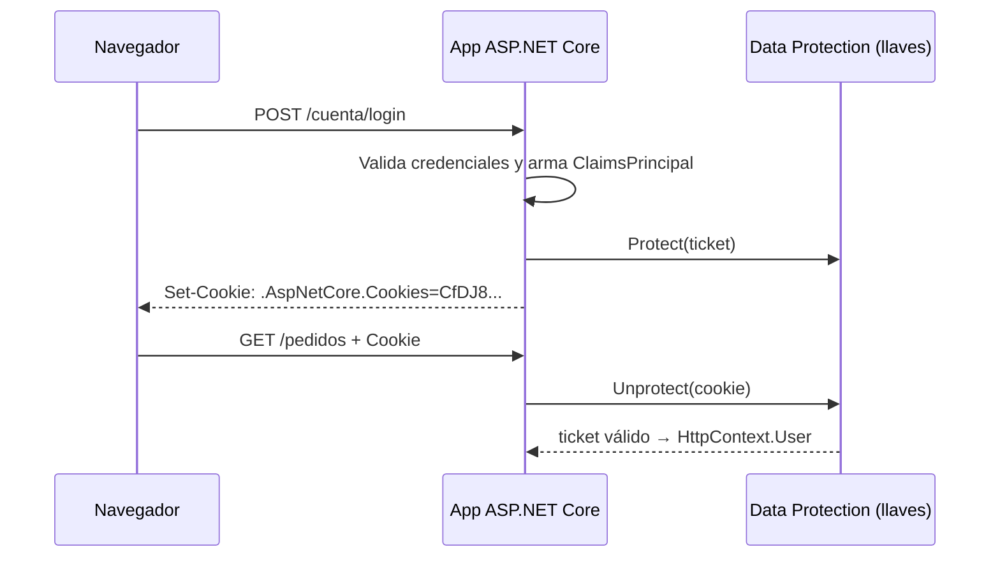

# Cookies en ASP.NET Core (autenticación y Data Protection)

Parte de: [[02-Fundamentos/04 Cookies/_Índice Cookies|Cookies]]

> [!info] Cómo avanzar
> `progreso`: **pendiente** → **viendo** (estudiando) → **visto** (contestaste la autoevaluación sin abrir las respuestas) → **dominado** (hiciste el laboratorio o lo aplicaste de verdad).

## Contenido

### Qué es
ASP.NET Core trae un **esquema de autenticación por cookie** (`AddCookie`) que, tras un login exitoso, serializa el `ClaimsPrincipal` del usuario en un **ticket**, lo protege (cifra y firma) con la **Data Protection API** y lo pone en una cookie. En cada petición, el middleware de autenticación desprotege la cookie y reconstruye `HttpContext.User`. Data Protection es el subsistema criptográfico que también protege tokens antiforgery, cookies de TempData y estado de OIDC.

### Cómo funciona


1. **Configuración**: `AddAuthentication(...).AddCookie(...)` registra el esquema; `UseAuthentication()` y `UseAuthorization()` lo activan en el pipeline.
2. **Login**: tu código llama `HttpContext.SignInAsync(principal, propiedades)`. El middleware emite el `Set-Cookie`.
3. **Peticiones**: el middleware lee la cookie, la desprotege y valida vencimiento; si usas `SlidingExpiration`, la reemite cuando pasó más de la mitad de su vida.
4. **Logout**: `SignOutAsync()` envía la cookie vencida.

**Data Protection y las llaves.** Por defecto, las llaves se generan y guardan localmente (perfil del usuario, registro o carpeta de la máquina) y rotan cada 90 días. Funciona en una sola máquina, pero:
- Con **varias instancias** (App Service escalado, Kubernetes), cada una tendría sus propias llaves: una cookie emitida por la instancia A no se puede abrir en la B → el usuario "se desloguea" al azar.
- En **contenedores**, el sistema de archivos se pierde en cada redeploy → todos los usuarios quedan deslogueados.

La solución es **persistir y compartir el anillo de llaves** (Azure Blob Storage, Redis, base de datos) y **protegerlo** en reposo (Azure Key Vault), además de fijar el mismo `SetApplicationName` en todas las instancias.

**APIs llamadas con `fetch`.** El comportamiento por defecto de `AddCookie` es pensar en páginas: si no hay sesión, responde **302** a `/Account/Login`. Un `fetch` sigue la redirección y recibe el HTML del login con 200, y tu front no entiende qué pasó. Se corrige sobrescribiendo los eventos `OnRedirectToLogin` y `OnRedirectToAccessDenied` para devolver 401 y 403.

### Ejemplo
`Program.cs` de Itzamna.Dionisio con cookie, Data Protection en Azure y respuestas de API correctas:

```csharp
using Azure.Identity;
using Microsoft.AspNetCore.Authentication.Cookies;
using Microsoft.AspNetCore.DataProtection;

var builder = WebApplication.CreateBuilder(args);

builder.Services.AddDataProtection()
    .SetApplicationName("itzamna")
    // Paquete: Azure.Extensions.AspNetCore.DataProtection.Blobs
    .PersistKeysToAzureBlobStorage(
        new Uri(builder.Configuration["DataProtection:BlobUri"]!), new DefaultAzureCredential())
    // Paquete: Azure.Extensions.AspNetCore.DataProtection.Keys
    .ProtectKeysWithAzureKeyVault(
        new Uri(builder.Configuration["DataProtection:KeyUri"]!), new DefaultAzureCredential());

builder.Services
    .AddAuthentication(CookieAuthenticationDefaults.AuthenticationScheme)
    .AddCookie(o =>
    {
        o.Cookie.Name = "__Host-itzamna";
        o.Cookie.HttpOnly = true;
        o.Cookie.SecurePolicy = CookieSecurePolicy.Always;
        o.Cookie.SameSite = SameSiteMode.Lax;
        o.ExpireTimeSpan = TimeSpan.FromHours(8);
        o.SlidingExpiration = true;

        // Para /api: 401/403 en lugar de 302 al login
        o.Events.OnRedirectToLogin = ctx =>
        {
            if (ctx.Request.Path.StartsWithSegments("/api"))
            {
                ctx.Response.StatusCode = StatusCodes.Status401Unauthorized;
                return Task.CompletedTask;
            }
            ctx.Response.Redirect(ctx.RedirectUri);
            return Task.CompletedTask;
        };
        o.Events.OnRedirectToAccessDenied = ctx =>
        {
            if (ctx.Request.Path.StartsWithSegments("/api"))
            {
                ctx.Response.StatusCode = StatusCodes.Status403Forbidden;
                return Task.CompletedTask;
            }
            ctx.Response.Redirect(ctx.RedirectUri);
            return Task.CompletedTask;
        };
    });

builder.Services.AddAuthorization();
builder.Services.AddControllers();

var app = builder.Build();
app.UseAuthentication();
app.UseAuthorization();
app.MapControllers();
app.Run();
```

Login en el controller (la validación de contraseña va en el slice correspondiente):

```csharp
var claims = new List<Claim>
{
    new(ClaimTypes.NameIdentifier, usuario.Id.ToString()),
    new(ClaimTypes.Name, usuario.Nombre),
    new("sid", sesionId)
};
var principal = new ClaimsPrincipal(new ClaimsIdentity(claims, CookieAuthenticationDefaults.AuthenticationScheme));
await HttpContext.SignInAsync(principal, new AuthenticationProperties { IsPersistent = cmd.Recordarme });
return NoContent();
```

Las URIs del blob y de Key Vault van en configuración (App Settings o Key Vault), no en el repo, y la identidad administrada de la app necesita permisos sobre ambos. Para un 401 con cuerpo uniforme puedes escribir un `ProblemDetails` con tu `codigo` (ver [[ProblemDetails]]).

### Cuándo usarlo y cuándo no
- **Sí**: apps web y SPAs del mismo sitio que consumen su propio backend (incluido el patrón BFF). Es simple y evita exponer tokens a JavaScript.
- **No**: APIs consumidas por apps móviles, otros servicios o terceros: usa JWT Bearer (ver [[JWT y autenticación con Bearer]] y [[Cookies vs tokens]]).
- Para login con proveedor externo, combina `AddCookie` con `AddOpenIdConnect`: OIDC autentica y la cookie mantiene la sesión.

### Errores comunes
1. **No persistir las llaves.** Usuarios deslogueados tras cada despliegue o al escalar. Persiste en Blob/Redis y protege con Key Vault.
2. **Distinto `ApplicationName` entre instancias o apps que comparten cookie.** Las llaves se aíslan por nombre y la cookie no se puede abrir.
3. **302 en llamadas de API.** El front recibe HTML del login. Sobrescribe los eventos de redirección.
4. **Orden del middleware.** `UseAuthorization` antes de `UseAuthentication` deja a `User` vacío; el orden es autenticación y luego autorización.
5. **Tickets gigantes.** Meter muchos claims infla la cookie (ASP.NET Core la parte en trozos `C1`, `C2`…). Guarda lo mínimo o usa un `ITicketStore` en el servidor.

### Para profundizar
- [Microsoft Learn: autenticación con cookies sin ASP.NET Core Identity](https://learn.microsoft.com/aspnet/core/security/authentication/cookie)
- [Microsoft Learn: configurar Data Protection](https://learn.microsoft.com/aspnet/core/security/data-protection/configuration/overview)
- [Microsoft Learn: proveedores de almacenamiento de llaves](https://learn.microsoft.com/aspnet/core/security/data-protection/implementation/key-storage-providers)

## Autoevaluación

Contesta primero en voz alta o en papel; luego despliega la respuesta.

> [!question]- ¿Cómo se configura autenticación por cookie en ASP.NET Core?
> ```csharp
> builder.Services.AddAuthentication(CookieAuthenticationDefaults.AuthenticationScheme)
>     .AddCookie(o => {
>         o.Cookie.HttpOnly = true;
>         o.Cookie.SecurePolicy = CookieSecurePolicy.Always;
>         o.Cookie.SameSite = SameSiteMode.Lax;
>         o.ExpireTimeSpan = TimeSpan.FromHours(8);
>         o.SlidingExpiration = true;
>     });
> ```
> Y `HttpContext.SignInAsync(...)` con un `ClaimsPrincipal` al iniciar sesión.

> [!question]- ¿Qué es Data Protection y por qué importa con varias instancias?
> La API que cifra y firma la cookie de autenticación (y tokens antiforgery). Por defecto las llaves son locales a la máquina; con varias instancias o tras redeploy en contenedores hay que **persistirlas y compartirlas** (Blob Storage, Redis, base de datos) o los usuarios quedan deslogueados.

> [!question]- Para una API llamada por `fetch`, la cookie redirige a `/Account/Login` con 302 en vez de 401. ¿Cómo se corrige?
> Sobrescribir `Events.OnRedirectToLogin` (y `OnRedirectToAccessDenied`) para responder `401`/`403` cuando la petición es de API.

