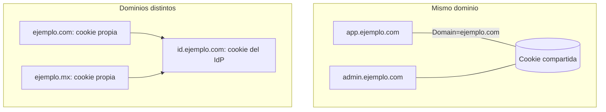

# Cookies entre sistemas propios (subdominios y dominios distintos)

Parte de: [[02-Fundamentos/04 Cookies/_Índice Cookies|Cookies]]

> [!info] Cómo avanzar
> `progreso`: **pendiente** → **viendo** (estudiando) → **visto** (contestaste la autoevaluación sin abrir las respuestas) → **dominado** (hiciste el laboratorio o lo aplicaste de verdad).

## Contenido

### Qué es
Es el problema de que varias aplicaciones **tuyas** compartan una sesión o un dato por cookie. La respuesta depende de si viven bajo el **mismo dominio registrable** (subdominios: `app.ejemplo.com` y `admin.ejemplo.com`) o en **dominios distintos** (`ejemplo.com` y `ejemplo.mx`):
- Subdominios: se puede compartir una cookie con `Domain=ejemplo.com`.
- Dominios distintos: **no se puede**. Una cookie nunca pertenece a otro dominio registrable; se resuelve con un proveedor de identidad común (SSO).

### Cómo funciona
**Caso 1: subdominios del mismo dominio.**
1. La app que inicia sesión emite la cookie con `Domain=ejemplo.com` (ver [[Cookies - Domain y Path]]).
2. El navegador la envía a todos los `*.ejemplo.com`.
3. Cada app debe poder **abrir** la cookie. En ASP.NET Core eso exige que todas compartan el **mismo anillo de llaves de Data Protection** y el mismo `SetApplicationName`, además del mismo nombre de cookie y esquema.

**Caso 2: dominios distintos.**
- El navegador no permite `Domain=ejemplo.mx` desde `ejemplo.com`. Cada sitio solo puede tener sus propias cookies.
- Se usa un **IdP común** (Xolotl.Hecate, Entra ID) con OpenID Connect: el usuario inicia sesión en el IdP, que tiene su propia cookie; cada app redirige al IdP, recibe un código, lo canjea y crea **su propia** cookie. La sensación de "una sola sesión" la da la cookie del IdP (ver [[Cookies y SSO]] y [[SSO]]).



**Riesgo de compartir en todo el dominio.** Toda máquina bajo `*.ejemplo.com` recibe la cookie: el blog en WordPress, la landing de marketing alojada por un tercero, un entorno de pruebas olvidado. Cualquiera de ellos, si se compromete, puede **leer** la cookie (llega en cada petición) o **sobrescribirla** con otra del mismo nombre. Por eso:
- Comparte lo mínimo (quizá solo una cookie de "hay sesión", no los datos).
- Las cookies que no deben compartirse llevan prefijo `__Host-` (que prohíbe `Domain`).
- No pongas en `*.ejemplo.com` servicios que no controles; usa otro dominio para ellos.

### Ejemplo
Itzamna.Clio (`app.itzamna.mx`) y un panel administrativo (`admin.itzamna.mx`) deben compartir la cookie de autenticación. En **ambas** apps:

```csharp
builder.Services.AddDataProtection()
    .SetApplicationName("itzamna-compartida") // idéntico en las dos
    .PersistKeysToAzureBlobStorage(
        new Uri(builder.Configuration["DataProtection:BlobUri"]!), new DefaultAzureCredential())
    .ProtectKeysWithAzureKeyVault(
        new Uri(builder.Configuration["DataProtection:KeyUri"]!), new DefaultAzureCredential());

builder.Services
    .AddAuthentication("Identity.Application")
    .AddCookie("Identity.Application", o =>
    {
        o.Cookie.Name = "__Secure-itzamna";   // __Secure- permite Domain; __Host- no
        o.Cookie.Domain = "itzamna.mx";       // la comparten los subdominios
        o.Cookie.HttpOnly = true;
        o.Cookie.SecurePolicy = CookieSecurePolicy.Always;
        o.Cookie.SameSite = SameSiteMode.Lax;
    });
```

Si además tienes `pochteca.com.mx` (Pochteca.Nomisma), no puede leer esa cookie. La integración correcta es que Pochteca use OIDC contra Xolotl.Hecate: el usuario ya tiene sesión en el IdP, así que el login es una redirección sin contraseña y Pochteca crea su propia cookie host-only.

Alternativa más segura que compartir la cookie entre subdominios: que **todas** las apps usen OIDC contra el IdP y cada una tenga su cookie host-only. Es un poco más de configuración, pero aísla los fallos de cada app y permite permisos distintos por aplicación.

### Cuándo usarlo y cuándo no
- **Cookie compartida por `Domain`**: pocas apps propias, mismo equipo, misma política de seguridad y mismo usuario/claims. Rápido y sencillo.
- **SSO con OIDC**: dominios distintos, muchas apps, equipos distintos o terceros, permisos diferentes por app. Es la opción escalable.
- **Nunca**: compartir cookies de sesión con subdominios que alojan contenido de terceros.

### Errores comunes
1. **Distinto `ApplicationName` o llaves no compartidas.** La segunda app no puede descifrar la cookie y redirige al login en bucle.
2. **Usar `__Host-` con `Domain`.** El navegador rechaza la cookie; para compartir usa `__Secure-`.
3. **Intentar `Domain=otro-dominio`.** El navegador lo ignora; la cookie no se crea. Pasa a SSO.
4. **Subdominios de terceros bajo el mismo dominio.** Reciben la cookie de sesión. Muévelos a otro dominio.
5. **Distintas versiones del ticket entre apps.** Si una app agrega claims o cambia el esquema, la otra puede fallar al validarla. Versiona y despliega coordinado.

### Para profundizar
- [Microsoft Learn: compartir cookies de autenticación entre apps de ASP.NET](https://learn.microsoft.com/aspnet/core/security/cookie-sharing)
- [MDN: atributo Domain](https://developer.mozilla.org/en-US/docs/Web/HTTP/Reference/Headers/Set-Cookie#domaindomain-value)
- [OpenID Connect Core 1.0](https://openid.net/specs/openid-connect-core-1_0.html)

## Autoevaluación

Contesta primero en voz alta o en papel; luego despliega la respuesta.

> [!question]- ¿Cómo compartes una cookie entre `app.ejemplo.com` y `admin.ejemplo.com`?
> Con `Domain=ejemplo.com`, y si es de autenticación de ASP.NET Core, las mismas llaves de Data Protection y el mismo nombre de aplicación en ambas apps.

> [!question]- ¿Se puede compartir una cookie entre `ejemplo.com` y `ejemplo.mx`?
> No. Una cookie no puede pertenecer a otro dominio registrable. Se usa un proveedor de identidad común (SSO con OIDC) y cada sitio crea su propia cookie.

> [!question]- ¿Qué riesgo trae compartir la cookie en todo el dominio?
> Cualquier subdominio (incluido uno vulnerable o de un tercero, como `blog.ejemplo.com`) la recibe y puede sobrescribirla. Comparte lo mínimo y considera prefijos `__Host-` para lo que no deba compartirse.

## Práctica

- [[Lab 1 - Cookies y CORS en el navegador con DevTools]]

