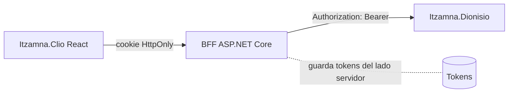

# Cookies vs localStorage vs sessionStorage

Parte de: [[02-Fundamentos/04 Cookies/_Índice Cookies|Cookies]]

> [!info] Cómo avanzar
> `progreso`: **pendiente** → **viendo** (estudiando) → **visto** (contestaste la autoevaluación sin abrir las respuestas) → **dominado** (hiciste el laboratorio o lo aplicaste de verdad).

## Contenido

### Qué es
Son tres formas de guardar datos en el navegador con propósitos distintos:
- **Cookies**: pequeñas, **viajan solas al servidor** en cada petición que coincide y pueden ser `HttpOnly` (invisibles para JS).
- **`localStorage`**: almacén clave-valor de cadenas, por **origen**, que persiste sin vencimiento y se comparte entre pestañas. Solo lo usa JS; nunca se envía solo.
- **`sessionStorage`**: igual que `localStorage` pero **por pestaña**: se borra al cerrarla y no se comparte con otras pestañas.

`localStorage` y `sessionStorage` forman la **Web Storage API**.

### Cómo funciona
| Característica | Cookie | localStorage | sessionStorage |
|---|---|---|---|
| Se envía al servidor | Sí, automáticamente | No | No |
| Accesible desde JS | Sí, salvo `HttpOnly` | Sí | Sí |
| Alcance | Dominio/ruta (y sitio para `SameSite`) | Origen | Origen + pestaña |
| Duración | Sesión o `Max-Age`/`Expires` | Hasta que se borre | Hasta cerrar la pestaña |
| Tamaño | ~4 KB por cookie | Del orden de 5 MB por origen | Del orden de 5 MB por origen |
| API | `Set-Cookie`, `document.cookie` | `getItem`/`setItem`, síncrona | igual |

Los límites de Web Storage varían por navegador; para datos grandes o estructurados usa **IndexedDB**.

**La pregunta clave es de seguridad**: ¿dónde guardar un token de acceso en una SPA?
- En **`localStorage`**, cualquier script que corra en tu página (un XSS, una dependencia npm comprometida, un script de analítica) lo lee con una línea y lo envía a otro servidor. El token sigue siendo válido fuera de tu sitio.
- En **memoria** (una variable de JS), sobrevive solo mientras la pestaña está abierta y es más difícil de robar en masa, pero un XSS activo aún puede usarlo. Se combina con vidas cortas y renovación.
- **Patrón BFF (Backend for Frontend)**: el front no ve tokens. Un backend del mismo sitio hace el flujo OIDC, guarda los tokens del lado del servidor y le da al navegador solo una cookie `HttpOnly; Secure; SameSite`. El front llama al BFF, y el BFF reenvía al API con el token. Es lo que recomienda el borrador de la IETF para apps basadas en navegador.



### Ejemplo
Uso correcto de cada uno en Itzamna.Clio (React + Vite con TypeScript):

```ts
// Preferencia que el servidor NO necesita: localStorage
localStorage.setItem("clio.vista", "tabla");
const vista = localStorage.getItem("clio.vista") ?? "tarjetas";

// Borrador de un formulario de esta pestaña: sessionStorage
sessionStorage.setItem("clio.borrador.pedido", JSON.stringify({ sku: "A1", cantidad: 2 }));

// Sesión: ni siquiera la tocamos. El BFF puso una cookie HttpOnly
// y fetch la envía sola en peticiones al mismo origen.
const resp = await fetch("/bff/api/pedidos", { credentials: "same-origin" });
if (resp.status === 401) window.location.href = "/bff/login";
```

Lo que **no** se hace:

```ts
// MAL: cualquier XSS lo roba
localStorage.setItem("access_token", token);
```

Si no puedes tener un BFF, guarda el token en memoria, con vida corta, y renueva con refresh tokens rotativos (ver [[Refresh tokens]]).

### Cuándo usarlo y cuándo no
- **Cookie**: sesión y todo lo que el servidor debe recibir en cada petición o que debe ser invisible a JS.
- **`localStorage`**: preferencias de UI, caché no sensible, estado que debe sobrevivir al cierre.
- **`sessionStorage`**: estado temporal de una pestaña (borradores, pasos de un asistente) o el `state`/`code_verifier` de un flujo OAuth que se completa en la misma pestaña.
- **IndexedDB**: datos grandes, offline, archivos.
- **Ninguno de los dos Web Storage** para secretos de larga duración.

### Errores comunes
1. **Tokens en `localStorage`.** Un XSS o una dependencia comprometida los exfiltra. Usa BFF o memoria.
2. **Esperar que `localStorage` llegue al servidor.** No se envía; si el servidor lo necesita, va en header, body o cookie.
3. **Guardar objetos sin serializar.** Web Storage solo guarda cadenas; `setItem("x", {a:1})` guarda `"[object Object]"`. Usa `JSON.stringify`.
4. **Creer que `sessionStorage` es por sesión del navegador.** Es por pestaña; abrir otra pestaña empieza vacío.
5. **No manejar excepciones de cuota o modo privado.** `setItem` puede lanzar `QuotaExceededError`; envuélvelo en `try/catch`.

### Para profundizar
- [MDN: Web Storage API](https://developer.mozilla.org/en-US/docs/Web/API/Web_Storage_API)
- [OWASP: HTML5 Security Cheat Sheet (almacenamiento local)](https://cheatsheetseries.owasp.org/cheatsheets/HTML5_Security_Cheat_Sheet.html)
- [IETF: OAuth 2.0 for Browser-Based Applications (borrador)](https://datatracker.ietf.org/doc/draft-ietf-oauth-browser-based-apps/)

## Autoevaluación

Contesta primero en voz alta o en papel; luego despliega la respuesta.

> [!question]- ¿Cuál es la diferencia principal entre cookies y Web Storage?
> Las **cookies** viajan automáticamente al servidor en cada petición y pueden ser `HttpOnly`. `localStorage` y `sessionStorage` solo existen en el navegador, se leen con JS y no se envían solos.

> [!question]- ¿Qué diferencia hay entre `localStorage` y `sessionStorage`?
> `localStorage` persiste sin vencimiento y se comparte entre pestañas del mismo origen. `sessionStorage` vive por pestaña y se borra al cerrarla. Ambos tienen límites del orden de unos MB por origen.

> [!question]- ¿Dónde guardarías un token de acceso en una SPA?
> Preferible no exponerlo a JS: patrón **BFF** con cookie `HttpOnly`. Si debe vivir en el navegador, en memoria con vida corta. En `localStorage` cualquier XSS lo roba.

## Práctica

- [[Lab 1 - Cookies y CORS en el navegador con DevTools]]

