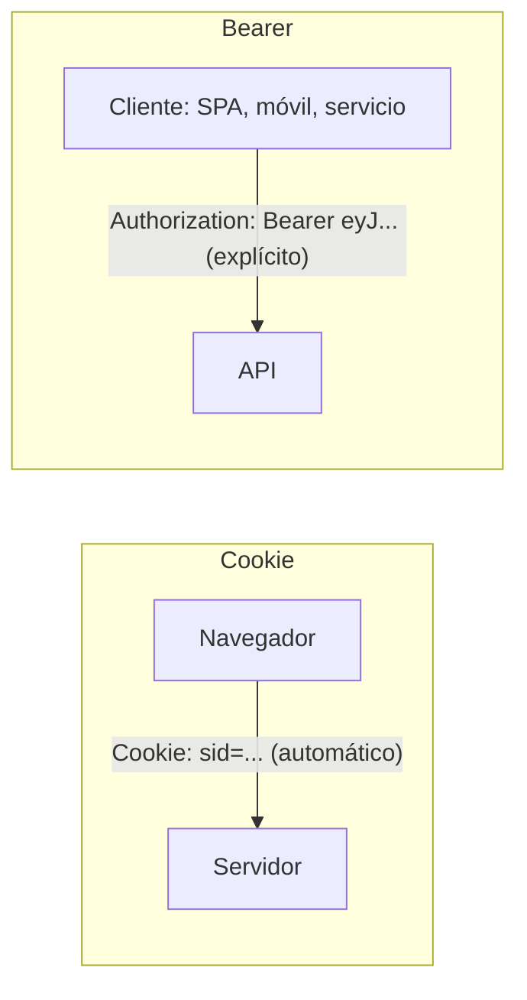

# Cookies vs tokens

Parte de: [[02-Fundamentos/04 Cookies/_Índice Cookies|Cookies]]

> [!info] Cómo avanzar
> `progreso`: **pendiente** → **viendo** (estudiando) → **visto** (contestaste la autoevaluación sin abrir las respuestas) → **dominado** (hiciste el laboratorio o lo aplicaste de verdad).

## Contenido

### Qué es
"Cookies vs tokens" compara dos formas de que el cliente presente su credencial en cada petición:
- **Cookie**: el navegador la adjunta **automáticamente** en el header `Cookie`.
- **Token Bearer**: el código del cliente lo agrega **explícitamente** en `Authorization: Bearer <token>`.

La confusión habitual es mezclar *cómo viaja* la credencial con *qué contiene*. Una cookie puede llevar un id de sesión opaco o un JWT; un header Bearer puede llevar un JWT o un token opaco. Son dos decisiones independientes: transporte y formato (ver [[Tokens de acceso]] y [[Sesiones]]).

### Cómo funciona


**Consecuencias del envío automático (cookie):**
- Ventaja: el código JS no maneja el secreto; con `HttpOnly` ni siquiera lo ve. Menos superficie ante XSS.
- Riesgo: **CSRF**. Como el navegador la envía sola, otro sitio puede provocar peticiones con ella. Se mitiga con `SameSite` y tokens antiforgery (ver [[Cookies y CSRF]]).
- Limitación: atada al navegador y a las reglas de dominio y sitio; complica APIs consumidas desde otros dominios o desde clientes no navegador.

**Consecuencias del envío explícito (Bearer):**
- Ventaja: **no hay CSRF**, porque otro sitio no puede hacer que el navegador agregue ese header. Funciona igual en móvil, CLIs, servicios y entre dominios.
- Riesgo: el token tiene que estar **accesible al código** que lo agrega. En el navegador, si está en `localStorage`, un XSS lo roba y lo usa desde otra máquina hasta que expire.
- Requiere gestionar renovación (refresh tokens) y almacenamiento.

**Ninguno es seguro con XSS.** Con cookie `HttpOnly`, el atacante no se lleva la credencial pero puede usarla desde tu página. Con token accesible, se la lleva. La prioridad es prevenir el XSS.

### Ejemplo
Ecosistema real con varios clientes:

| Cliente | Transporte recomendado | Por qué |
|---|---|---|
| Itzamna.Clio (React en `app.itzamna.mx`) | Cookie `HttpOnly` vía BFF | El navegador maneja la credencial; tokens fuera de JS |
| App móvil de Ocelotl.Hermes | Bearer (Authorization Code + PKCE) | No hay cookies de navegador confiables; tokens en almacenamiento seguro del sistema |
| Job de Wee.Reporteria que llama a Dionisio | Bearer (Client Credentials) | Servicio a servicio, sin usuario |
| Integración de un cliente externo | Bearer | Otro dominio, otro equipo |

En Itzamna.Dionisio puedes aceptar ambos con dos esquemas y una política que los combine:

```csharp
builder.Services
    .AddAuthentication()
    .AddCookie("Cookies", o => o.Cookie.Name = "__Host-itzamna")
    .AddJwtBearer("Bearer", o =>
    {
        o.Authority = builder.Configuration["Auth:Authority"]; // Xolotl.Hecate
        o.Audience = "itzamna-api";
    });

builder.Services.AddAuthorization(o =>
{
    o.DefaultPolicy = new AuthorizationPolicyBuilder("Cookies", "Bearer")
        .RequireAuthenticatedUser()
        .Build();
});
```

Ojo: si aceptas cookie, las peticiones que cambian estado vuelven a ser candidatas a CSRF; exige antiforgery cuando la autenticación vino por cookie.

### Cuándo usarlo y cuándo no
- **Cookie (o BFF)**: tu propia web en el mismo sitio que su backend. Es lo más sencillo y, bien configurado, lo más seguro para navegadores.
- **Bearer**: apps móviles y de escritorio, servicios, CLIs, APIs públicas o consumidas por terceros, y SPAs que no pueden tener BFF (con token en memoria y vida corta).
- No elijas "JWT en `localStorage`" solo porque es lo que muestra el tutorial; evalúa el riesgo de XSS.

### Errores comunes
1. **Decir "cookies o JWT"** como si fueran opuestos. Un JWT puede viajar en cookie; decide transporte y formato por separado.
2. **Creer que Bearer elimina todos los riesgos.** Elimina CSRF, pero el robo por XSS se vuelve más grave.
3. **Aceptar cookie y Bearer sin antiforgery.** La parte de cookie reintroduce CSRF.
4. **Tokens de larga vida en el navegador.** Si se filtran, valen días. Vidas de minutos y renovación.
5. **Usar cookies para clientes móviles.** Manejo frágil de la jarra de cookies y de `SameSite`; usa Bearer.

### Para profundizar
- [IETF: OAuth 2.0 for Browser-Based Applications (borrador)](https://datatracker.ietf.org/doc/draft-ietf-oauth-browser-based-apps/)
- [RFC 6750: Bearer Token Usage](https://www.rfc-editor.org/rfc/rfc6750)
- [Microsoft Learn: autorizar con un esquema específico](https://learn.microsoft.com/aspnet/core/security/authorization/limitingidentitybyscheme)

## Autoevaluación

Contesta primero en voz alta o en papel; luego despliega la respuesta.

> [!question]- ¿Cuál es la diferencia de fondo entre autenticar con cookie y con token Bearer?
> Es sobre **cómo viaja** la credencial: la cookie la adjunta el navegador automáticamente; el token lo agrega el código en `Authorization: Bearer ...`. El contenido (sesión opaca o JWT) es otra decisión.

> [!question]- ¿Qué riesgo tiene cada uno?
> **Cookie**: CSRF, porque se envía sola (se mitiga con `SameSite` y antiforgery). **Token en JS**: robo vía XSS si se guarda accesible. Ninguno es seguro si hay XSS.

> [!question]- ¿Cuándo usar tokens Bearer en lugar de cookies?
> Para clientes que no son navegador (apps móviles, servicios, CLIs) y para APIs consumidas por terceros. Para una web propia, una cookie `HttpOnly` (o BFF) suele ser lo más sencillo y seguro.

## Práctica

- [[Lab 1 - Cookies y CORS en el navegador con DevTools]]

