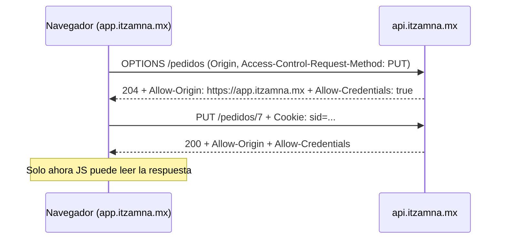

# Cookies y CORS con credenciales

Parte de: [[02-Fundamentos/04 Cookies/_Índice Cookies|Cookies]]

> [!info] Cómo avanzar
> `progreso`: **pendiente** → **viendo** (estudiando) → **visto** (contestaste la autoevaluación sin abrir las respuestas) → **dominado** (hiciste el laboratorio o lo aplicaste de verdad).

## Contenido

### Qué es
**CORS** (Cross-Origin Resource Sharing) es el mecanismo con el que un servidor le dice al navegador qué **otros orígenes** pueden **leer** sus respuestas. Por defecto, un `fetch` a otro origen **no envía cookies** ni deja leer las que llegan. Para que lo haga, tienen que cumplirse condiciones en el cliente, en el servidor y en la propia cookie: eso es "CORS con credenciales".

### Cómo funciona
Para que `https://app.itzamna.mx` llame a `https://api.itzamna.mx` con cookies:

1. **Cliente**: `fetch(url, { credentials: "include" })` (en `XMLHttpRequest`, `withCredentials = true`). El valor por defecto de `fetch` es `same-origin`, que no manda cookies a otro origen.
2. **Servidor**: responde con
   - `Access-Control-Allow-Origin: https://app.itzamna.mx` (el **origen exacto**, nunca `*`), y
   - `Access-Control-Allow-Credentials: true`.
   - Si la petición no es "simple" (por ejemplo `PUT`, o `Content-Type: application/json`), el navegador manda antes un **preflight** `OPTIONS` que también debe responder con esos headers más `Access-Control-Allow-Methods` y `Access-Control-Allow-Headers`.
3. **Cookie**: debe estar permitida en ese contexto. Si el front y el API son **mismo sitio** (subdominios de `itzamna.mx`), basta con `SameSite=Lax`. Si son **sitios distintos** (`app.itzamna.mx` llamando a `api.otro.com`), necesita `SameSite=None; Secure`, y aun así puede bloquearse por las restricciones a cookies de terceros.



**Por qué `*` está prohibido con credenciales.** `*` significa "cualquier sitio puede leer esto". Si además se enviaran cookies, cualquier página que visite la víctima podría leer sus datos autenticados (pedidos, perfil). El navegador rechaza esa combinación.

**Reflejar `Origin` es igual de grave.** Algunos copian el header `Origin` de la petición a `Access-Control-Allow-Origin` "para que funcione con todos". Con `Allow-Credentials: true`, eso equivale a permitir cualquier origen con credenciales: `malo.com` hace `fetch` con `credentials: "include"`, tu servidor responde "malo.com puede leer" y se lleva los datos. Usa una **lista blanca** explícita.

**CORS no protege al servidor.** Es una política del **navegador** para leer respuestas. La petición puede llegar y ejecutarse en el servidor aunque el navegador luego oculte la respuesta (las peticiones "simples" ni siquiera tienen preflight), y `curl` o Postman ignoran CORS por completo. La protección del servidor es autenticación, autorización y antiforgery (ver [[Cookies y CSRF]]).

### Ejemplo
Itzamna.Dionisio en `api.itzamna.mx` atendiendo a Itzamna.Clio:

```csharp
const string PoliticaClio = "clio";

builder.Services.AddCors(o => o.AddPolicy(PoliticaClio, p => p
    .WithOrigins(builder.Configuration.GetSection("Cors:Origenes").Get<string[]>()!) // lista blanca
    .AllowCredentials()
    .WithMethods("GET", "POST", "PUT", "DELETE")
    .WithHeaders("Content-Type", "X-XSRF-TOKEN")));

var app = builder.Build();
app.UseRouting();
app.UseCors(PoliticaClio);   // antes de autenticación y autorización
app.UseAuthentication();
app.UseAuthorization();
app.MapControllers();
```

`appsettings.Production.json`: `"Cors": { "Origenes": ["https://app.itzamna.mx"] }`. ASP.NET Core lanza una excepción si combinas `AllowAnyOrigin()` con `AllowCredentials()`, justamente para evitar el error.

Front (TypeScript):

```ts
const r = await fetch("https://api.itzamna.mx/pedidos/7", {
  method: "PUT",
  credentials: "include",
  headers: { "Content-Type": "application/json", "X-XSRF-TOKEN": tokenXsrf },
  body: JSON.stringify({ cantidad: 3 })
});
```

En desarrollo, una alternativa que evita CORS es el **proxy de Vite** (`server.proxy` en `vite.config.ts`): el front llama a `/api` en su mismo origen y Vite reenvía al backend.

### Cuándo usarlo y cuándo no
- **Sí**: front y API en orígenes distintos que usan cookie (por ejemplo, `app.` y `api.` del mismo dominio).
- **Mejor evitarlo**: sirve el API bajo el mismo origen (`app.itzamna.mx/api`, con un proxy inverso o BFF) y no necesitas CORS.
- **Sin credenciales**: APIs públicas de solo lectura pueden usar `*` sin cookies.

### Errores comunes
1. **`credentials: "include"` sin `Allow-Credentials: true`** (o al revés): el navegador bloquea la lectura y en consola aparece el error de CORS.
2. **`*` o reflejar `Origin`** con credenciales: fuga de datos a cualquier sitio. Lista blanca.
3. **Olvidar el preflight.** Si un middleware de autenticación rechaza el `OPTIONS` con 401, todo falla. `UseCors` va antes de autenticación.
4. **Cookie con `SameSite=Lax` entre sitios distintos.** No viaja en `fetch` entre sitios; requiere `None; Secure` o rediseñar a mismo sitio.
5. **Creer que CORS es control de acceso.** No sustituye autenticación ni antiforgery.

### Para profundizar
- [MDN: Cross-Origin Resource Sharing (CORS)](https://developer.mozilla.org/en-US/docs/Web/HTTP/Guides/CORS)
- [Microsoft Learn: habilitar CORS en ASP.NET Core](https://learn.microsoft.com/aspnet/core/security/cors)
- [Fetch Standard (WHATWG), sección CORS](https://fetch.spec.whatwg.org/#http-cors-protocol)

## Autoevaluación

Contesta primero en voz alta o en papel; luego despliega la respuesta.

> [!question]- ¿Qué necesita un `fetch` a otro origen para enviar y recibir cookies?
> Cliente: `fetch(url, { credentials: 'include' })`. Servidor: `Access-Control-Allow-Origin` con el **origen exacto** (no `*`) y `Access-Control-Allow-Credentials: true`. Y la cookie debe permitir el contexto (`SameSite=None; Secure` si es entre sitios).

> [!question]- ¿Por qué no se permite `Access-Control-Allow-Origin: *` con credenciales?
> Sería dejar que cualquier sitio lea respuestas autenticadas con la sesión de la víctima. El navegador lo rechaza.

> [!question]- Error común: reflejar el header `Origin` que llega en `Access-Control-Allow-Origin` con credenciales. ¿Por qué es grave?
> Equivale a permitir cualquier origen con credenciales: cualquier sitio malicioso puede leer datos del usuario. Usa una lista blanca de orígenes.

> [!question]- ¿CORS protege al servidor de peticiones no deseadas?
> No. CORS es una política del **navegador** para leer respuestas; la petición puede llegar igual al servidor (y curl lo ignora). Para eso están la autenticación y la protección CSRF.

## Práctica

- [[Lab 1 - Cookies y CORS en el navegador con DevTools]]

