# Cookies y CSRF

Parte de: [[02-Fundamentos/04 Cookies/_Índice Cookies|Cookies]]

> [!info] Cómo avanzar
> `progreso`: **pendiente** → **viendo** (estudiando) → **visto** (contestaste la autoevaluación sin abrir las respuestas) → **dominado** (hiciste el laboratorio o lo aplicaste de verdad).

## Contenido

### Qué es
**CSRF** (Cross-Site Request Forgery, falsificación de petición entre sitios) es un ataque en el que un sitio malicioso hace que el navegador de la víctima envíe una petición a tu aplicación. Como el navegador **adjunta las cookies automáticamente**, tu app ve una petición autenticada y la ejecuta como si el usuario la hubiera querido. El atacante no lee la respuesta: le basta con que la acción ocurra (transferir, cambiar correo, borrar).

### Cómo funciona

```mermaid
sequenceDiagram
    participant V as Víctima (con sesión en app.itzamna.mx)
    participant M as malo.com
    participant A as app.itzamna.mx
    V->>M: Visita una página trampa
    M-->>V: HTML con <form action="https://app.itzamna.mx/cuenta/correo" method="POST"> autoenviado
    V->>A: POST /cuenta/correo + Cookie de sesión (la adjunta el navegador)
    A-->>V: 200: correo cambiado al del atacante
```


Condiciones para que funcione:
1. La app autentica con algo que el navegador envía solo (cookies, autenticación básica o Windows integrada).
2. La acción se puede disparar con una petición que el atacante sabe construir (sin valores secretos).
3. No hay defensas que la distingan de una petición legítima.

**Defensas (combínalas):**
- **`SameSite=Lax` o `Strict`** en la cookie de sesión: el `POST` desde otro sitio llega sin cookie (ver [[Cookies - SameSite]]). Es la defensa más barata, pero no cubre todo: los subdominios son mismo sitio y `Lax` permite `GET` de nivel superior.
- **Token antiforgery**:
  - *Synchronizer token*: el servidor genera un token ligado a la sesión, lo pone en el formulario (campo oculto) y valida que regrese igual. El atacante no puede leerlo desde otro sitio.
  - *Double-submit cookie*: el token va en una cookie legible por JS y el front lo copia a un header (`X-XSRF-TOKEN`); el servidor compara. En ASP.NET Core la variante es firmada con Data Protection.
- **Validar `Origin` (o `Referer`)** en peticiones que cambian estado: debe ser tu origen.
- **No cambiar estado con `GET`**: un `` basta para disparar un `GET`.
- **Reautenticación o confirmación** en acciones críticas.

**¿Una API solo con `Authorization: Bearer` es vulnerable?** En general **no**: un sitio ajeno no puede hacer que el navegador agregue ese header (requiere JavaScript en otro origen, que CORS bloquea en el preflight, y además el atacante no tiene el token). El riesgo vuelve si la API **también** acepta cookies, o si el token está en una cookie.

### Ejemplo
Antiforgery en Itzamna.Dionisio para un front React que usa cookie de sesión:

```csharp
builder.Services.AddAntiforgery(o =>
{
    o.HeaderName = "X-XSRF-TOKEN";            // el front lo enviará en este header
    o.Cookie.Name = "__Host-xsrf";
    o.Cookie.SecurePolicy = CookieSecurePolicy.Always;
    o.Cookie.SameSite = SameSiteMode.Strict;
});

builder.Services.AddControllers(o =>
    // Valida el token en POST/PUT/PATCH/DELETE de todos los controllers
    o.Filters.Add(new AutoValidateAntiforgeryTokenAttribute()));

// Endpoint que entrega el token de petición al front (después del login)
app.MapGet("/api/antiforgery", (IAntiforgery af, HttpContext ctx) =>
{
    var tokens = af.GetAndStoreTokens(ctx);   // pone la cookie y devuelve el token de petición
    return Results.Ok(new { token = tokens.RequestToken });
}).RequireAuthorization();
```

Front:

```ts
const { token } = await (await fetch("/api/antiforgery")).json();
await fetch("/api/cuenta/correo", {
  method: "POST",
  headers: { "Content-Type": "application/json", "X-XSRF-TOKEN": token },
  body: JSON.stringify({ correo: "nuevo@ejemplo.mx" })
});
```

Si falta o no coincide el token, el filtro responde **400**. Combínalo con la cookie de sesión `SameSite=Lax`.

### Cuándo usarlo y cuándo no
- **Antiforgery obligatorio**: apps con autenticación por cookie y operaciones que cambian estado (formularios MVC/Razor, SPAs con cookie o BFF).
- **No necesario**: APIs que solo aceptan Bearer en header y no aceptan cookies, y endpoints de solo lectura sin efectos.
- **Siempre**: `SameSite` explícito y nunca cambiar estado con `GET`.

### Errores comunes
1. **Confiar solo en `SameSite`.** Un subdominio comprometido o un `GET` con efectos lo saltan. Agrega token.
2. **Endpoints `GET` que modifican datos** (`/pedidos/7/cancelar`). Usa `POST`/`DELETE`.
3. **Desactivar antiforgery "porque es API".** Si la API usa cookie, es vulnerable igual.
4. **Token en query string.** Se filtra en logs y en `Referer`. Va en header o en el body.
5. **CORS permisivo con credenciales.** Permite a otros orígenes leer el token antiforgery y la defensa se cae (ver [[Cookies y CORS con credenciales]]).

### Para profundizar
- [OWASP: Cross-Site Request Forgery Prevention Cheat Sheet](https://cheatsheetseries.owasp.org/cheatsheets/Cross-Site_Request_Forgery_Prevention_Cheat_Sheet.html)
- [Microsoft Learn: prevenir ataques XSRF/CSRF en ASP.NET Core](https://learn.microsoft.com/aspnet/core/security/anti-request-forgery)

## Autoevaluación

Contesta primero en voz alta o en papel; luego despliega la respuesta.

> [!question]- ¿Qué es CSRF?
> Cross-Site Request Forgery: un sitio malicioso hace que el navegador de la víctima envíe una petición a tu app; como la cookie viaja sola, la app la toma como legítima.

> [!question]- ¿Qué defensas hay?
> `SameSite=Lax` o `Strict` en la cookie, tokens antiforgery (sincronizador o double-submit) en formularios y peticiones que cambian estado, validar `Origin`/`Referer` y no cambiar estado con `GET`.

> [!question]- ¿Una API que solo acepta `Authorization: Bearer` es vulnerable a CSRF?
> En general no: el navegador no agrega ese header solo, así que un sitio ajeno no puede forjarlo. El riesgo vuelve si la API también acepta cookies.

## Práctica

- [[Lab 1 - Cookies y CORS en el navegador con DevTools]]

