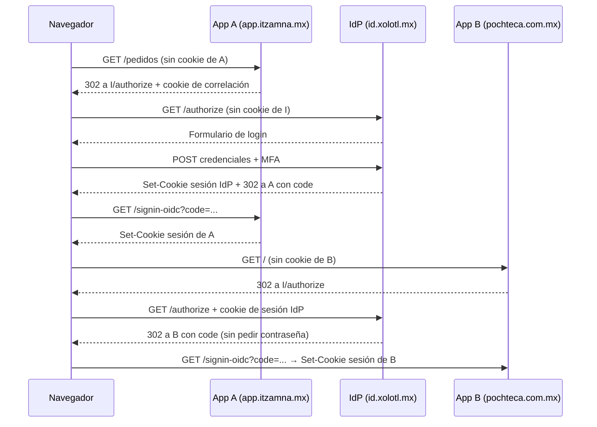

# Cookies y SSO

Parte de: [[02-Fundamentos/04 Cookies/_Índice Cookies|Cookies]]

> [!info] Cómo avanzar
> `progreso`: **pendiente** → **viendo** (estudiando) → **visto** (contestaste la autoevaluación sin abrir las respuestas) → **dominado** (hiciste el laboratorio o lo aplicaste de verdad).

## Contenido

### Qué es
En un **SSO** (inicio de sesión único, ver [[SSO]]) con un proveedor de identidad (IdP) mediante OpenID Connect, la "sesión única" se apoya en **varias cookies**, no en una sola:
1. Una cookie de sesión **en el dominio del IdP** (por ejemplo `id.xolotl.mx`), que recuerda que ya te autenticaste ahí.
2. Una cookie de sesión **en cada aplicación**, creada por la app después de validar el token que le entregó el IdP.
3. Cookies **temporales** del flujo: correlación, `state` y `nonce`, que viven unos minutos.

Entender cuál es cuál explica casi todos los comportamientos "raros" del SSO, sobre todo al cerrar sesión.

### Cómo funciona


La app B no pidió contraseña porque el navegador envió la **cookie del IdP** en la navegación de nivel superior hacia `id.xolotl.mx`.

**Cerrar sesión.** Si en la app A solo borras la cookie de A, al volver a entrar A redirige al IdP, el IdP ve su cookie viva y te devuelve sin pedir contraseña: parece que el logout "no funcionó". Un logout completo:
1. Borra la cookie de la app (`SignOutAsync` del esquema de cookie).
2. Redirige al **`end_session_endpoint`** del IdP (OIDC RP-Initiated Logout) con `id_token_hint` y `post_logout_redirect_uri`, para que el IdP borre su cookie.
3. Opcionalmente, el IdP avisa a las demás apps (front-channel o back-channel logout) para que borren las suyas.

**Por qué el bloqueo de cookies de terceros afecta.** Algunas técnicas leen la cookie del IdP desde un **iframe** dentro de la app:
- *Silent renew*: renovar tokens en un iframe oculto con `prompt=none`.
- *Session management*: un iframe que vigila si la sesión del IdP cambió.
- Front-channel logout: el IdP carga iframes de cada app para cerrar sesión.

En un iframe, la cookie del IdP es de **tercera parte** si el IdP está en otro sitio, y Safari o Firefox la bloquean o particionan (ver [[Restricciones a cookies de terceros en navegadores]]). Las navegaciones de nivel superior (redirecciones) no se ven afectadas. Alternativas: redirecciones de nivel superior, refresh tokens, back-channel logout y el patrón BFF.

### Ejemplo
Logout completo en una app ASP.NET Core con `AddCookie` + `AddOpenIdConnect`:

```csharp
[HttpPost("cuenta/salir")]
[ValidateAntiForgeryToken]
public IActionResult Salir()
{
    // Cierra la cookie local y redirige al end_session_endpoint del IdP
    return SignOut(
        new AuthenticationProperties { RedirectUri = "/" },
        CookieAuthenticationDefaults.AuthenticationScheme,
        OpenIdConnectDefaults.AuthenticationScheme);
}
```

El handler de OIDC lee `end_session_endpoint` del documento de descubrimiento y agrega `id_token_hint` si guardaste los tokens (`o.SaveTokens = true`). En el IdP hay que registrar `post_logout_redirect_uri`.

Para cerrar también las otras apps, configura en Xolotl.Hecate **back-channel logout**: el IdP manda un `POST` servidor a servidor con un *logout token* a cada app, que invalida la sesión en su almacenamiento (por eso conviene que la sesión de la app sea revocable en el servidor, ver [[Sesiones]]).

### Cuándo usarlo y cuándo no
- **IdP en el mismo sitio que las apps** (`id.itzamna.mx` y `app.itzamna.mx`): menos problemas con cookies, los iframes siguen siendo primera parte.
- **IdP en otro sitio** (Entra ID, Google): diseña sin iframes; usa redirecciones, refresh tokens o BFF.
- **Back-channel logout** cuando el cierre de sesión global sea un requisito (apps corporativas, datos sensibles).

### Errores comunes
1. **Logout solo local.** El IdP sigue con sesión y reautentica en silencio. Llama al `end_session_endpoint`.
2. **No registrar `post_logout_redirect_uri`.** El IdP se queda en su página tras cerrar sesión o rechaza la petición.
3. **Depender de silent renew en iframes** con IdP de otro sitio. Falla en Safari y Firefox.
4. **Cookies de correlación con `SameSite=Lax`** y `form_post`: "Correlation failed" (ver [[Cookies - SameSite]]).
5. **Sesiones de app no revocables.** El back-channel logout llega pero la app no tiene dónde invalidar la cookie.

### Para profundizar
- [OpenID Connect RP-Initiated Logout 1.0](https://openid.net/specs/openid-connect-rpinitiated-1_0.html)
- [OpenID Connect Back-Channel Logout 1.0](https://openid.net/specs/openid-connect-backchannel-1_0.html)
- [Microsoft Learn: OpenID Connect en ASP.NET Core](https://learn.microsoft.com/aspnet/core/security/authentication/configure-oidc-web-authentication)

## Autoevaluación

Contesta primero en voz alta o en papel; luego despliega la respuesta.

> [!question]- ¿Qué cookies intervienen en un SSO con un proveedor de identidad (IdP)?
> Una cookie de sesión **en el dominio del IdP** (recuerda que ya iniciaste sesión ahí) y una cookie de sesión **en cada aplicación** creada tras validar el token. Al entrar a otra app, el IdP reconoce su cookie y no pide contraseña.

> [!question]- Cerraste sesión en la app pero al volver a entrar no te pide contraseña. ¿Por qué?
> Solo borraste la cookie de la app; la del IdP sigue viva. Hay que hacer también el logout en el IdP (`end_session_endpoint` en OIDC) y, si aplica, logout en las demás apps.

> [!question]- ¿Por qué el bloqueo de cookies de terceros afecta a algunos SSO?
> Técnicas como renovar en un iframe oculto ("silent renew") o el monitoreo de sesión dependen de la cookie del IdP en contexto de tercero. Las alternativas son redirecciones de nivel superior, refresh tokens o un backend (patrón BFF).

## Práctica

- [[Lab 1 - Cookies y CORS en el navegador con DevTools]]

