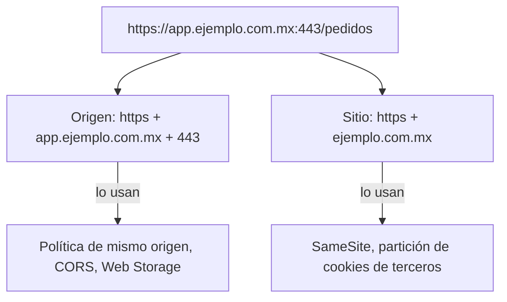

# Mismo origen, mismo sitio y mismo dominio

Parte de: [[02-Fundamentos/04 Cookies/_Índice Cookies|Cookies]]

> [!info] Cómo avanzar
> `progreso`: **pendiente** → **viendo** (estudiando) → **visto** (contestaste la autoevaluación sin abrir las respuestas) → **dominado** (hiciste el laboratorio o lo aplicaste de verdad).

## Contenido

### Qué es
Tres conceptos parecidos que el navegador usa para decisiones de seguridad distintas, y que conviene no mezclar:
- **Origen** (origin) = **esquema + host + puerto**. Es la unidad de aislamiento de la política de mismo origen: qué puede leer JavaScript, qué regula CORS, a qué se asocian `localStorage` y `sessionStorage`.
- **Sitio** (site) = **esquema + dominio registrable** (eTLD+1). Lo usan `SameSite` en cookies y la partición de cookies de terceros.
- **Dominio** de una cookie = el host o dominio "padre" al que se asocia la cookie mediante `Domain` (ver [[Cookies - Domain y Path]]). Las cookies **no** distinguen puertos y, salvo `Secure`, tampoco esquema.

### Cómo funciona
**Origen.** Dos URLs son del mismo origen si coinciden exactamente en esquema, host y puerto (el puerto por defecto de `https` es 443 y el de `http` es 80):

| URL A | URL B | ¿Mismo origen? | Por qué |
|---|---|---|---|
| `https://ejemplo.com` | `https://ejemplo.com:8443` | No | Puerto distinto (443 vs 8443) |
| `http://app.ejemplo.com` | `https://app.ejemplo.com` | No | Esquema distinto |
| `https://app.ejemplo.com` | `https://app.ejemplo.com:443/x` | Sí | 443 es el puerto por defecto; la ruta no cuenta |
| `http://localhost:5173` | `http://localhost:5000` | No | Puerto distinto: tu Vite y tu API en desarrollo son orígenes distintos y necesitan CORS o proxy |
| `https://app.ejemplo.com` | `https://api.ejemplo.com` | No | Host distinto |

**Sitio.** Se calcula con la **Public Suffix List** (PSL), que enumera los sufijos bajo los que cualquiera puede registrar nombres: `com`, `com.mx`, `gob.mx`, y también sufijos "privados" como `azurewebsites.net` o `github.io`. El dominio registrable es el sufijo público más una etiqueta (eTLD+1):

| Host | Sufijo público | Sitio (eTLD+1) |
|---|---|---|
| `a.ejemplo.com.mx` | `com.mx` | `ejemplo.com.mx` |
| `b.ejemplo.com.mx` | `com.mx` | `ejemplo.com.mx` → **mismo sitio** que el anterior |
| `miapp.azurewebsites.net` | `azurewebsites.net` | `miapp.azurewebsites.net` |
| `otraapp.azurewebsites.net` | `azurewebsites.net` | `otraapp.azurewebsites.net` → **otro sitio** |

Por eso dos App Services con el dominio por defecto son sitios distintos entre sí, igual que dos páginas de `github.io`: si no fuera así, cualquier cliente de Azure podría plantar cookies a los demás. Los navegadores modernos usan además el esquema ("schemeful same-site"), así que `http://ejemplo.com` y `https://ejemplo.com` cuentan como sitios distintos para `SameSite`.

### Ejemplo
Arquitectura de Itzamna en producción y desarrollo:

| Escenario | Front | API | Relación | Qué necesitas |
|---|---|---|---|---|
| Desarrollo | `http://localhost:5173` (Vite) | `http://localhost:5000` | Mismo sitio, distinto origen | CORS o, mejor, el proxy de Vite |
| Producción A | `https://app.itzamna.mx` | `https://api.itzamna.mx` | Mismo sitio, distinto origen | CORS con credenciales; la cookie `SameSite=Lax` sí viaja |
| Producción B | `https://itzamna-clio.azurewebsites.net` | `https://itzamna-api.azurewebsites.net` | **Sitios distintos** | CORS y cookie `SameSite=None; Secure`, expuesta a bloqueos de terceros |
| Producción C | `https://app.itzamna.mx` | `https://app.itzamna.mx/api` (proxy) | Mismo origen | Nada de CORS |

La lección práctica: usa un **dominio propio** para front y API (A o C). Con los dominios por defecto de Azure (B) tus cookies se vuelven de tercera parte entre sí.

Para comprobar el sitio de un host puedes buscar su sufijo en la PSL; en DevTools, la pestaña Application muestra para cada cookie si se bloqueó por `SameSite` o por ser de terceros.

### Cuándo usarlo y cuándo no
- Piensa en **origen** al diseñar CORS, `postMessage`, `localStorage` y qué puede leer JavaScript.
- Piensa en **sitio** al decidir `SameSite` y al evaluar si tu cookie será de primera o tercera parte (ver [[Cookies de primera y tercera parte]]).
- Piensa en **dominio de cookie** al decidir con `Domain` qué hosts reciben una cookie.

### Errores comunes
1. **Creer que subdominios son mismo origen.** `app.` y `api.` son orígenes distintos: necesitan CORS aunque sean mismo sitio.
2. **Creer que `*.azurewebsites.net` es un solo sitio.** Está en la PSL: cada app es su propio sitio y sus cookies son de tercera parte entre sí.
3. **Olvidar el puerto.** En desarrollo, front y API en puertos distintos ya son orígenes distintos.
4. **Ignorar el esquema.** Mezclar `http` y `https` rompe origen y, con schemeful same-site, también sitio.
5. **Asumir que las cookies se aíslan por puerto.** No: una cookie de `localhost:5000` también se envía a `localhost:5173`, lo que confunde al probar dos apps locales.

### Para profundizar
- [MDN: Política de mismo origen](https://developer.mozilla.org/en-US/docs/Web/Security/Same-origin_policy)
- [web.dev: Understanding "same-site" and "same-origin"](https://web.dev/articles/same-site-same-origin)
- [Public Suffix List](https://publicsuffix.org/)

## Ejercicios

Resuélvelos en papel o en la herramienta; la solución está plegada.

> [!question]- ¿Mismo origen? `https://ejemplo.com` y `https://ejemplo.com:8443`
> No (puerto distinto). Mismo sitio: sí.

> [!question]- ¿Mismo origen? `http://app.ejemplo.com` y `https://app.ejemplo.com`
> No (esquema distinto). Mismo sitio: no ("schemeful same-site" considera el esquema).

> [!question]- ¿Mismo sitio? `https://a.ejemplo.com.mx` y `https://b.ejemplo.com.mx`
> Sí: `com.mx` es sufijo público y el dominio registrable de ambos es `ejemplo.com.mx`.

> [!question]- ¿Mismo origen? `http://localhost:5173` y `http://localhost:5000`
> No (puerto distinto); por eso el frontend de Vite necesita CORS o proxy para llamar al API local.

## Autoevaluación

Contesta primero en voz alta o en papel; luego despliega la respuesta.

> [!question]- ¿Qué es un **origen** y cuándo dos URLs son del mismo origen?
> Esquema + host + puerto. `https://app.ejemplo.com` y `https://app.ejemplo.com:443/x` sí; `http://` vs `https://`, otro subdominio u otro puerto, no.

> [!question]- ¿Qué es un **sitio** (site)?
> Esquema + dominio registrable (eTLD+1, según la Public Suffix List). `https://app.ejemplo.com` y `https://api.ejemplo.com` son **mismo sitio** pero distinto origen. `SameSite` usa este concepto.

> [!question]- ¿`miapp.azurewebsites.net` y `otraapp.azurewebsites.net` son el mismo sitio?
> No. `azurewebsites.net` está en la Public Suffix List, así que cada subdominio es un sitio distinto (igual que `github.io`).

## Práctica

- [[Lab 1 - Cookies y CORS en el navegador con DevTools]]

