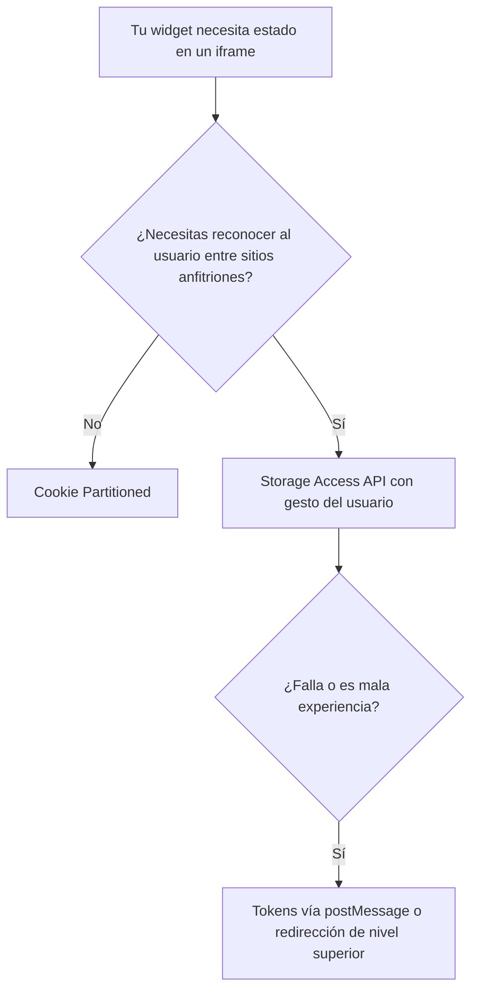

# Restricciones a cookies de terceros en navegadores

Parte de: [[02-Fundamentos/04 Cookies/_Índice Cookies|Cookies]]

> [!info] Cómo avanzar
> `progreso`: **pendiente** → **viendo** (estudiando) → **visto** (contestaste la autoevaluación sin abrir las respuestas) → **dominado** (hiciste el laboratorio o lo aplicaste de verdad).

## Contenido

### Qué es
Desde hace años los navegadores limitan las **cookies de tercera parte** (las de un sitio embebido dentro de otro, ver [[Cookies de primera y tercera parte]]) para impedir el rastreo entre sitios. Cada navegador lo hace distinto, y eso afecta a productos legítimos: widgets en iframe, SSO con iframes ocultos, pagos embebidos, chats de soporte.

### Cómo funciona
Panorama por navegador (verificado en noviembre de 2026; revisa la documentación de cada uno porque cambia):

| Navegador | Comportamiento por defecto |
|---|---|
| **Safari** (WebKit, *Intelligent Tracking Prevention*) | Bloquea las cookies de terceros por defecto. Además acorta la vida de algunas cookies de primera parte creadas por JavaScript. |
| **Firefox** (*Total Cookie Protection*) | **Particiona** las cookies de terceros: cada sitio de nivel superior tiene su propia "jarra" para el tercero, así que el tercero no puede reconocer al usuario entre sitios. |
| **Chrome** | Google abandonó en 2024 su plan de eliminarlas, en abril de 2025 anunció que no cambiaría su manejo de cookies y después retiró las tecnologías de Privacy Sandbox. Las cookies de terceros siguen **permitidas por defecto**; el usuario puede bloquearlas y en incógnito se bloquean. |
| **Edge** | Basado en Chromium, con su propia prevención de rastreo que bloquea rastreadores conocidos según el nivel elegido. |

Mecanismos que existen para usos legítimos:

**1. Cookies particionadas (CHIPS).** Se agrega el atributo `Partitioned` (exige `Secure`):

```http
Set-Cookie: __Host-sesion=abc; Path=/; Secure; HttpOnly; SameSite=None; Partitioned
```

El navegador guarda la cookie con una **clave doble**: (sitio del tercero, sitio de nivel superior). Si tu widget está en `tienda-a.com` y en `tienda-b.com`, tiene dos cookies independientes. Sirve para mantener estado **dentro** de cada sitio anfitrión, pero no para seguir al usuario entre ellos, que es justo la idea.

**2. Storage Access API.** El contenido embebido pide acceso a sus cookies no particionadas:

```js
// Dentro del iframe, tras un clic del usuario
if (!(await document.hasStorageAccess())) {
  await document.requestStorageAccess(); // puede mostrar un aviso al usuario
}
```

Requiere un gesto del usuario y cada navegador aplica condiciones (por ejemplo, que el usuario haya visitado antes el sitio del tercero como primera parte).

**3. Rediseño sin cookies de terceros.** Redirecciones de nivel superior, tokens o servir el contenido como primera parte.



### Ejemplo
Itzamna.Clio usa una librería OIDC que renueva tokens con un **iframe oculto** a Xolotl.Hecate (`prompt=none`, "silent renew"). Con front en `app.itzamna.mx` e IdP en `id.itzamna.mx`, es mismo sitio y funciona. Pero un cliente embebe Clio en su portal `portal-cliente.com`: ahora la cookie del IdP es de tercera parte en Safari y Firefox, el iframe no ve sesión y la renovación falla.

Opciones ordenadas por robustez:
1. **BFF**: la renovación la hace el servidor con refresh tokens; el navegador solo tiene una cookie de primera parte del BFF.
2. **Refresh tokens rotativos** en la SPA (sin iframe).
3. **Redirección de nivel superior** al IdP cuando expira la sesión.
4. CHIPS no ayuda aquí si la sesión del IdP debe compartirse con el sitio del propio IdP.

Para depurar, en Chrome puedes simular el bloqueo en `chrome://settings/cookies` y ver en DevTools > Application qué cookies se bloquearon y por qué.

### Cuándo usarlo y cuándo no
- **CHIPS**: widgets, chats o mapas embebidos que necesitan estado por sitio anfitrión.
- **Storage Access API**: contenido embebido que de verdad necesita la identidad del usuario en tu sitio (por ejemplo, comentarios con la cuenta del usuario), aceptando el aviso.
- **Tokens o BFF**: cuando la experiencia debe ser confiable en todos los navegadores.
- **No**: rastreo entre sitios; además del bloqueo técnico tiene implicaciones de privacidad y consentimiento.

### Errores comunes
1. **Probar solo en Chrome.** Es el más permisivo; los problemas aparecen en Safari (incluido todo iOS) y Firefox.
2. **`Partitioned` sin `Secure`.** La cookie se rechaza.
3. **Depender de iframes ocultos para SSO o renovación.** Se rompen en contexto de tercero.
4. **Esperar que CHIPS permita compartir estado entre sitios anfitriones.** Está diseñado para lo contrario.
5. **Llamar a `requestStorageAccess()` sin gesto del usuario.** El navegador lo rechaza.

### Para profundizar
- [MDN: Storage Access API](https://developer.mozilla.org/en-US/docs/Web/API/Storage_Access_API)
- [WebKit: Tracking Prevention](https://webkit.org/tracking-prevention/)
- [Mozilla: Total Cookie Protection](https://support.mozilla.org/kb/introducing-total-cookie-protection-standard-mode)

## Autoevaluación

Contesta primero en voz alta o en papel; luego despliega la respuesta.

> [!question]- ¿Qué hacen hoy los navegadores con las cookies de terceros?
> Safari (ITP) y Firefox (Total Cookie Protection) las bloquean o las **particionan** por sitio de nivel superior. Chrome anunció su eliminación y luego cambió de plan; su estado actual es (Pendiente de confirmar).

> [!question]- ¿Qué son las cookies particionadas (CHIPS)?
> Cookies con el atributo `Partitioned` (y `Secure`): el navegador guarda un "bote" separado por cada sitio de nivel superior donde está embebido el tercero, así sirven para el widget pero no para rastrear entre sitios.

> [!question]- ¿Qué alternativas hay si tu producto embebido depende de cookies de terceros?
> Storage Access API (el usuario concede acceso), cookies particionadas, mover la autenticación a redirecciones de primer nivel o a tokens, y servir el contenido desde un subdominio del cliente (primera parte).

## Práctica

- [[Lab 1 - Cookies y CORS en el navegador con DevTools]]

