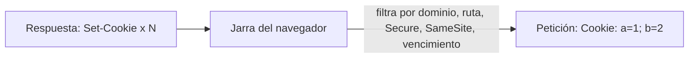

# Set-Cookie y el header Cookie

Parte de: [[02-Fundamentos/04 Cookies/_Índice Cookies|Cookies]]

> [!info] Cómo avanzar
> `progreso`: **pendiente** → **viendo** (estudiando) → **visto** (contestaste la autoevaluación sin abrir las respuestas) → **dominado** (hiciste el laboratorio o lo aplicaste de verdad).

## Contenido

### Qué es
Las cookies se transportan con dos headers HTTP distintos que van en sentidos opuestos:
- **`Set-Cookie`** va en la **respuesta** del servidor. Le dice al navegador "guarda esta cookie con estas reglas".
- **`Cookie`** va en la **petición** del navegador. Lleva, en una sola línea, los pares nombre=valor de todas las cookies que aplican a esa URL.

Entender esta asimetría evita muchos errores: los atributos (`Path`, `Secure`, `Max-Age`…) solo existen en `Set-Cookie`; el servidor nunca los recibe de vuelta.

### Cómo funciona
Un `Set-Cookie` tiene la forma `nombre=valor` seguida de atributos separados por `;`:

```http
Set-Cookie: sid=abc123; Path=/; Max-Age=3600; Secure; HttpOnly; SameSite=Lax
```

- `nombre=valor`: el dato. El valor no debe llevar espacios, comas ni `;` sin codificar; lo usual es Base64URL o codificación de URL.
- Atributos: `Domain`, `Path`, `Expires`, `Max-Age`, `Secure`, `HttpOnly`, `SameSite`, `Partitioned`. Los nombres de atributo no distinguen mayúsculas.

**Varias cookies en una respuesta** se envían con **varios headers `Set-Cookie`**, uno por cookie. A diferencia de otros headers, no se pueden combinar con comas, porque `Expires` lleva una coma dentro de la fecha (`Wed, 21 Oct 2026 ...`) y el parseo sería ambiguo.

```http
HTTP/1.1 200 OK
Set-Cookie: sid=abc123; Path=/; Secure; HttpOnly; SameSite=Lax
Set-Cookie: idioma=es-MX; Path=/; Max-Age=2592000
```

En la petición siguiente, el navegador junta las que aplican en **un solo** header:

```http
GET /pedidos HTTP/1.1
Host: app.ejemplo.com
Cookie: sid=abc123; idioma=es-MX
```

Nota que el servidor no sabe cuándo vence cada cookie ni si es `HttpOnly`: solo ve nombre y valor. Si hay dos cookies con el mismo nombre (por ejemplo, una host-only y otra con `Domain`), ambas llegan, normalmente la de `Path` más específico primero, y el servidor no puede distinguirlas con certeza.



**Borrar una cookie.** No existe un header "borrar". Se envía otro `Set-Cookie` con el **mismo nombre, `Domain` y `Path`** y una caducidad en el pasado:

```http
Set-Cookie: idioma=; Path=/; Max-Age=0
```

La identidad de una cookie es la tripleta nombre + dominio + ruta. Si al borrar cambias el `Path` (por ejemplo, `/app` en vez de `/`), el navegador lo interpreta como una cookie distinta: crea una nueva ya vencida y la original sigue viva.

### Ejemplo
En un controller de ASP.NET Core para Itzamna.Dionisio que guarda la preferencia de idioma:

```csharp
[ApiController]
[Route("api/preferencias")]
public sealed class PreferenciasController : ControllerBase
{
    [HttpPut("idioma")]
    public IActionResult GuardarIdioma([FromBody] string idioma)
    {
        // Genera: Set-Cookie: idioma=es-MX; max-age=2592000; path=/; secure; samesite=lax
        Response.Cookies.Append("idioma", idioma, new CookieOptions
        {
            MaxAge = TimeSpan.FromDays(30),
            Path = "/",
            Secure = true,
            SameSite = SameSiteMode.Lax,
            HttpOnly = false // la lee también el front para mostrar el selector
        });
        return NoContent();
    }

    [HttpDelete("idioma")]
    public IActionResult BorrarIdioma()
    {
        // Debe usar el mismo Path (y Domain, si se puso) que al crearla
        Response.Cookies.Delete("idioma", new CookieOptions { Path = "/" });
        return NoContent();
    }

    [HttpGet("idioma")]
    public IActionResult LeerIdioma()
        => Ok(Request.Cookies.TryGetValue("idioma", out var v) ? v : "es-MX");
}
```

`Response.Cookies.Append` agrega un header `Set-Cookie` por llamada; `Request.Cookies` es el header `Cookie` ya parseado. Puedes verificarlo en DevTools > Network > Headers, o con `curl -i`, que muestra cada `Set-Cookie` en su propia línea.

### Cuándo usarlo y cuándo no
- Pon cookies desde el servidor (`Set-Cookie`) cuando sean de autenticación o deban ser `HttpOnly`: es la única forma de crear una cookie `HttpOnly`.
- Crea cookies desde JavaScript solo para datos no sensibles del front (ver [[Cookies desde JavaScript]]).
- Si un dato no necesita viajar al servidor en cada petición, no lo pongas en cookie.

### Errores comunes
1. **Borrar con otro `Path` o `Domain`.** La cookie "no se borra". Usa exactamente los mismos valores que al crearla; centraliza las `CookieOptions` en una constante.
2. **Combinar varias cookies en un `Set-Cookie` con comas.** El navegador solo toma la primera o interpreta mal las fechas. Un header por cookie.
3. **Valores con caracteres especiales sin codificar.** Comas, `;` o espacios cortan el valor. Codifica (ASP.NET Core lo hace por ti con `Append`).
4. **Esperar que el servidor reciba los atributos.** El header `Cookie` solo trae nombre y valor; si necesitas saber cuándo vence algo, ponlo dentro del valor firmado.
5. **Nombres duplicados en distintos dominios o rutas.** El servidor recibe dos valores y puede leer el equivocado. Usa nombres únicos y prefijos `__Host-` (ver [[Cookies - Secure y HttpOnly]]).

### Para profundizar
- [MDN: Set-Cookie](https://developer.mozilla.org/en-US/docs/Web/HTTP/Reference/Headers/Set-Cookie)
- [MDN: Cookie](https://developer.mozilla.org/en-US/docs/Web/HTTP/Reference/Headers/Cookie)
- [RFC 6265, sección 4 (Set-Cookie y Cookie)](https://www.rfc-editor.org/rfc/rfc6265#section-4)

## Autoevaluación

Contesta primero en voz alta o en papel; luego despliega la respuesta.

> [!question]- ¿Cómo se ve un `Set-Cookie` típico y qué envía luego el navegador?
> Respuesta: `Set-Cookie: sid=abc123; Path=/; Secure; HttpOnly; SameSite=Lax`. Peticiones siguientes: `Cookie: sid=abc123` (solo nombre y valor, sin atributos).

> [!question]- ¿Cómo se ponen varias cookies en una respuesta?
> Con **varios** headers `Set-Cookie`, uno por cookie (no se combinan con comas). En la petición, el navegador las junta en un solo `Cookie: a=1; b=2`.

> [!question]- ¿Cómo se borra una cookie?
> Enviando `Set-Cookie` con el mismo nombre, `Domain` y `Path`, y `Max-Age=0` (o un `Expires` en el pasado). Si `Domain` o `Path` no coinciden, se crea otra cookie en vez de borrar la original.

## Práctica

- [[Lab 1 - Cookies y CORS en el navegador con DevTools]]

