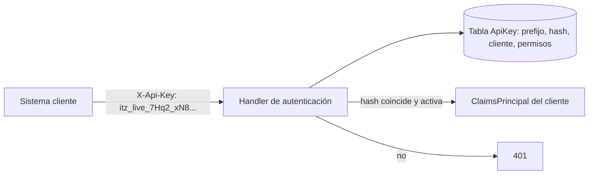

# API keys

Parte de: [[02-Fundamentos/05 Autenticación y autorización/_Índice Autenticación y autorización|Autenticación y autorización]]

> [!info] Cómo avanzar
> `progreso`: **pendiente** → **viendo** (estudiando) → **visto** (contestaste la autoevaluación sin abrir las respuestas) → **dominado** (hiciste el laboratorio o lo aplicaste de verdad).

## Contenido

### Qué es
Una **API key** es un secreto estático, largo y aleatorio que identifica a una **aplicación o cliente** (no a un usuario) cuando llama a un API. Se envía normalmente en un header (`X-Api-Key: ...` o `Authorization: ApiKey ...`). Sirve para control de acceso simple entre sistemas, cuotas de uso, facturación y trazabilidad ("estas peticiones son del sistema de Contabilidad").

No es un mecanismo de autenticación de **usuarios** ni sustituye a OAuth: no tiene alcance delegado, no caduca sola y no dice quién es la persona detrás.

### Cómo funciona
1. **Emisión**: el servidor genera una llave aleatoria criptográfica (por ejemplo 32 bytes en Base64URL) con un **prefijo** legible que identifica el entorno y la llave: `itz_live_7Hq2_xN8...`. Se muestra **una sola vez** al cliente.
2. **Almacenamiento**: el servidor guarda solo el **hash** (SHA-256 es suficiente porque la llave es larga y aleatoria; no hace falta un hash lento como con contraseñas) más el prefijo visible, el cliente dueño, permisos, fecha de creación, último uso y estado.
3. **Validación**: en cada petición se busca por prefijo, se calcula el hash de la llave recibida y se compara **en tiempo constante** (`CryptographicOperations.FixedTimeEquals`) para no filtrar información por tiempos de respuesta.
4. **Rotación**: el cliente puede tener dos llaves activas a la vez; crea la nueva, la despliega y revoca la vieja.



**Por qué no en navegador ni móvil.** Todo lo que se entrega al cliente se puede extraer: el bundle de JavaScript, el APK descompilado, el tráfico interceptado con un proxy. Una API key en una app pública **identifica** la app, pero no **protege** nada: cualquiera puede copiarla y usarla. Los secretos de servidor se usan desde un **backend**, y las apps de usuario usan OAuth con PKCE. Hay excepciones de diseño (llaves de mapas restringidas por dominio de referencia), pero esas llaves se tratan como públicas.

### Ejemplo
Handler de autenticación por API key para que Wee.Reporteria llame a Itzamna.Dionisio:

```csharp
public sealed class ApiKeyHandler(
    IOptionsMonitor<AuthenticationSchemeOptions> o, ILoggerFactory l, UrlEncoder e,
    IBuscarApiKey buscar) : AuthenticationHandler<AuthenticationSchemeOptions>(o, l, e)
{
    protected override async Task<AuthenticateResult> HandleAuthenticateAsync()
    {
        if (!Request.Headers.TryGetValue("X-Api-Key", out var valor) || valor.Count != 1)
            return AuthenticateResult.NoResult();

        var llave = valor.ToString();
        var partes = llave.Split('_');           // itz_live_<id>_<secreto>
        if (partes.Length != 4) return AuthenticateResult.Fail("formato");

        var registro = await buscar.EjecutarAsync(prefijo: partes[2], Context.RequestAborted);
        if (registro is null || !registro.Activa) return AuthenticateResult.Fail("invalida");

        var hash = SHA256.HashData(Encoding.UTF8.GetBytes(llave));
        if (!CryptographicOperations.FixedTimeEquals(hash, registro.Hash))
            return AuthenticateResult.Fail("invalida");

        var claims = new[] { new Claim("client_id", registro.ClienteId), new Claim("scope", registro.Permisos) };
        var principal = new ClaimsPrincipal(new ClaimsIdentity(claims, Scheme.Name));
        return AuthenticateResult.Success(new AuthenticationTicket(principal, Scheme.Name));
    }
}

// Program.cs
builder.Services.AddAuthentication()
    .AddScheme<AuthenticationSchemeOptions, ApiKeyHandler>("ApiKey", null);
```

```sql
-- ApiKeys/BuscarApiKey.sql
SELECT ClienteId, Hash, Permisos, CAST(CASE WHEN RevocadaUtc IS NULL THEN 1 ELSE 0 END AS bit) AS Activa
FROM dbo.ApiKey WHERE Prefijo = @prefijo;
```

En Wee.Reporteria, la llave vive en **Azure Key Vault** o en una variable secreta de Azure DevOps, nunca en `appsettings.json` del repo. Si el llamador corre en Azure, considera reemplazar la API key por **Client Credentials con identidad administrada** (ver [[OAuth 2.0 - Client Credentials]]): no hay secreto que rotar.

### Cuándo usarlo y cuándo no
- **Sí**: integraciones de servidor a servidor simples, APIs para socios con cuotas, webhooks entrantes (aunque ahí suele preferirse una firma HMAC).
- **No**: identificar usuarios, apps de navegador o móviles, o cuando necesitas permisos delegados y caducidad: usa OAuth.
- Si ya tienes un IdP, Client Credentials da lo mismo con tokens de vida corta.

### Errores comunes
1. **Guardarlas en texto plano** en la base de datos. Una fuga expone todas. Guarda el hash.
2. **Ponerlas en el repo o en el front.** Se filtran. Usa Key Vault o variables secretas del pipeline.
3. **Comparar con `==`.** Permite ataques de tiempo. Usa comparación en tiempo constante sobre hashes.
4. **Mandarlas en la query string** (`?api_key=`). Quedan en logs de servidores y proxies. Usa header.
5. **Llaves sin dueño, permisos ni rotación.** Imposible saber quién las usa o revocarlas sin romper todo. Registra cliente, permisos, último uso y permite dos llaves activas.

### Para profundizar
- [OWASP: REST Security Cheat Sheet (API keys)](https://cheatsheetseries.owasp.org/cheatsheets/REST_Security_Cheat_Sheet.html)
- [Microsoft Learn: CryptographicOperations.FixedTimeEquals](https://learn.microsoft.com/dotnet/api/system.security.cryptography.cryptographicoperations.fixedtimeequals)
- [Microsoft Learn: Azure Key Vault](https://learn.microsoft.com/azure/key-vault/general/overview)

## Autoevaluación

Contesta primero en voz alta o en papel; luego despliega la respuesta.

> [!question]- ¿Qué es una API key y qué identifica?
> Un secreto estático que identifica a una **aplicación o cliente** (no a un usuario), normalmente en un header como `X-Api-Key`. Sirve para control de acceso simple, cuotas y facturación.

> [!question]- ¿Cómo guardas y comparas las API keys en el servidor?
> Guardar un **hash** (por ejemplo SHA-256, porque son largas y aleatorias) junto con un prefijo visible para identificarla, y comparar en tiempo constante. Nunca en texto plano ni en el repositorio.

> [!question]- ¿Por qué no poner una API key en una app de navegador o móvil?
> Cualquiera puede extraerla del código o del tráfico. Solo sirve para identificar, no para proteger; los secretos de servidor se usan desde un backend.

