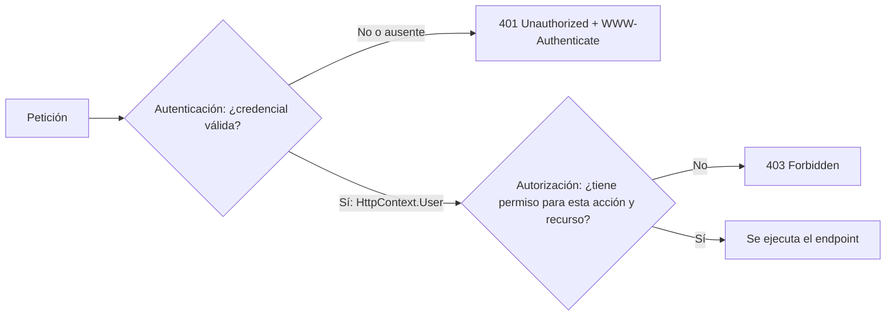

# Autenticación vs autorización

Parte de: [[02-Fundamentos/05 Autenticación y autorización/_Índice Autenticación y autorización|Autenticación y autorización]]

> [!info] Cómo avanzar
> `progreso`: **pendiente** → **viendo** (estudiando) → **visto** (contestaste la autoevaluación sin abrir las respuestas) → **dominado** (hiciste el laboratorio o lo aplicaste de verdad).

## Contenido

### Qué es
Son dos preguntas distintas que un sistema responde en orden:
- **Autenticación (AuthN)**: *¿quién eres?* Comprobar la identidad de quien hace la petición: contraseña, passkey, token firmado, certificado.
- **Autorización (AuthZ)**: *¿qué puedes hacer?* Decidir si esa identidad puede realizar **esta** acción sobre **este** recurso.

Primero se autentica y después se autoriza. Un usuario puede estar perfectamente autenticado y aun así no tener permiso para algo.

### Cómo funciona


**Códigos HTTP.**
- **401 Unauthorized** (el nombre es histórico y engañoso: significa "no autenticado"): no hay credencial o es inválida o expiró. Debe ir con `WWW-Authenticate` que indique el esquema (`Bearer`).
- **403 Forbidden**: la identidad es conocida pero no tiene permiso. Reintentar con la misma credencial no sirve.
- A veces se responde **404** en lugar de 403 para no revelar que el recurso existe (por ejemplo, el pedido de otro usuario).

**Niveles de autorización.**
1. **Por endpoint**: "solo usuarios autenticados", "solo rol Admin" (`[Authorize]`, `[Authorize(Policy = "...")]`).
2. **Por recurso**: "solo el dueño de este pedido". Requiere cargar el recurso y compararlo con el usuario. Es la que más se olvida.
3. **Por campo o dato**: qué columnas o registros ve cada quien (filtros por sucursal, enmascarar datos).

Si solo haces el nivel 1 en `GET /pedidos/{id}`, cualquier usuario logueado puede cambiar el id en la URL y ver pedidos ajenos: es un **IDOR** (Insecure Direct Object Reference), una de las fallas más comunes en APIs (OWASP la llama *Broken Object Level Authorization*).

**En ASP.NET Core**, el orden de middlewares importa:

```csharp
app.UseRouting();
app.UseCors();            // si se usa
app.UseAuthentication();  // construye HttpContext.User
app.UseAuthorization();   // evalúa [Authorize] y policies con ese User
app.MapControllers();
```

Si `UseAuthorization` va antes, `User` todavía está vacío y todo responde 401.

### Ejemplo
Endpoint de Itzamna.Dionisio con los dos niveles. Consulta con Dapper en archivo `.sql` y una interfaz por consulta:

```sql
-- Pedidos/ObtenerPedido.sql
SELECT p.Id, p.ClienteId, p.Total, p.Estatus
FROM dbo.Pedido AS p
WHERE p.Id = @Id;
```

```csharp
public interface IObtenerPedido
{
    Task<PedidoDto?> EjecutarAsync(int id, CancellationToken ct);
}

[ApiController]
[Route("api/pedidos")]
[Authorize] // nivel 1: autenticado
public sealed class PedidosController(IObtenerPedido obtener) : ControllerBase
{
    [HttpGet("{id:int}")]
    public async Task<IActionResult> Obtener(int id, CancellationToken ct)
    {
        var pedido = await obtener.EjecutarAsync(id, ct);
        if (pedido is null) return NotFound();

        // nivel 2: autorización por recurso
        var clienteId = User.FindFirstValue("cliente_id");
        var esSoporte = User.IsInRole("Soporte");
        if (!esSoporte && pedido.ClienteId.ToString() != clienteId)
            return NotFound(); // no revelamos que existe

        return Ok(pedido);
    }
}
```

En una app más grande, esa regla se mueve a un `AuthorizationHandler` basado en recursos para no repetirla (ver [[Roles, claims y policies]]).

### Cuándo usarlo y cuándo no
- **Autenticación** en todo lo que no sea público; decide el mecanismo según el cliente (cookie, Bearer, API key; ver [[Cookies vs tokens]] y [[API keys]]).
- **Autorización por endpoint** como primera barrera, siempre.
- **Autorización por recurso** en cualquier endpoint que reciba un id de algo que pertenece a alguien. No es opcional.
- No mezcles: un 403 cuando falta el token confunde al cliente, que no sabrá que debe renovar.

### Errores comunes
1. **Validar solo que esté logueado.** Produce IDOR. Compara el recurso con el usuario o sus permisos.
2. **Confundir 401 y 403.** Los clientes renuevan tokens ante 401; si devuelves 401 por falta de permiso, entran en bucle.
3. **Autorizar en el front.** Ocultar un botón no es seguridad; el API debe verificar.
4. **Orden incorrecto de middlewares.** `UseAuthentication` antes de `UseAuthorization`.
5. **Confiar en datos del cliente para autorizar** (por ejemplo, un `clienteId` en el body). Usa los claims del usuario autenticado.

### Para profundizar
- [Microsoft Learn: introducción a la autorización en ASP.NET Core](https://learn.microsoft.com/aspnet/core/security/authorization/introduction)
- [OWASP API Security Top 10: Broken Object Level Authorization](https://owasp.org/API-Security/editions/2023/en/0xa1-broken-object-level-authorization/)
- [RFC 9110: códigos 401 y 403](https://www.rfc-editor.org/rfc/rfc9110#name-401-unauthorized)

## Autoevaluación

Contesta primero en voz alta o en papel; luego despliega la respuesta.

> [!question]- ¿Qué diferencia hay entre autenticación y autorización?
> **Autenticación** (AuthN): comprobar quién eres. **Autorización** (AuthZ): decidir qué puedes hacer. Primero se autentica y luego se autoriza.

> [!question]- ¿Qué códigos HTTP corresponden a cada fallo?
> Falla autenticación → `401 Unauthorized`. Autenticado pero sin permiso → `403 Forbidden`.

> [!question]- Error común: validar solo que el usuario esté logueado en `GET /pedidos/{id}`. ¿Qué falta?
> Autorización **a nivel de recurso**: que el pedido pertenezca al usuario o que tenga permiso para verlo. Sin eso hay IDOR (acceso a datos de otros cambiando el id).

> [!question]- En ASP.NET Core, ¿en qué orden van los middlewares?
> `app.UseAuthentication();` antes de `app.UseAuthorization();` (y ambos después de `UseRouting` y `UseCors` si se usan).

