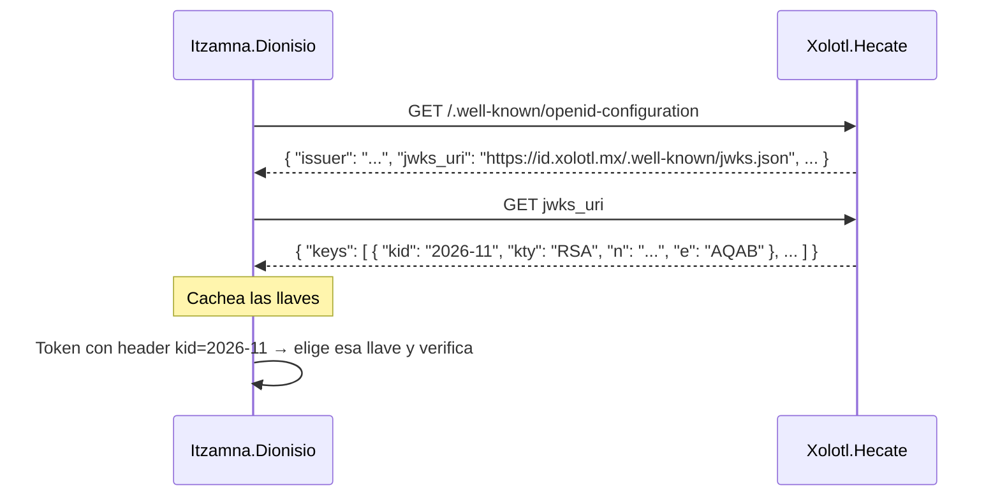

# Firmas de JWT (HS256 vs RS256) y JWKS

Parte de: [[02-Fundamentos/05 Autenticación y autorización/_Índice Autenticación y autorización|Autenticación y autorización]]

> [!info] Cómo avanzar
> `progreso`: **pendiente** → **viendo** (estudiando) → **visto** (contestaste la autoevaluación sin abrir las respuestas) → **dominado** (hiciste el laboratorio o lo aplicaste de verdad).

## Contenido

### Qué es
Un JWT firmado (JWS) lleva una **firma** que permite comprobar que lo emitió quien dice y que nadie lo modificó. El header indica el algoritmo en `alg`. Los dos más comunes:
- **HS256**: HMAC con SHA-256 usando un **secreto compartido**. La misma llave firma y verifica.
- **RS256**: firma RSA (PKCS#1 v1.5) con SHA-256. Se firma con la **llave privada** y se verifica con la **pública**.

Un **JWKS** (JSON Web Key Set) es un documento JSON que publica las **llaves públicas** de un emisor para que cualquier API pueda verificar sus tokens.

### Cómo funciona
**HS256 (simétrico).**
- Firma = HMAC-SHA256(secreto, `base64url(header) + "." + base64url(payload)`).
- Quien verifica tiene el mismo secreto, así que **también podría emitir** tokens válidos. Si 10 APIs validan, hay 10 lugares donde se puede filtrar la capacidad de emitir.

**RS256 (asimétrico).**
- Solo el emisor (Xolotl.Hecate) tiene la llave privada. Los APIs solo necesitan la pública, que no es secreta. Un API comprometido **no puede** fabricar tokens.
- Otras opciones asimétricas: **ES256** (ECDSA P-256, firmas más pequeñas) y **PS256** (RSA-PSS).

**JWKS y descubrimiento.**


1. El API conoce el `Authority` (emisor). Descarga el documento de descubrimiento OIDC, que trae `jwks_uri`.
2. Descarga el JWKS y lo **cachea**.
3. Cada token trae en su header un `kid` (key id); el API elige la llave con ese `kid`.
4. Si llega un `kid` desconocido, la librería vuelve a descargar la configuración (con límite de frecuencia), lo que permite la rotación (ver [[Rotación de llaves de firma]]).

**Fijar algoritmos.** El validador nunca debe "obedecer" el `alg` del token. Si aceptara cualquier valor, un atacante podría poner `alg: none` o usar la llave pública RSA como si fuera un secreto HMAC (confusión de algoritmos). Configura los algoritmos permitidos de forma explícita.

### Ejemplo
Header y JWKS de Xolotl.Hecate:

```json
{ "alg": "RS256", "typ": "at+jwt", "kid": "2026-11" }
```

```json
{
  "keys": [
    { "kty": "RSA", "use": "sig", "alg": "RS256", "kid": "2026-11", "n": "0vx7agoebGcQ...", "e": "AQAB" }
  ]
}
```

Configuración correcta en el API:

```csharp
builder.Services.AddAuthentication(JwtBearerDefaults.AuthenticationScheme)
    .AddJwtBearer(o =>
    {
        o.Authority = "https://id.xolotl.mx";  // descubre issuer y jwks_uri
        o.Audience = "itzamna-api";
        o.TokenValidationParameters.ValidAlgorithms = [SecurityAlgorithms.RsaSha256];
    });
```

**El error típico del ejercicio.** El emisor firma con RS256 pero el API se configuró así:

```csharp
// MAL para tokens RS256: valida con un secreto HMAC
o.TokenValidationParameters.IssuerSigningKey =
    new SymmetricSecurityKey(Encoding.UTF8.GetBytes(config["Jwt:Secreto"]!));
```

Todos los tokens fallan con errores como `IDX10503` o `IDX10517` (firma inválida o llave no encontrada). La solución es quitar la llave simétrica y validar con la llave pública del emisor mediante `Authority`/`MetadataAddress`, y luego revisar que `kid`, `iss` y `aud` coincidan.

Inspecciona un token con un decodificador local o con `jwt.ms` (de Microsoft) para ver `alg` y `kid` sin enviar tokens de producción a sitios desconocidos.

### Cuándo usarlo y cuándo no
- **RS256 o ES256**: siempre que emisor y validadores sean sistemas distintos, haya varios APIs o terceros validen tus tokens. Es lo estándar con OIDC.
- **HS256**: aceptable solo cuando el emisor y el validador son el **mismo sistema** (o confían plenamente uno en otro), el secreto tiene al menos 256 bits aleatorios y vive en un almacén de secretos (Key Vault). Ejemplo: un token interno de corta vida que el mismo servicio emite y consume.
- **Nunca** `none`.

### Errores comunes
1. **Secretos HS256 cortos o legibles** (`"MiClaveSuperSecreta"`). Se rompen por fuerza bruta fuera de línea con un solo token.
2. **No fijar algoritmos.** Abre la puerta a `alg: none` o confusión RS/HS.
3. **Llave pública copiada a mano en la configuración.** Al rotar el emisor, todo falla. Usa `Authority` y JWKS.
4. **Ignorar `kid`.** Con varias llaves publicadas, el validador debe elegir la correcta.
5. **Compartir el secreto HS256 entre muchos servicios.** Cualquiera puede emitir tokens; migra a asimétrico.

### Para profundizar
- [RFC 7515: JSON Web Signature](https://www.rfc-editor.org/rfc/rfc7515)
- [RFC 7517: JSON Web Key](https://www.rfc-editor.org/rfc/rfc7517)
- [RFC 7518: JSON Web Algorithms](https://www.rfc-editor.org/rfc/rfc7518)
- [RFC 8725: JWT Best Current Practices](https://www.rfc-editor.org/rfc/rfc8725)

## Autoevaluación

Contesta primero en voz alta o en papel; luego despliega la respuesta.

> [!question]- ¿Qué diferencia hay entre HS256 y RS256?
> **HS256**: HMAC con un **secreto compartido**; quien valida también puede emitir. **RS256**: firma RSA; se firma con la llave **privada** y se valida con la **pública**, así los APIs no pueden emitir tokens.

> [!question]- ¿Qué es un JWKS y cómo lo usa el API?
> JSON Web Key Set: un documento (por ejemplo `/.well-known/jwks.json`, referido desde `jwks_uri` en la configuración OIDC) con las llaves públicas del emisor. El API elige la llave por el `kid` del header y la cachea.

> [!question]- El emisor firma con RS256 y el API está configurado con un secreto HS256: todos los tokens fallan con `IDX10503`/firma inválida. ¿Qué arreglas?
> Alinear configuración: el API debe validar con la llave pública del emisor (`Authority`/`MetadataAddress` o el JWKS) y aceptar `RS256`. Revisar también `kid`, `iss` y `aud`.

> [!question]- ¿Cuándo es aceptable HS256?
> Cuando emisor y validador son el mismo sistema o confían plenamente uno en el otro y el secreto es largo y aleatorio (al menos 256 bits) y se guarda en un almacén de secretos.

## Práctica

- [[Lab 1 - Decodificar y validar un JWT]]

