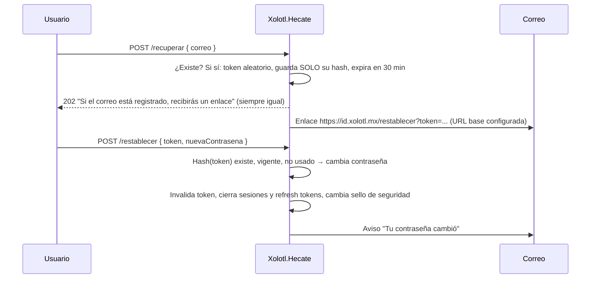

# Flujo seguro de restablecer contraseña

Parte de: [[02-Fundamentos/05 Autenticación y autorización/_Índice Autenticación y autorización|Autenticación y autorización]]

> [!info] Cómo avanzar
> `progreso`: **pendiente** → **viendo** (estudiando) → **visto** (contestaste la autoevaluación sin abrir las respuestas) → **dominado** (hiciste el laboratorio o lo aplicaste de verdad).

## Contenido

### Qué es
El flujo de "¿Olvidaste tu contraseña?" permite que un usuario recupere el acceso demostrando que controla su correo (u otro canal). Es una de las partes más atacadas de un sistema de identidad: si es débil, el atacante no necesita la contraseña; le basta con restablecerla. Un flujo seguro evita la enumeración de cuentas, usa tokens imposibles de adivinar y de un solo uso, y cierra las sesiones abiertas al terminar.

### Cómo funciona


Pasos:
1. **Solicitud**: el usuario escribe su correo.
2. **Respuesta idéntica** exista o no la cuenta: mismo mensaje, mismo código HTTP y tiempo de respuesta parecido (envía el correo en segundo plano para que el tiempo no delate). Si respondes "Ese correo no existe", cualquiera puede **enumerar** qué correos están registrados y usar la lista para phishing dirigido o relleno de credenciales.
3. **Token**: aleatorio criptográfico (32 bytes), de **un solo uso**, que **expira pronto** (30 a 60 minutos) y ligado al usuario y al propósito.
4. **Almacenamiento**: guarda solo el **hash** del token (SHA-256 basta, es aleatorio y largo). Si la base se filtra, los tokens vigentes no se pueden usar.
5. **Cambio**: valida el token, aplica la política de contraseñas, guarda el nuevo hash (ver [[Hashing de contraseñas]]), **invalida el token** y todos los demás pendientes, **cierra las sesiones** abiertas y revoca refresh tokens, y **notifica** al usuario por correo.

**Envenenamiento del header `Host`.** Si armas el enlace con el host de la petición (`$"{Request.Scheme}://{Request.Host}/restablecer?token=..."`), el atacante puede enviar la solicitud de recuperación para el correo de la víctima con `Host: atacante.com`. El correo **legítimo** que recibe la víctima contiene un enlace a `atacante.com` con un token **válido**; si hace clic, el atacante lo captura y restablece la contraseña. Solución: arma el enlace con una **URL base configurada** (`Identidad:UrlPublica`) y, además, restringe los hosts permitidos (`AllowedHosts` en ASP.NET Core).

Otros cuidados:
- **Límite de solicitudes** por correo y por IP.
- El token va en la URL, así que la página de restablecer debe tener `Referrer-Policy: no-referrer` y no cargar scripts de terceros que puedan ver la URL.
- **No inicies sesión automáticamente** al restablecer si la cuenta tiene MFA; pide el segundo factor.
- Las preguntas secretas no son un mecanismo de recuperación seguro.

### Ejemplo
Endpoints en Xolotl.Hecate con Dapper y procedimientos:

```csharp
[ApiController]
[Route("api/recuperacion")]
public sealed class RecuperacionController(
    IOptions<OpcionesIdentidad> opciones, IBuscarUsuarioPorCorreo buscar,
    IGuardarTokenRecuperacion guardar, IColaCorreos correos) : ControllerBase
{
    [HttpPost]
    [EnableRateLimiting("recuperacion")]
    public async Task<IActionResult> Solicitar(SolicitarRecuperacion cmd, CancellationToken ct)
    {
        var usuario = await buscar.EjecutarAsync(cmd.Correo, ct);
        if (usuario is not null)
        {
            var token = Base64Url.EncodeToString(RandomNumberGenerator.GetBytes(32));
            var hash = SHA256.HashData(Encoding.ASCII.GetBytes(token));
            await guardar.EjecutarAsync(usuario.Id, hash, DateTime.UtcNow.AddMinutes(30), ct);

            // URL base de configuración, NUNCA Request.Host
            var enlace = $"{opciones.Value.UrlPublica}/restablecer?token={token}";
            await correos.EncolarAsync(usuario.Correo, "Restablece tu contraseña", enlace, ct);
        }
        // Misma respuesta siempre
        return Accepted(new { mensaje = "Si el correo está registrado, recibirás un enlace en unos minutos." });
    }
}
```

```sql
-- Recuperacion/CanjearToken.sql (cuerpo de dbo.TokenRecuperacion_Canjear)
UPDATE dbo.TokenRecuperacion
SET UsadoUtc = SYSUTCDATETIME()
OUTPUT inserted.UsuarioId
WHERE Hash = @Hash AND UsadoUtc IS NULL AND ExpiraUtc > SYSUTCDATETIME();
-- Si devuelve fila: cambiar contraseña, invalidar otros tokens del usuario,
-- revocar sesiones y refresh tokens y actualizar el sello de seguridad.
```

El `UPDATE ... OUTPUT` marca el token como usado y devuelve el usuario en una sola operación atómica, así dos peticiones simultáneas con el mismo token no pueden usarlo dos veces. La validación de la nueva contraseña (longitud mínima, que no esté en listas de contraseñas filtradas) va con FluentValidation en el comando.

### Cuándo usarlo y cuándo no
- **Siempre** que tu sistema tenga contraseñas propias.
- **Si usas un IdP externo** (Entra ID, Google), la recuperación es suya; tu app no debe implementar otra.
- **Con passkeys**, el equivalente es la recuperación de cuenta (registrar una nueva passkey), con el mismo rigor.

### Errores comunes
1. **Mensajes distintos** según exista la cuenta. Permite enumerar usuarios.
2. **Enlace armado con el header `Host`.** Envenenamiento del enlace.
3. **Tokens predecibles o eternos** (GUID v1, timestamp, sin expiración).
4. **Guardar el token en claro.** Una fuga de la base da acceso a las cuentas con recuperación pendiente.
5. **No cerrar sesiones** tras el cambio. Si el atacante tenía una sesión abierta, la conserva.

### Para profundizar
- [OWASP: Forgot Password Cheat Sheet](https://cheatsheetseries.owasp.org/cheatsheets/Forgot_Password_Cheat_Sheet.html)
- [PortSwigger: envenenamiento de restablecimiento de contraseña por Host header](https://portswigger.net/web-security/host-header/exploiting/password-reset-poisoning)
- [Microsoft Learn: confirmación de cuenta y recuperación de contraseña en ASP.NET Core](https://learn.microsoft.com/aspnet/core/security/authentication/accconfirm)

## Autoevaluación

Contesta primero en voz alta o en papel; luego despliega la respuesta.

> [!question]- ¿Qué pasos tiene un flujo seguro?
> 1. El usuario pide restablecer con su correo. 2. Responder **lo mismo** exista o no la cuenta. 3. Enviar un enlace con token aleatorio, de un solo uso y que expire pronto (p. ej. 30–60 min). 4. Guardar solo el hash del token. 5. Al cambiar la contraseña, invalidar el token y las sesiones abiertas, y notificar.

> [!question]- ¿Por qué el mensaje debe ser idéntico exista o no la cuenta?
> Para no permitir **enumerar** qué correos están registrados.

> [!question]- ¿Qué riesgo hay al armar el enlace con el header `Host` de la petición?
> Host header poisoning: el atacante manda otro `Host` y el correo de la víctima contiene un enlace a su dominio, donde captura el token. Usa una URL base configurada.

