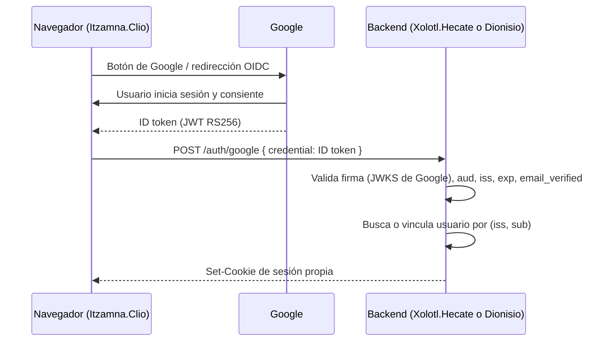

# Google Sign-In

Parte de: [[02-Fundamentos/05 Autenticación y autorización/_Índice Autenticación y autorización|Autenticación y autorización]]

> [!info] Cómo avanzar
> `progreso`: **pendiente** → **viendo** (estudiando) → **visto** (contestaste la autoevaluación sin abrir las respuestas) → **dominado** (hiciste el laboratorio o lo aplicaste de verdad).

## Contenido

### Qué es
"Iniciar sesión con Google" es una implementación de **OpenID Connect** (ver [[OpenID Connect]]) en la que Google actúa como proveedor de identidad. Tu app no ve la contraseña del usuario: Google lo autentica (con su MFA, passkeys y detección de riesgo) y te entrega un **ID token** firmado con RS256 que tu backend valida con las llaves públicas de Google.

Google ofrece dos formas de integrarlo:
- **Flujo OIDC estándar** (Authorization Code con redirección): funciona con cualquier librería OIDC, como `AddOpenIdConnect` o `AddGoogle` en ASP.NET Core.
- **Google Identity Services** para web (botón "Iniciar sesión con Google" y One Tap): una librería de JavaScript que entrega al front un ID token (llamado *credential*) que luego envías a tu backend.

### Cómo funciona


**Qué validar del ID token en tu backend:**
1. **Firma** con las llaves públicas de Google (publicadas en su JWKS, referido desde `https://accounts.google.com/.well-known/openid-configuration`).
2. **`aud`** igual a **tu** client ID de Google. Si no lo validas, un ID token emitido para **otra** app (cualquier sitio que use Google Sign-In) serviría para entrar a la tuya.
3. **`iss`** igual a `accounts.google.com` o `https://accounts.google.com` (Google documenta ambos valores).
4. **`exp`** no vencido.
5. Usa **`sub`** como identificador estable del usuario, no el correo, que puede cambiar.
6. Si restringes a un dominio de Google Workspace, revisa el claim **`hd`** (dominio alojado), no solo el sufijo del correo.

**`email_verified`.** El claim indica si Google verificó que el usuario controla ese correo. Si tu sistema vincula cuentas por correo ("ya existe ana@ejemplo.mx, la conecto con su login de Google") y no revisas `email_verified`, alguien podría tener una cuenta de Google con un correo no verificado que pertenece a otra persona y quedar **vinculado a la cuenta existente de esa persona**. Regla: solo vincula automáticamente por correo si `email_verified` es `true`, y aun así considera pedir confirmación (iniciar sesión con el método anterior) antes de vincular.

### Ejemplo
Endpoint en Xolotl.Hecate que recibe el *credential* del botón de Google y crea la sesión:

```csharp
[ApiController]
[Route("auth/google")]
public sealed class GoogleController(IConfiguration cfg, IVincularUsuarioExterno vincular) : ControllerBase
{
    private static readonly ConfigurationManager<OpenIdConnectConfiguration> Config = new(
        "https://accounts.google.com/.well-known/openid-configuration",
        new OpenIdConnectConfigurationRetriever());

    [HttpPost]
    public async Task<IActionResult> Iniciar([FromBody] SolicitudGoogle req, CancellationToken ct)
    {
        var oidc = await Config.GetConfigurationAsync(ct);
        var parametros = new TokenValidationParameters
        {
            ValidIssuers = ["accounts.google.com", "https://accounts.google.com"],
            ValidAudience = cfg["Google:ClientId"],
            IssuerSigningKeys = oidc.SigningKeys,
            ValidAlgorithms = [SecurityAlgorithms.RsaSha256],
            ClockSkew = TimeSpan.FromMinutes(1)
        };

        var resultado = await new JsonWebTokenHandler().ValidateTokenAsync(req.Credential, parametros);
        if (!resultado.IsValid) return Unauthorized();

        var claims = resultado.ClaimsIdentity;
        var sub = claims.FindFirst("sub")!.Value;
        var correo = claims.FindFirst("email")?.Value;
        var verificado = claims.FindFirst("email_verified")?.Value == "true";

        var usuario = await vincular.EjecutarAsync("google", sub, verificado ? correo : null, ct);
        // ...crear sesión propia (cookie o tokens de Hecate)
        return NoContent();
    }
}

public sealed record SolicitudGoogle(string Credential);
```

Si usas el paquete `Microsoft.AspNetCore.Authentication.Google` (`AddGoogle`), el handler hace el flujo de redirección y la validación por ti; obtienes el `sub` en `ClaimTypes.NameIdentifier`.

El **client ID** se crea en Google Cloud Console (APIs y servicios > Credenciales > ID de cliente de OAuth) y ahí registras los **orígenes de JavaScript** y las **URIs de redirección** autorizadas. El *client secret*, si usas el flujo con backend, va en Key Vault.

### Cuándo usarlo y cuándo no
- **Sí**: apps para público general donde muchos usuarios tienen cuenta de Google; reduce fricción y delegas la seguridad de la contraseña.
- **Ofrécelo junto con otras opciones** (Microsoft, correo con passkey), no como única vía si tu público es corporativo.
- **No** como fuente de autorización: Google te dice quién es, tú decides qué puede hacer.

### Errores comunes
1. **No validar `aud`.** Cualquier ID token de Google para otra app entra a la tuya.
2. **Identificar por correo** en lugar de `sub`. Al cambiar el correo se "pierde" la cuenta o se cruza con otra.
3. **Vincular cuentas sin revisar `email_verified`.** Toma de cuentas.
4. **Validar el token solo en el front.** El backend debe validarlo siempre.
5. **Restringir por dominio con `email.EndsWith("@empresa.com")`.** Usa `hd` y valida `email_verified`.

### Para profundizar
- [Google: verificar el ID token en el servidor](https://developers.google.com/identity/gsi/web/guides/verify-google-id-token)
- [Google: OpenID Connect](https://developers.google.com/identity/openid-connect/openid-connect)
- [Microsoft Learn: inicio de sesión con Google en ASP.NET Core](https://learn.microsoft.com/aspnet/core/security/authentication/social/google-logins)

## Autoevaluación

Contesta primero en voz alta o en papel; luego despliega la respuesta.

> [!question]- ¿Qué protocolo hay detrás de "Iniciar sesión con Google"?
> OpenID Connect. Google emite un ID token firmado (RS256) que la app valida con las llaves públicas de Google.

> [!question]- ¿Qué debes validar del ID token de Google en tu backend?
> Firma, `aud` igual a **tu** client ID, `iss` (`accounts.google.com` o `https://accounts.google.com`), `exp`, y usar `sub` como identificador estable del usuario (no el email, que puede cambiar).

> [!question]- ¿Por qué no confiar en el correo sin revisar `email_verified`?
> Si no está verificado, alguien podría registrar una cuenta con el correo de otra persona y quedar vinculado a una cuenta existente de tu sistema.

