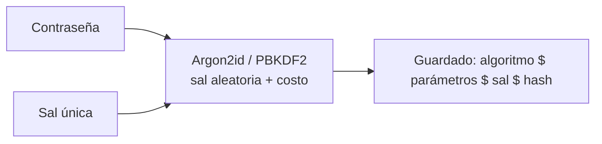

# Hashing de contraseñas

Parte de: [[02-Fundamentos/05 Autenticación y autorización/_Índice Autenticación y autorización|Autenticación y autorización]]

> [!info] Cómo avanzar
> `progreso`: **pendiente** → **viendo** (estudiando) → **visto** (contestaste la autoevaluación sin abrir las respuestas) → **dominado** (hiciste el laboratorio o lo aplicaste de verdad).

## Contenido

### Qué es
Guardar contraseñas de forma segura significa **no guardarlas**: se guarda un **hash** calculado con una función diseñada para ser **lenta**, con una **sal** única por usuario. Al iniciar sesión se recalcula el hash con la contraseña que llega y se compara. Si la base de datos se filtra, el atacante obtiene hashes, no contraseñas, y recuperarlas le cuesta muchísimo tiempo por cada usuario.

Funciones adecuadas: **Argon2id** (la recomendada por OWASP), **scrypt**, **bcrypt** y **PBKDF2** con muchas iteraciones.

### Cómo funciona
**Por qué no basta SHA-256.** SHA-256 es una función de hash criptográfica excelente, pero **rapidísima**: está diseñada para verificar archivos de gigabytes. Una GPU calcula miles de millones de SHA-256 por segundo. Con un diccionario de contraseñas filtradas y reglas (agregar "123", cambiar "a" por "@"), el atacante prueba miles de millones de candidatas por segundo contra cada hash. Las contraseñas humanas típicas caen en minutos.

Las funciones para contraseñas son **lentas a propósito** y configurables:
- **PBKDF2**: repite un HMAC muchas iteraciones (decenas o cientos de miles).
- **bcrypt**: factor de costo exponencial.
- **scrypt y Argon2id**: además de tiempo, exigen **memoria**, lo que encarece mucho los ataques con GPU y hardware especializado.

Si un login tarda 100 ms en calcular el hash, para el usuario es imperceptible; para un atacante significa pasar de miles de millones de intentos por segundo a unos pocos por núcleo.

**La sal.** Es un valor **aleatorio y único por usuario** (16 bytes o más) que se combina con la contraseña antes de calcular el hash y se guarda junto al hash (no es secreta). Evita:
- **Tablas precalculadas** (rainbow tables): el atacante no puede tener hashes precalculados para todas las sales posibles.
- **Hashes iguales para contraseñas iguales**: sin sal, todos los usuarios con `Mexico2026!` tienen el mismo hash, y crackear uno revela a todos.
- Atacar a todos los usuarios a la vez: con sal, cada candidata hay que calcularla por usuario.



**Cifrar no es hashear.** Cifrar con AES "para poder recuperarlas" es un error grave: quien obtenga la llave (que tiene que estar accesible para la app) obtiene **todas** las contraseñas en claro de golpe, y los usuarios reutilizan contraseñas en otros sitios. Una contraseña nunca debe poder recuperarse: se **restablece** (ver [[Flujo seguro de restablecer contraseña]]).

### Ejemplo
**ASP.NET Core Identity** usa `PasswordHasher<TUser>`. Su formato actual (versión 3) es, según el código fuente: **PBKDF2 con HMAC-SHA512, sal de 128 bits, subclave de 256 bits y 100,000 iteraciones** por defecto (configurable con `PasswordHasherOptions.IterationCount`). El hash guardado incluye un byte de versión, el algoritmo, las iteraciones y la sal, así que puede cambiar de parámetros sin romper los hashes viejos: `VerifyHashedPassword` devuelve `SuccessRehashNeeded` cuando el hash usa parámetros antiguos, e Identity lo recalcula al iniciar sesión.

OWASP recomienda valores más altos para PBKDF2-HMAC-SHA512 (220,000 iteraciones en su hoja de referencia, consultada en noviembre de 2026), así que puedes subirlo:

```csharp
builder.Services.Configure<PasswordHasherOptions>(o => o.IterationCount = 220_000);
```

Uso directo del hasher fuera de Identity completo (por ejemplo en Xolotl.Hecate con Dapper):

```csharp
var hasher = new PasswordHasher<Usuario>();

// Registro
var hash = hasher.HashPassword(usuario, cmd.Contrasena);
await crearUsuario.EjecutarAsync(usuario.Correo, hash, ct); // columna nvarchar(max) o varchar(200)

// Login
var resultado = hasher.VerifyHashedPassword(usuario, usuario.HashContrasena, cmd.Contrasena);
if (resultado == PasswordVerificationResult.Failed) return Unauthorized();
if (resultado == PasswordVerificationResult.SuccessRehashNeeded)
    await actualizarHash.EjecutarAsync(usuario.Id, hasher.HashPassword(usuario, cmd.Contrasena), ct);
```

Si prefieres Argon2id, hay librerías como Konscious.Security.Cryptography o Isopoh.Cryptography.Argon2; OWASP sugiere como mínimo 19 MiB de memoria, 2 iteraciones y paralelismo 1. Mide el tiempo en tu servidor de Azure: apunta a decenas o pocos cientos de milisegundos por verificación.

### Cuándo usarlo y cuándo no
- **Siempre** que tu sistema guarde contraseñas. Mejor aún: no guardarlas, delegando en un IdP (Entra ID, Google) o usando passkeys.
- **No** uses estas funciones para secretos aleatorios largos (API keys, tokens de restablecimiento): ahí basta SHA-256, porque no hay diccionario que probar.
- Reevalúa los parámetros cada cierto tiempo; el hardware mejora.

### Errores comunes
1. **SHA-256 o MD5 sin costo**, con o sin sal. Demasiado rápido.
2. **Sal fija** para todos los usuarios o derivada del usuario (el correo). Debe ser aleatoria por hash.
3. **Cifrar con AES** para poder recuperarlas. Una llave expone todas.
4. **Implementar el algoritmo a mano.** Usa `PasswordHasher` o una librería mantenida.
5. **Limitar la longitud a 16 caracteres** o prohibir símbolos. Permite frases largas (al menos 64 caracteres) y revisa contra listas de contraseñas filtradas.

### Para profundizar
- [OWASP: Password Storage Cheat Sheet](https://cheatsheetseries.owasp.org/cheatsheets/Password_Storage_Cheat_Sheet.html)
- [Código fuente de PasswordHasher en ASP.NET Core](https://source.dot.net/Microsoft.Extensions.Identity.Core/PasswordHasher.cs.html)
- [Microsoft Learn: PasswordHasherOptions](https://learn.microsoft.com/dotnet/api/microsoft.aspnetcore.identity.passwordhasheroptions)

## Autoevaluación

Contesta primero en voz alta o en papel; luego despliega la respuesta.

> [!question]- ¿Por qué no basta con SHA-256 para guardar contraseñas?
> Es rapidísimo: con GPU se prueban miles de millones por segundo. Se necesita una función **lenta y con sal**: Argon2id, bcrypt, scrypt o PBKDF2 con muchas iteraciones.

> [!question]- ¿Qué es la sal y qué evita?
> Un valor aleatorio único por usuario que se combina con la contraseña. Evita tablas precalculadas (rainbow tables) y que dos usuarios con la misma contraseña tengan el mismo hash.

> [!question]- ¿Qué usa ASP.NET Core Identity?
> `PasswordHasher<TUser>` con PBKDF2 (HMAC-SHA512 en la versión actual del formato) y sal aleatoria; el número de iteraciones ha aumentado entre versiones (Pendiente de confirmar valor actual). Rehashea al iniciar sesión si cambia el formato.

> [!question]- Error común: cifrar las contraseñas con AES "para poder recuperarlas". ¿Por qué está mal?
> Con la llave se obtienen todas las contraseñas. Nunca deben poder recuperarse; se restablecen.

