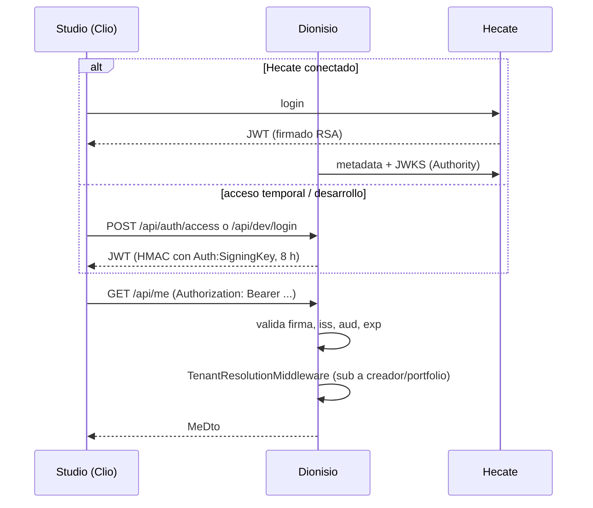

# JWT y autenticación con Bearer

> Un JWT es un token firmado con *claims* (quién eres, para qué API, hasta cuándo); el cliente lo manda en `Authorization: Bearer <token>` y la API lo valida sin guardar sesión. [[Itzamna.Dionisio]] valida tokens de [[Hecate]] o, mientras Hecate no está conectado, tokens propios firmados con una llave HMAC.

## Qué es y qué problema resuelve
- **JWT** (RFC 7519): `header.payload.firma` en Base64URL. El *payload* lleva claims como `sub` (sujeto), `iss` (emisor), `aud` (audiencia), `exp` (expiración), `email`, `name`.
- **Bearer** (RFC 6750): "quien porta el token tiene acceso". Se manda en cada petición.
- **Firma**: simétrica (HMAC, una llave compartida) o asimétrica (RSA/ECDSA, el proveedor firma con su llave privada y publica las públicas en un **JWKS**).

Resuelve autenticación *stateless* entre un front SPA y una API, y delegar el login a un proveedor de identidad.

## Cómo funciona por dentro
1. El cliente obtiene el token (proveedor de identidad o endpoint de login).
2. `JwtBearerHandler` lee el header, verifica firma, `iss`, `aud`, `exp` (con `ClockSkew`).
3. Con `Authority`, descarga la metadata OIDC y las llaves (JWKS) del proveedor y las cachea.
4. Crea un `ClaimsPrincipal` en `HttpContext.User`; la autorización decide si deja pasar.



## Cuándo usarla y cuándo no
### Ventajas
- Sin sesión en servidor: escala horizontalmente.
- Delegar el login a un IdP (Hecate) y validar con llaves públicas.
- Claims estándar que cualquier stack entiende.
### Desventajas
- No se puede "revocar" un JWT antes de `exp` sin infraestructura extra.
- Guardarlo en el navegador expone a XSS (decisión del front).
- Llave HMAC compartida: quien la tenga puede emitir tokens válidos.

## Alternativas
| Alternativa | En qué se diferencia |
|---|---|
| Cookies de sesión (servidor) | Revocables y `HttpOnly`; requieren estado o cookie cifrada y CSRF. |
| Tokens opacos + introspección | El token no lleva datos; la API consulta al IdP cada vez. |
| BFF (backend for frontend) | El navegador solo ve cookies; el BFF guarda los tokens. |
| Secreto local por header | Lo que usa [[Ocelotl.Hermes]] (`X-Iris-Session`) para una app de escritorio. |

## Cómo se usó en Itzamna
Configuración en `Itzamna.Dionisio/src/Itzamna.Dionisio.API/Program.cs` y `Auth/AuthOptions.cs`:
- Si `Auth:Authority` tiene valor → **modo Hecate** (llaves por JWKS). Si no, se exige `Auth:SigningKey` (mínimo 32 caracteres) → **modo local**. Si faltan ambos, la API no arranca.
- `MapInboundClaims = false`: los claims quedan con su nombre corto (`sub`, `email`, `name`), no las URIs de Microsoft.
- **Política por defecto**: todo requiere usuario autenticado; solo lo marcado `[AllowAnonymous]` es público (portfolio público, login de desarrollo, acceso temporal, OpenAPI/Scalar en Development, `/health`).

```csharp
options.TokenValidationParameters = new TokenValidationParameters
{
    ValidateIssuer = true,
    ValidIssuer = auth.Issuer,
    ValidateAudience = true,
    ValidAudience = auth.Audience,
    ValidateLifetime = true,
    ValidateIssuerSigningKey = true,
    ClockSkew = TimeSpan.FromMinutes(1),
    NameClaimType = "name",
    RoleClaimType = "role",
    IssuerSigningKey = useHecate ? null : new SymmetricSecurityKey(Encoding.UTF8.GetBytes(auth.SigningKey!))
};
```

Piezas:
- `LocalTokenService` emite tokens "con la misma forma que Hecate" (`sub = "dev|" + email`, `email`, `name`), HMAC-SHA256, 8 horas.
- `POST /api/dev/login` (solo Development, 404 fuera) y `POST /api/auth/access` (correo permitido + código; compara hashes con `CryptographicOperations.FixedTimeEquals`; mismo error para correo o código incorrecto). Ambos con rate limit `"auth"` ([[Rate limiting]]).
- `HttpCurrentUser : ICurrentUser` lee `sub/email/name` del token; "Nunca se toma del body".
- `TenantResolutionMiddleware` va **después** de `UseAuthentication` y antes de `UseAuthorization`: con el `sub` busca creador y portfolio ([[Multi-tenancy]]).
- Producción (`appsettings.Production.json`): `Issuer = Audience = "itzamna-dionisio"`, es decir, tokens emitidos por la propia API (acceso temporal); la llave va en App Settings de Azure.

Funcionalidad: [[Autenticación y acceso]]. En el front, modos `VITE_AUTH_MODE` (ver [[Autenticación y acceso - Front]]).

> [!note] Pendiente de confirmar
> Con Hecate el `Issuer` por defecto es `"hecate"` y la audiencia `"itzamna-dionisio"`; falta confirmar los valores reales cuando Hecate se conecte. Tampoco hay roles en uso todavía (`RoleClaimType = "role"` está configurado, sin políticas por rol).

> [!tip] Reutilizable
> El patrón "Authority vacío → llave HMAC local con tokens de la misma forma que el IdP" permite desarrollar y hacer demos sin el proveedor de identidad y cambiar a él solo con configuración.

## Errores comunes y buenas prácticas
- Dejar `MapInboundClaims` en `true` y buscar `"sub"`: el claim se llama distinto.
- `ValidateAudience = false` "para que funcione": cualquier token del mismo IdP entraría.
- Llave HMAC corta o en Git: Dionisio exige ≥32 caracteres y la de `appsettings.Development.json` es solo de desarrollo.
- Middleware de tenant antes de `UseAuthentication`: `User` aún no existe.
- Mensajes que revelan qué falló (correo vs código): `AccessController` responde lo mismo.

## Qué estudiar después
- [[Multi-tenancy]], [[Rate limiting]], [[Hecate]]
- OpenID Connect, PKCE, refresh tokens; cookies vs tokens en SPA.

## Documentación oficial
- https://www.rfc-editor.org/rfc/rfc7519
- https://www.rfc-editor.org/rfc/rfc6750
- https://learn.microsoft.com/aspnet/core/security/authentication/configure-jwt-bearer-authentication

## Autoevaluación

Contesta primero en voz alta o en papel; luego despliega la respuesta.

> [!question]- ¿Qué partes tiene un JWT?
> Tres segmentos Base64URL separados por puntos: **header** (`alg`, `kid`, `typ`), **payload** (claims como `sub`, `iss`, `aud`, `exp`) y **firma**. El payload solo está codificado, no cifrado.

> [!question]- ¿Qué debe validar un API al recibir un JWT?
> Firma con la llave correcta y algoritmo esperado, `iss` (emisor), `aud` (que sea para este API), `exp`/`nbf` con poca tolerancia de reloj y, si aplica, scopes o roles.

> [!question]- Error común: poner datos sensibles en el payload. ¿Por qué no?
> Cualquiera con el token puede decodificarlo con Base64. Solo van identificadores y permisos necesarios.

> [!question]- ¿Qué es el ataque `alg: none` o la confusión de algoritmos?
> Aceptar el algoritmo que dice el header del token: un atacante pone `none` o usa la llave pública RSA como secreto HMAC. Se evita fijando los algoritmos permitidos en el validador.

## Práctica

- [[Lab 1 - Decodificar y validar un JWT]]

