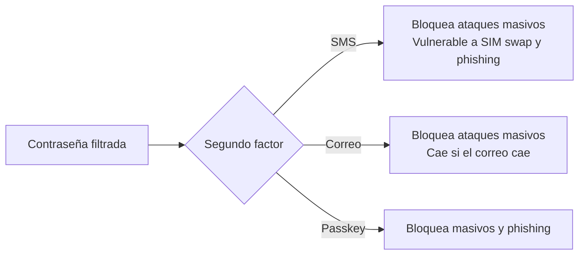

# MFA - SMS y correo (factores débiles)

Parte de: [[MFA]]

> [!info] Cómo avanzar
> `progreso`: **pendiente** → **viendo** (estudiando) → **visto** (contestaste la autoevaluación sin abrir las respuestas) → **dominado** (hiciste el laboratorio o lo aplicaste de verdad).

## Contenido

### Qué es
Enviar un **código de un solo uso** por **SMS** o por **correo electrónico** es la forma más extendida de segundo factor porque no requiere instalar nada. Se consideran **factores débiles**: mejoran mucho frente a no tener MFA, pero tienen vulnerabilidades conocidas que otros métodos (TOTP, passkeys) no tienen. NIST, en su guía SP 800-63B, clasifica la autenticación por red telefónica pública como **restringida**: se puede usar, pero con evaluación de riesgo y ofreciendo alternativas.

### Cómo funciona
1. El usuario escribe usuario y contraseña.
2. El servidor genera un código aleatorio (6 a 8 dígitos), lo guarda con su hash, vencimiento y contador de intentos, y lo envía por SMS o correo.
3. El usuario lo escribe; el servidor compara, verifica vigencia y lo marca como usado.

**Por qué el SMS es débil:**
- **SIM swapping**: el atacante convence o soborna a la compañía telefónica para transferir el número de la víctima a una SIM suya (portabilidad fraudulenta). A partir de ahí recibe todos los SMS. Es un ataque frecuente contra cuentas bancarias y de criptomonedas.
- **Interceptación de red**: debilidades en la señalización telefónica (SS7) y malware en el teléfono que lee SMS.
- **Phishing**: igual que TOTP, un sitio falso pide el código y lo usa en el real al instante. Además, muchos usuarios dictan códigos por teléfono a "soporte" falso.
- **Dependencia del operador**: retrasos, falta de cobertura, números reciclados que llegan a otra persona, costos por mensaje.

**Códigos por correo.** Comparten el problema de phishing y añaden uno: **si el correo de la cuenta está comprometido, el factor también**. Y el correo suele ser justo el canal de recuperación de contraseña, así que contraseña y "segundo factor" terminan dependiendo de la misma cuenta.



**¿Es mejor que nada?** Sí, claramente. Los ataques más comunes (relleno de credenciales con contraseñas filtradas en otros sitios, rociado de contraseñas) se automatizan contra miles de cuentas; un SMS los frena porque el atacante no tiene el teléfono de cada víctima. SIM swapping y phishing dirigido cuestan esfuerzo y se reservan para objetivos de valor. Por eso: SMS como mínimo para el público general, y TOTP o passkeys para cuentas de alto valor y administradores.

### Ejemplo
Generación y verificación de un código por correo en Xolotl.Hecate (para verificar el correo o como factor de respaldo):

```csharp
public sealed class CodigoUnSoloUso(IGuardarCodigo guardar, IObtenerCodigo obtener, TimeProvider reloj)
{
    public async Task<string> GenerarAsync(int usuarioId, string proposito, CancellationToken ct)
    {
        var codigo = RandomNumberGenerator.GetInt32(0, 1_000_000).ToString("D6"); // aleatorio criptográfico
        var hash = SHA256.HashData(Encoding.UTF8.GetBytes($"{usuarioId}:{proposito}:{codigo}"));
        await guardar.EjecutarAsync(usuarioId, proposito, hash,
            expiraUtc: reloj.GetUtcNow().AddMinutes(10), ct); // invalida códigos anteriores del mismo propósito
        return codigo; // se envía por correo; nunca se registra en logs
    }

    public async Task<bool> VerificarAsync(int usuarioId, string proposito, string codigo, CancellationToken ct)
    {
        var registro = await obtener.EjecutarAsync(usuarioId, proposito, ct);
        if (registro is null || registro.Usado || registro.ExpiraUtc < reloj.GetUtcNow() || registro.Intentos >= 5)
            return false;

        var hash = SHA256.HashData(Encoding.UTF8.GetBytes($"{usuarioId}:{proposito}:{codigo}"));
        var ok = CryptographicOperations.FixedTimeEquals(hash, registro.Hash);
        await obtener.RegistrarIntentoAsync(registro.Id, marcarUsado: ok, ct);
        return ok;
    }
}
```

Puntos clave:
- **Vida corta** (5 a 10 minutos) y **un solo uso**.
- **Intentos limitados** por código y por cuenta (6 dígitos son solo un millón de combinaciones).
- **Propósito ligado**: un código de "verificar correo" no sirve para "iniciar sesión".
- **Mensaje claro**: "Nunca te pediremos este código por teléfono".
- **Límite de envíos** por usuario y por IP para evitar abuso (y costos de SMS: hay fraudes que generan miles de SMS a números premium, conocido como *SMS pumping*).

### Cuándo usarlo y cuándo no
- **SMS**: segundo factor mínimo para público general cuando no hay alternativa, o como uno más de varios métodos.
- **Correo**: verificar la dirección, notificaciones, recuperación con controles adicionales. Como segundo factor solo si el correo no es también el canal de recuperación.
- **No**: como único MFA para administradores, cuentas financieras o acceso a producción. Usa TOTP o passkeys (ver [[MFA - TOTP y apps autenticadoras]] y [[MFA - passkeys y WebAuthn]]).

### Errores comunes
1. **Códigos sin vencimiento o reutilizables.** Amplían la ventana de ataque.
2. **Sin límite de intentos ni de envíos.** Fuerza bruta y facturas de SMS inesperadas.
3. **Generar con `Random`** en lugar de `RandomNumberGenerator`. Los códigos se vuelven predecibles.
4. **Usar el mismo correo como factor y como recuperación.** Un solo punto de falla.
5. **Permitir cambiar el número de teléfono** sin reautenticación fuerte. Es el primer paso de una toma de cuenta.

### Para profundizar
- [NIST SP 800-63B: autenticadores fuera de banda](https://pages.nist.gov/800-63-4/sp800-63b.html)
- [OWASP: Multifactor Authentication Cheat Sheet](https://cheatsheetseries.owasp.org/cheatsheets/Multifactor_Authentication_Cheat_Sheet.html)
- [Microsoft Learn: RandomNumberGenerator.GetInt32](https://learn.microsoft.com/dotnet/api/system.security.cryptography.randomnumbergenerator.getint32)

## Autoevaluación

Contesta primero en voz alta o en papel; luego despliega la respuesta.

> [!question]- ¿Por qué el SMS se considera un factor débil?
> Es vulnerable a SIM swapping, interceptación y phishing; el código además puede reenviarse a un sitio falso.

> [!question]- ¿Es mejor SMS que no tener MFA?
> Sí, frena ataques masivos con contraseñas filtradas, pero para cuentas de alto valor conviene app autenticadora o passkeys.

> [!question]- ¿Qué cuidar con los códigos por correo?
> Que expiren pronto, sean de un solo uso y con intentos limitados; si el correo de la cuenta está comprometido, el factor también.

