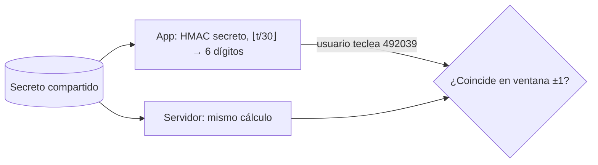

# MFA - TOTP y apps autenticadoras

Parte de: [[MFA]]

> [!info] Cómo avanzar
> `progreso`: **pendiente** → **viendo** (estudiando) → **visto** (contestaste la autoevaluación sin abrir las respuestas) → **dominado** (hiciste el laboratorio o lo aplicaste de verdad).

## Contenido

### Qué es
**TOTP** (Time-based One-Time Password, RFC 6238) es el algoritmo de los códigos de 6 dígitos que cambian cada 30 segundos en apps como Microsoft Authenticator, Google Authenticator, Authy o el gestor de contraseñas. Es un factor de tipo "algo que tienes": el dispositivo con el secreto. Es más fuerte que SMS porque no depende de la red telefónica, pero **no** es resistente a phishing.

### Cómo funciona
**Registro (una vez):**
1. El servidor genera un **secreto aleatorio** (por ejemplo 20 bytes) y lo guarda asociado al usuario (cifrado).
2. Lo muestra como **código QR** con una URI `otpauth://totp/Emisor:usuario?secret=BASE32&issuer=Emisor&digits=6&period=30`. El secreto va en **Base32**.
3. El usuario lo escanea con la app; la app guarda el secreto.
4. El usuario escribe un código para **confirmar** que quedó bien configurado antes de activarlo.

**Cada login:**
1. App y servidor calculan, cada uno por su lado, el contador `T = ⌊tiempo_unix / 30⌋`.
2. Calculan `HMAC-SHA1(secreto, T)` (HOTP, RFC 4226, aplicado a ese contador).
3. **Truncamiento dinámico**: toman 4 bytes de una posición que indica el último nibble del HMAC, los convierten a entero de 31 bits y sacan `mod 10^6` para obtener 6 dígitos.
4. Si el código del usuario coincide con el del servidor, es válido.



Como depende del reloj, servidor y teléfono deben tener la hora sincronizada (NTP). Por eso el servidor acepta una **ventana** pequeña: el intervalo actual y uno antes y uno después (±30 s).

**¿Protege contra phishing?** No del todo. Un sitio falso que imita el login pide usuario, contraseña y el código TOTP, y los usa **de inmediato** en el sitio real a través de un proxy (herramientas como Evilginx automatizan esto). El código vale 30 a 90 segundos, suficiente. TOTP frena el robo de contraseñas reutilizadas, no el phishing dirigido.

### Ejemplo
Implementación verificable en Python (para entender el algoritmo):

```python
import base64, hmac, hashlib, struct, time

def totp(secreto_b32: str, t: float | None = None, paso=30, digitos=6) -> str:
    clave = base64.b32decode(secreto_b32, casefold=True)
    contador = int((time.time() if t is None else t) // paso)
    mac = hmac.new(clave, struct.pack(">Q", contador), hashlib.sha1).digest()
    desplazamiento = mac[-1] & 0x0F
    numero = struct.unpack(">I", mac[desplazamiento:desplazamiento + 4])[0] & 0x7FFFFFFF
    return str(numero % 10**digitos).zfill(digitos)

# Vector de prueba del RFC 6238 (SHA1, 8 dígitos, t=59): 94287082
secreto = base64.b32encode(b"12345678901234567890").decode()
print(totp(secreto, t=59, digitos=8))  # 94287082
```

En .NET, **ASP.NET Core Identity** ya incluye TOTP: `UserManager.GetAuthenticatorKeyAsync`, `ResetAuthenticatorKeyAsync` y `VerifyTwoFactorTokenAsync(usuario, TokenOptions.DefaultAuthenticatorProvider, codigo)`, más generación de códigos de recuperación con `GenerateNewTwoFactorRecoveryCodesAsync`. Para Xolotl.Hecate fuera de Identity, el paquete Otp.NET es una opción común.

Detalles de implementación que importan:

```csharp
// Pseudocódigo de verificación robusta
if (intentosFallidos >= 5) return Bloquear();
var paso = ObtenerPasoValido(secreto, codigo, ventana: 1); // devuelve el contador que coincidió o null
if (paso is null) { RegistrarFallo(); return Invalido(); }
if (paso <= ultimoPasoUsado) return Invalido();            // impide reutilizar el mismo código
GuardarUltimoPasoUsado(paso);
return Valido();
```

### Cuándo usarlo y cuándo no
- **Sí**: segundo factor general para clientes y empleados, respaldo cuando no hay passkey, sistemas sin dependencia de telefonía.
- **No como única defensa** en cuentas de alto valor expuestas a phishing dirigido: prefiere passkeys (ver [[MFA - passkeys y WebAuthn]]).
- **Mejor que SMS** casi siempre (ver [[MFA - SMS y correo (factores débiles)]]).

### Errores comunes
1. **Guardar el secreto en claro.** Si se filtra la base, el atacante genera códigos de todos. Cífralo (Data Protection o Key Vault).
2. **Ventanas amplias** (±5 minutos). Aumentan la vida útil de un código robado. Usa ±1 paso.
3. **Permitir reutilizar el mismo código** en su ventana. Guarda el último paso usado.
4. **Sin límite de intentos.** Un millón de combinaciones se pueden probar por fuerza bruta en pocas horas sin límite. Bloquea tras pocos fallos.
5. **Sin códigos de recuperación.** El usuario cambia de teléfono y pierde la cuenta, o soporte termina reseteando sin verificar.

### Para profundizar
- [RFC 6238: TOTP](https://www.rfc-editor.org/rfc/rfc6238)
- [RFC 4226: HOTP](https://www.rfc-editor.org/rfc/rfc4226)
- [Microsoft Learn: generar QR para apps autenticadoras TOTP en ASP.NET Core](https://learn.microsoft.com/aspnet/core/security/authentication/identity-enable-qrcodes)

## Autoevaluación

Contesta primero en voz alta o en papel; luego despliega la respuesta.

> [!question]- ¿Cómo funciona TOTP?
> Servidor y app comparten un secreto (vía código QR). Ambos calculan `HMAC(secreto, ⌊tiempo / 30 s⌋)` y lo truncan a 6 dígitos (RFC 6238). Coincide si los relojes están sincronizados.

> [!question]- ¿TOTP protege contra phishing?
> No del todo: un sitio falso puede pedir el código y usarlo de inmediato en el sitio real (proxy en tiempo real).

> [!question]- ¿Qué cuidar al implementarlo?
> Guardar el secreto cifrado, aceptar una ventana pequeña (±1 intervalo), impedir reutilizar el mismo código, limitar intentos y ofrecer códigos de recuperación.

