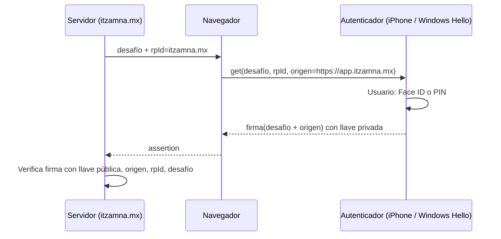

# MFA - passkeys y WebAuthn

Parte de: [[MFA]]

> [!info] Cómo avanzar
> `progreso`: **pendiente** → **viendo** (estudiando) → **visto** (contestaste la autoevaluación sin abrir las respuestas) → **dominado** (hiciste el laboratorio o lo aplicaste de verdad).

## Contenido

### Qué es
Una **passkey** es una credencial **FIDO2 / WebAuthn**: un **par de llaves criptográficas** creado para un sitio concreto. La **llave privada** se queda en el dispositivo del usuario (el chip seguro del iPhone, el TPM de Windows, una llave de seguridad física o un gestor de contraseñas que las sincroniza) y el **servidor guarda la llave pública**. Para iniciar sesión, el dispositivo firma un desafío con la privada, y el usuario lo autoriza con biometría o PIN.

**WebAuthn** es la API del navegador (estándar del W3C) y **CTAP** es el protocolo entre el navegador y el autenticador; juntos forman FIDO2. "Passkey" es el nombre comercial para credenciales FIDO2 detectables (que pueden iniciar sesión sin escribir el usuario) y, a menudo, sincronizadas entre dispositivos.

### Cómo funciona
**Registro:**
1. El servidor genera un **desafío** aleatorio y lo manda con el identificador del sitio (**RP ID**, por ejemplo `itzamna.mx`) y datos del usuario.
2. El navegador llama a `navigator.credentials.create()`. El autenticador pide verificación (Face ID, huella, PIN de Windows Hello), crea un par de llaves **para ese RP ID** y devuelve la **llave pública**, un **id de credencial** y una firma.
3. El servidor valida y guarda: llave pública, id de credencial, contador de firmas, usuario.

**Autenticación:**
1. El servidor manda un desafío nuevo.
2. `navigator.credentials.get()`: el autenticador busca credenciales para ese RP ID, el usuario se verifica y el autenticador **firma** el desafío junto con el **origen** que reporta el navegador.
3. El servidor verifica la firma con la llave pública guardada, que el origen y el RP ID sean los suyos y que el desafío sea el que emitió.



**Por qué resisten el phishing.**
- La credencial está **ligada al dominio** (RP ID). Si el usuario cae en `itzamna-mx.com`, el navegador no ofrece la passkey de `itzamna.mx`: para el autenticador, es otro sitio y no hay credencial que usar.
- El navegador, no el usuario, informa el origen. Un proxy de phishing no puede falsificarlo.
- **No hay secreto que el usuario pueda teclear** o dictar por teléfono, así que tampoco hay nada que un atacante le pueda "pedir".

**Qué pasa si se filtra la base del servidor.** El servidor solo tiene llaves **públicas**, ids de credencial y contadores. Con eso no se puede firmar un desafío: la filtración **no** permite iniciar sesión. Compáralo con contraseñas (aun con hash, se pueden atacar fuera de línea) o con secretos TOTP (con ellos se generan códigos válidos).

### Ejemplo
Front de Itzamna.Clio (TypeScript) para iniciar sesión con passkey. Las opciones vienen del servidor y los binarios viajan en Base64URL; los navegadores modernos traen `PublicKeyCredential.parseRequestOptionsFromJSON` para convertirlas (verifica soporte; si no, conviértelas a mano):

```ts
async function iniciarConPasskey() {
  const opcionesJson = await (await fetch("/api/passkeys/opciones-login", { method: "POST" })).json();
  const opciones = PublicKeyCredential.parseRequestOptionsFromJSON(opcionesJson);

  const credencial = (await navigator.credentials.get({ publicKey: opciones })) as PublicKeyCredential;

  const r = await fetch("/api/passkeys/login", {
    method: "POST",
    headers: { "Content-Type": "application/json" },
    body: JSON.stringify(credencial.toJSON()) // el servidor valida firma, origen, rpId y desafío
  });
  if (r.ok) location.assign("/");
}
```

En el backend, **no implementes la verificación criptográfica a mano**: usa una librería mantenida. En .NET, la opción comunitaria más conocida es **Fido2NetLib** (`Fido2.AspNet`); y ASP.NET Core Identity en .NET 10 incorpora soporte de passkeys (Pendiente de confirmar el alcance exacto de la API en la versión que uses). Lo que se guarda por credencial:

```sql
CREATE TABLE dbo.Passkey (
    CredencialId   varbinary(1024) NOT NULL PRIMARY KEY,
    UsuarioId      int             NOT NULL,
    LlavePublica   varbinary(1024) NOT NULL,   -- COSE
    ContadorFirmas bigint          NOT NULL,
    Nombre         nvarchar(100)   NULL,       -- "iPhone de Ana"
    CreadaUtc      datetime2       NOT NULL,
    UltimoUsoUtc   datetime2       NULL
);
```

Nada de esta tabla es secreto. Permite al usuario registrar **varias** passkeys (teléfono, laptop, llave física) y nombrarlas para poder revocarlas.

### Cuándo usarlo y cuándo no
- **Sí**: como método principal sin contraseña o como segundo factor fuerte, sobre todo para administradores y cuentas de alto valor. Es la mejor defensa disponible contra phishing.
- **Planea la recuperación**: si el usuario pierde su único dispositivo con passkeys no sincronizadas, necesita otra passkey registrada o un proceso de recuperación verificado.
- **Considera el público**: dispositivos muy viejos o compartidos pueden no soportarlo; ofrece un respaldo (TOTP).

### Errores comunes
1. **RP ID mal elegido.** Si usas `app.itzamna.mx`, las passkeys no servirán en `admin.itzamna.mx`. Usa el dominio registrable si quieres compartirlas entre subdominios.
2. **Validar a mano** la estructura CBOR y las firmas. Usa una librería.
3. **Reutilizar desafíos** o no expirarlos. Deben ser aleatorios, de un solo uso y de vida corta.
4. **Permitir solo una passkey por usuario.** Perder el dispositivo bloquea la cuenta.
5. **Recuperación por SMS** que anula la ventaja: el atacante ataca la recuperación en lugar de la passkey.

### Para profundizar
- [W3C: Web Authentication Level 3](https://www.w3.org/TR/webauthn-3/)
- [passkeys.dev: guía para desarrolladores](https://passkeys.dev/)
- [MDN: Web Authentication API](https://developer.mozilla.org/en-US/docs/Web/API/Web_Authentication_API)
- [FIDO Alliance: Passkeys](https://fidoalliance.org/passkeys/)

## Autoevaluación

Contesta primero en voz alta o en papel; luego despliega la respuesta.

> [!question]- ¿Qué es una passkey?
> Una credencial **WebAuthn/FIDO2**: un par de llaves donde la privada se queda en el dispositivo o gestor y el servidor guarda la pública. El usuario la desbloquea con biometría o PIN.

> [!question]- ¿Por qué resisten el phishing?
> La credencial está ligada al **dominio** (relying party ID); el navegador no la usa en un sitio falso con otro dominio, y no hay secreto que el usuario pueda teclear.

> [!question]- ¿Qué guarda el servidor y qué pasa si se filtra su base de datos?
> La llave pública, el id de credencial y un contador. Una filtración no permite iniciar sesión, porque no contiene secretos.

