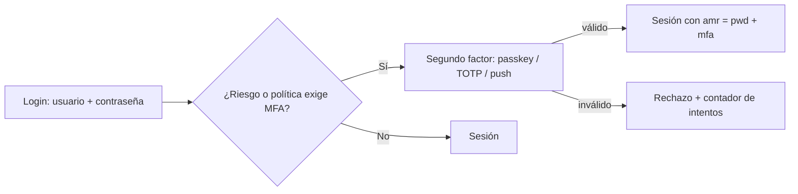

# MFA

Parte de: [[02-Fundamentos/05 Autenticación y autorización/_Índice Autenticación y autorización|Autenticación y autorización]]

> [!info] Cómo avanzar
> `progreso`: **pendiente** → **viendo** (estudiando) → **visto** (contestaste la autoevaluación sin abrir las respuestas) → **dominado** (hiciste el laboratorio o lo aplicaste de verdad).

## Contenido

### Qué es
**MFA** (autenticación multifactor) es exigir **al menos dos factores de tipos distintos** para autenticar a alguien. Los tipos son:
- **Algo que sabes**: contraseña, PIN, respuesta secreta.
- **Algo que tienes**: teléfono con app autenticadora, llave de seguridad física, tarjeta.
- **Algo que eres**: huella, rostro (normalmente usada para desbloquear algo que tienes).

La idea es que robar un factor no baste. La mayoría de las cuentas comprometidas lo son por contraseñas filtradas, reutilizadas o adivinadas; un segundo factor de otro tipo frena casi todos esos ataques masivos.

Lo importante es que sean de **tipos distintos**. Contraseña más pregunta secreta **no es MFA**: ambos son "algo que sabes", y quien obtuvo uno (por phishing o filtración) a menudo obtiene el otro igual. Es un solo factor repetido.

### Cómo funciona
El panorama de métodos, de más débil a más fuerte, y dónde está el detalle de cada uno:

| Método | Tipo | Resistente a phishing | Nota |
|---|---|---|---|
| SMS o código por correo | Tienes | No | Ver [[MFA - SMS y correo (factores débiles)]] |
| TOTP (app autenticadora) | Tienes | No | Ver [[MFA - TOTP y apps autenticadoras]] |
| Notificación push con aprobación | Tienes | No (y sufre fatiga) | Mejor con *number matching* |
| Passkeys / llaves FIDO2 (WebAuthn) | Tienes (+ eres o sabes para desbloquear) | **Sí** | Ver [[MFA - passkeys y WebAuthn]] |

"Resistente a phishing" significa que, aunque el usuario caiga en un sitio falso que imita el login real, el atacante **no obtiene algo que pueda reutilizar** en el sitio real. Solo los métodos ligados criptográficamente al dominio (WebAuthn/passkeys, certificados) lo logran. Un código de 6 dígitos se puede pedir en el sitio falso y teclear en el real en segundos (phishing con proxy en tiempo real).



**Fatiga de MFA (push bombing).** El atacante ya tiene la contraseña e intenta iniciar sesión una y otra vez; la víctima recibe decenas de notificaciones "¿Aprobar inicio de sesión?" a las 3 a. m. y termina aprobando una para que paren, o porque cree que es un error. Ha sido la vía de entrada en incidentes conocidos. Mitigaciones:
- **Number matching**: la pantalla del login muestra un número que el usuario debe escribir en la app; aprobar sin ver la pantalla no sirve. Entra ID lo aplica en Microsoft Authenticator.
- **Contexto en la notificación**: app, ubicación aproximada, dispositivo.
- **Límites** de intentos y alertas por muchas solicitudes rechazadas.
- Mejor aún: métodos resistentes a phishing (passkeys), que no tienen "aprobar".

**Otros elementos de un buen diseño de MFA:**
- **Recuperación**: códigos de recuperación de un solo uso, o un segundo método registrado; si la recuperación es "te mando un SMS", ese es tu factor real más débil.
- **MFA adaptativo**: exigirlo siempre en acciones sensibles y según riesgo (dispositivo nuevo, país distinto).
- **Registro seguro**: registrar un nuevo factor requiere una sesión ya autenticada con MFA reciente.

### Ejemplo
En Xolotl.Hecate, la política de Itzamna podría ser:
1. Empleados: passkey obligatoria (o TOTP como respaldo), exigida en cada login nuevo y para acciones administrativas.
2. Clientes finales: contraseña + TOTP opcional, con passkey ofrecida como forma de entrar sin contraseña.
3. Acciones críticas (cambiar correo, ver datos fiscales): MFA en los últimos 10 minutos.

El ID token comunica qué se usó en `amr` y `acr`, y las apps lo verifican:

```csharp
builder.Services.AddAuthorization(o =>
    o.AddPolicy("MfaReciente", p => p.RequireAssertion(ctx =>
    {
        var amr = ctx.User.FindAll("amr").Select(c => c.Value);
        var authTime = ctx.User.FindFirst("auth_time")?.Value;
        var reciente = long.TryParse(authTime, out var t)
            && DateTimeOffset.UtcNow - DateTimeOffset.FromUnixTimeSeconds(t) < TimeSpan.FromMinutes(10);
        return reciente && amr.Any(v => v is "mfa" or "otp" or "hwk" or "swk");
    })));
```

Los valores de `amr` están estandarizados en el RFC 8176 (`pwd`, `otp`, `hwk`, `swk`, `mfa`, `sms`...); cada IdP decide cuáles emite, así que revisa los tuyos.

### Cuándo usarlo y cuándo no
- **Siempre**: cuentas administrativas, acceso a producción, Azure, Azure DevOps, correo corporativo, el propio IdP.
- **Muy recomendable**: cualquier cuenta con datos personales o dinero.
- **Elige el método por riesgo**: passkeys donde puedas; TOTP como respaldo; SMS solo como mínimo o recuperación.

### Errores comunes
1. **Dos factores del mismo tipo** (contraseña + pregunta secreta). No es MFA.
2. **Push sin number matching.** Expuesto a fatiga.
3. **Recuperación débil** que salta el MFA (soporte que resetea con nombre y fecha de nacimiento).
4. **MFA solo al iniciar sesión** y no en acciones críticas con sesiones largas.
5. **Excepciones permanentes** ("al director no le pidas MFA"). Son las cuentas que más buscan los atacantes.

### Para profundizar
- [OWASP: Multifactor Authentication Cheat Sheet](https://cheatsheetseries.owasp.org/cheatsheets/Multifactor_Authentication_Cheat_Sheet.html)
- [NIST SP 800-63B: Authentication and Lifecycle Management](https://pages.nist.gov/800-63-4/sp800-63b.html)
- [Microsoft Learn: number matching en notificaciones de MFA](https://learn.microsoft.com/entra/identity/authentication/how-to-mfa-number-match)

## Subtemas

- [[MFA - TOTP y apps autenticadoras]]
- [[MFA - passkeys y WebAuthn]]
- [[MFA - SMS y correo (factores débiles)]]

## Autoevaluación

Contesta primero en voz alta o en papel; luego despliega la respuesta.

> [!question]- ¿Qué es MFA?
> Autenticación multifactor: combinar al menos dos factores de tipos distintos: algo que **sabes** (contraseña), algo que **tienes** (teléfono, llave física) y algo que **eres** (biometría).

> [!question]- ¿Contraseña + pregunta secreta es MFA?
> No. Ambos son "algo que sabes": es un solo factor repetido.

> [!question]- ¿Qué es la fatiga de MFA (push bombing) y cómo se mitiga?
> El atacante con la contraseña manda muchas notificaciones hasta que la víctima aprueba una. Se mitiga con *number matching*, contexto de la solicitud y límites de intentos, o con métodos resistentes a phishing (passkeys).

## Progreso de los subtemas

```base
filters:
  and:
    - file.inFolder("02-Fundamentos/05 Autenticación y autorización/MFA")
    - file.name != "MFA"
views:
  - type: table
    name: Progreso
    order:
      - file.name
      - progreso
      - nivel
```
