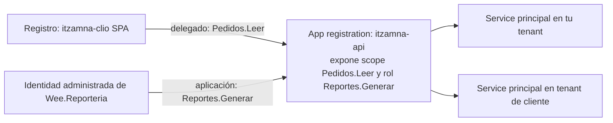

# Microsoft Entra ID

Parte de: [[02-Fundamentos/05 Autenticación y autorización/_Índice Autenticación y autorización|Autenticación y autorización]]

> [!info] Cómo avanzar
> `progreso`: **pendiente** → **viendo** (estudiando) → **visto** (contestaste la autoevaluación sin abrir las respuestas) → **dominado** (hiciste el laboratorio o lo aplicaste de verdad).

## Contenido

### Qué es
**Microsoft Entra ID** (antes **Azure Active Directory**, renombrado en 2023) es el servicio de identidad y acceso en la nube de Microsoft. Es el proveedor de identidad (IdP) de Microsoft 365, Azure y Azure DevOps, y puedes usarlo para tus propias apps como servidor de autorización **OAuth 2.0 / OpenID Connect** y como IdP **SAML**. Cada organización tiene su **tenant** (inquilino): un directorio con usuarios, grupos, aplicaciones y políticas.

No es lo mismo que Active Directory local (Windows Server): Entra ID habla protocolos web (OIDC, OAuth, SAML), no LDAP ni Kerberos de forma nativa; ambos se pueden sincronizar con Entra Connect.

### Cómo funciona
**Registro de aplicación vs aplicación empresarial.** Es la distinción que más confunde:

| Concepto | Qué es | Dónde vive | Qué configuras |
|---|---|---|---|
| **App registration** (objeto de aplicación) | La **definición global** de tu app | En el tenant donde la registras (el "hogar") | Client ID, redirect URIs, secretos o certificados, permisos que solicita, roles de app que expone, scopes de API |
| **Enterprise application** (service principal) | La **instancia** de esa app en un tenant concreto | En cada tenant donde se usa (incluido el hogar) | Qué usuarios o grupos pueden entrar, consentimientos otorgados, asignación de roles, SSO, acceso condicional |

Analogía: el registro es la "clase" y el service principal es el "objeto". Una app multi-tenant tiene **un** registro en tu tenant y **un service principal en cada** tenant cliente que la consiente. Las identidades administradas también son service principals.

**Permisos delegados vs de aplicación:**

| | Delegados | De aplicación |
|---|---|---|
| Quién actúa | La app **en nombre de un usuario** | La app **por sí misma**, sin usuario |
| Flujo típico | Authorization Code + PKCE, on-behalf-of | Client Credentials (ver [[OAuth 2.0 - Client Credentials]]) |
| Límite | Lo que el usuario puede hacer ∩ los scopes concedidos | Todo lo que el permiso abarca, normalmente en todo el tenant |
| Claim en el token | `scp` (scopes) | `roles` |
| Consentimiento | Usuario o administrador según el permiso | Siempre **administrador** |

Por ejemplo, `Mail.Read` delegado permite leer **el correo del usuario que inició sesión**; `Mail.Read` de aplicación permite leer **el correo de todos** los buzones del tenant. Por eso los de aplicación exigen consentimiento de administrador.

**Endpoints** (plataforma de identidad v2.0):

```text
https://login.microsoftonline.com/{tenant}/v2.0/.well-known/openid-configuration
https://login.microsoftonline.com/{tenant}/oauth2/v2.0/authorize
https://login.microsoftonline.com/{tenant}/oauth2/v2.0/token
```

`{tenant}` puede ser el GUID del tenant, un dominio verificado, `organizations`, `consumers` o `common`.



### Ejemplo
Proteger Itzamna.Dionisio con Entra ID usando `Microsoft.Identity.Web`:

1. **Registro del API** (`itzamna-api`): en *Expose an API* define el Application ID URI `api://itzamna-api` y el scope `Pedidos.Leer`; en *App roles* crea `Reportes.Generar` para aplicaciones.
2. **Registro de la SPA** (`itzamna-clio`): plataforma **SPA** con redirect `https://app.itzamna.mx/callback`; en *API permissions* agrega el permiso delegado `api://itzamna-api/Pedidos.Leer`.
3. **Wee.Reporteria**: su identidad administrada recibe el rol de aplicación `Reportes.Generar` (asignación de app role al service principal).

```json
// appsettings.json (sin secretos)
"AzureAd": {
  "Instance": "https://login.microsoftonline.com/",
  "TenantId": "<guid-del-tenant>",
  "ClientId": "<client-id-de-itzamna-api>",
  "Audience": "api://itzamna-api"
}
```

```csharp
builder.Services.AddAuthentication(JwtBearerDefaults.AuthenticationScheme)
    .AddMicrosoftIdentityWebApi(builder.Configuration.GetSection("AzureAd"));

builder.Services.AddAuthorization(o =>
{
    o.AddPolicy("PedidosLeer", p => p.RequireScope("Pedidos.Leer"));        // delegado (scp)
    o.AddPolicy("GenerarReportes", p => p.RequireRole("Reportes.Generar")); // aplicación (roles)
});
```

`RequireScope` viene de Microsoft.Identity.Web. La SPA usa MSAL.js para obtener tokens con `scopes: ["api://itzamna-api/Pedidos.Leer"]`.

### Cuándo usarlo y cuándo no
- **Sí**: apps internas de una organización que ya usa Microsoft 365, integración con Microsoft Graph, APIs en Azure llamadas por identidades administradas, Azure DevOps con conexiones de servicio federadas.
- **Para clientes externos (B2C)** Microsoft ofrece **Entra External ID**; revisa sus planes y límites antes de elegir (Pendiente de confirmar precios y nivel gratuito vigentes).
- **No necesariamente**: si ya tienes un IdP propio como Xolotl.Hecate para tus usuarios finales; puedes federarlo con Entra ID para empleados.

### Errores comunes
1. **Confundir registro con enterprise app.** Asignas usuarios en el registro y "no aparece la opción": la asignación está en la enterprise app.
2. **Pedir permisos de aplicación cuando bastaban delegados.** Acceso a todo el tenant y consentimiento de administrador innecesario.
3. **Validar `aud` contra el client ID equivocado.** En tokens v2.0, `aud` suele ser el client ID del API; revisa la versión del token (`accessTokenAcceptedVersion` en el manifiesto).
4. **Registrar la SPA como plataforma "Web".** El canje del código falla por CORS o termina usando Implicit.
5. **Secretos de cliente vencidos.** Tienen fecha de expiración; prefiere certificados o identidades administradas y monitorea vencimientos.

### Para profundizar
- [Microsoft Learn: ¿qué es Microsoft Entra ID?](https://learn.microsoft.com/entra/fundamentals/whatis)
- [Microsoft Learn: objetos de aplicación y entidades de servicio](https://learn.microsoft.com/entra/identity-platform/app-objects-and-service-principals)
- [Microsoft Learn: permisos y consentimiento](https://learn.microsoft.com/entra/identity-platform/permissions-consent-overview)

## Autoevaluación

Contesta primero en voz alta o en papel; luego despliega la respuesta.

> [!question]- ¿Qué es Microsoft Entra ID?
> El servicio de identidad en la nube de Microsoft (antes Azure Active Directory). Es el proveedor OIDC/OAuth 2.0 y SAML para Microsoft 365, Azure y apps propias.

> [!question]- ¿Qué diferencia hay entre *app registration* y *enterprise application* (service principal)?
> El **registro de aplicación** es la definición global de la app (client ID, redirect URIs, permisos). La **enterprise application** es su instancia en un tenant concreto, donde se asignan usuarios y consentimientos.

> [!question]- ¿Qué diferencia hay entre permisos delegados y de aplicación?
> **Delegados**: la app actúa en nombre de un usuario y se limita a lo que el usuario puede hacer (scopes). **De aplicación**: la app actúa por sí misma (Client Credentials, roles de app) y requiere consentimiento de un administrador.

