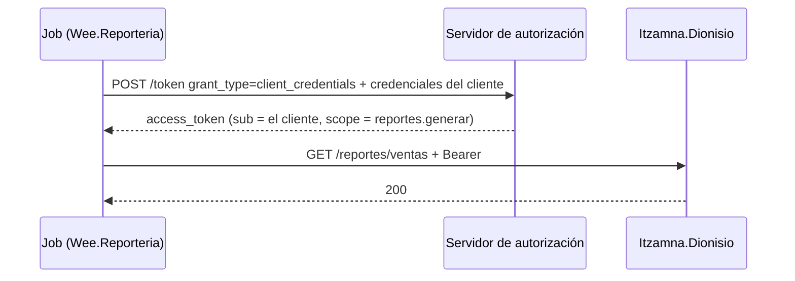

# OAuth 2.0 - Client Credentials

Parte de: [[OAuth 2.0]]

> [!info] Cómo avanzar
> `progreso`: **pendiente** → **viendo** (estudiando) → **visto** (contestaste la autoevaluación sin abrir las respuestas) → **dominado** (hiciste el laboratorio o lo aplicaste de verdad).

## Contenido

### Qué es
**Client Credentials** es el flujo de OAuth 2.0 para comunicación **máquina a máquina**: no hay usuario. Un servicio, job o demonio se autentica ante el servidor de autorización con **sus propias credenciales** (`client_id` más un secreto, un certificado o una identidad administrada) y recibe un token de acceso para llamar a otro API. Los permisos son de la **aplicación**, no de una persona.

### Cómo funciona


**Petición de token** (con secreto, como formulario):

```http
POST /connect/token HTTP/1.1
Host: id.xolotl.mx
Content-Type: application/x-www-form-urlencoded

grant_type=client_credentials&client_id=wee-reporteria&client_secret=...&scope=reportes.generar
```

También se puede mandar `client_id:client_secret` en `Authorization: Basic`. La respuesta:

```json
{ "access_token": "eyJ...", "token_type": "Bearer", "expires_in": 3600, "scope": "reportes.generar" }
```

Características:
- **No hay refresh token**: cuando el token expira, el servicio pide otro con sus credenciales. Lo correcto es **cachearlo** hasta poco antes de `expires_in`, no pedir uno por petición.
- En **Entra ID**, el scope se pide como `api://<id-del-api>/.default`, que significa "todos los permisos de aplicación ya concedidos por un administrador"; el token trae los permisos en el claim `roles` (ver [[Microsoft Entra ID]]).

**Alternativas más seguras al secreto compartido.** Un `client_secret` es una contraseña que hay que guardar, rotar y que puede filtrarse en un log o un repo. Opciones mejores:
- **Certificado o `private_key_jwt`** (RFC 7523): el cliente firma un JWT corto con su llave privada y lo manda como `client_assertion`. El servidor de autorización solo conoce la llave pública. La privada puede vivir en Key Vault sin salir de ahí.
- **Identidad administrada de Azure**: si el servicio corre en Azure (App Service, Functions, AKS, VM), Azure le da una identidad sin ningún secreto que tú manejes. `DefaultAzureCredential` obtiene el token por ti.
- **Federación de identidad de cargas de trabajo**: pipelines de Azure DevOps o GitHub Actions obtienen tokens de Entra ID con un token federado, sin secretos guardados.

### Ejemplo
Wee.Reporteria (job en Azure) llamando a Itzamna.Dionisio protegido por Entra ID, **sin secretos**, con identidad administrada:

```csharp
using Azure.Core;
using Azure.Identity;

public sealed class TokenHandler(TokenCredential credencial, string scope) : DelegatingHandler
{
    protected override async Task<HttpResponseMessage> SendAsync(HttpRequestMessage req, CancellationToken ct)
    {
        // La librería cachea y renueva el token automáticamente
        var token = await credencial.GetTokenAsync(new TokenRequestContext([scope]), ct);
        req.Headers.Authorization = new("Bearer", token.Token);
        return await base.SendAsync(req, ct);
    }
}

// Program.cs del job
builder.Services.AddHttpClient("dionisio", c => c.BaseAddress = new Uri("https://api.itzamna.mx"))
    .AddHttpMessageHandler(() => new TokenHandler(
        new DefaultAzureCredential(),               // en Azure: identidad administrada; local: tu login de az/VS
        "api://itzamna-api/.default"));
```

En el API, una policy exige el permiso de aplicación:

```csharp
o.AddPolicy("GenerarReportes", p => p.RequireRole("Reportes.Generar")); // llega en el claim roles
```

Si no estás en Azure y tu IdP es Xolotl.Hecate, usa `private_key_jwt` con el certificado en Key Vault; el secreto compartido queda como último recurso, guardado en Key Vault o en una variable secreta del pipeline de Azure DevOps.

### Cuándo usarlo y cuándo no
- **Sí**: jobs, demonios, microservicios que llaman a otros APIs por su cuenta, integraciones de backend.
- **No**: cuando la acción debe hacerse **en nombre de un usuario** (para que se respeten sus permisos y quede auditado quién fue): usa Authorization Code, o el flujo *on-behalf-of* entre APIs.
- **No** en apps públicas (SPA, móvil): no pueden guardar un secreto.

### Errores comunes
1. **Usarlo para saltarse permisos del usuario.** El API ve a la app, no a la persona; las auditorías pierden quién hizo qué.
2. **Secretos en el repo o en `appsettings.json`.** Usa identidad administrada, certificados o Key Vault.
3. **Pedir un token por cada petición.** Saturas el IdP y agregas latencia. Cachea hasta su expiración.
4. **Permisos de aplicación excesivos.** Un permiso de aplicación suele aplicar a **todos** los datos (por ejemplo, leer el correo de toda la organización). Concede lo mínimo.
5. **No rotar secretos** con fecha de expiración. En Entra ID los secretos vencen; si nadie los rota, la integración cae un viernes en la noche.

### Para profundizar
- [RFC 6749, sección 4.4 (Client Credentials Grant)](https://www.rfc-editor.org/rfc/rfc6749#section-4.4)
- [Microsoft Learn: flujo de credenciales de cliente en Microsoft Entra](https://learn.microsoft.com/entra/identity-platform/v2-oauth2-client-creds-grant-flow)
- [Microsoft Learn: identidades administradas para recursos de Azure](https://learn.microsoft.com/entra/identity/managed-identities-azure-resources/overview)

## Autoevaluación

Contesta primero en voz alta o en papel; luego despliega la respuesta.

> [!question]- ¿Cuándo se usa Client Credentials?
> Para comunicación de **máquina a máquina** sin usuario: un servicio o job pide un token con su `client_id` y su secreto (o certificado) para llamar a otro API.

> [!question]- ¿Cómo es la petición de token?
> ```http
> POST /connect/token
> Content-Type: application/x-www-form-urlencoded
>
> grant_type=client_credentials&client_id=svc-reportes&client_secret=...&scope=api.leer
> ```

> [!question]- ¿Qué alternativa al secreto compartido es más segura?
> Autenticar al cliente con certificado o `private_key_jwt`, o en Azure usar **identidades administradas**, para no tener secretos que rotar ni filtrar.

