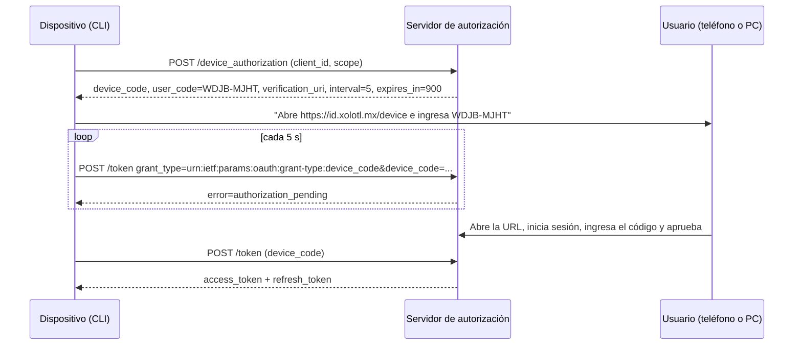

# OAuth 2.0 - Device Authorization Grant

Parte de: [[OAuth 2.0]]

> [!info] Cómo avanzar
> `progreso`: **pendiente** → **viendo** (estudiando) → **visto** (contestaste la autoevaluación sin abrir las respuestas) → **dominado** (hiciste el laboratorio o lo aplicaste de verdad).

## Contenido

### Qué es
El **Device Authorization Grant** (RFC 8628, también llamado *device code flow*) es el flujo de OAuth 2.0 para dispositivos que **no tienen navegador** o donde escribir es incómodo: televisores, consolas, herramientas de línea de comandos (CLIs), dispositivos IoT. El dispositivo muestra un **código corto** y una **URL**; el usuario abre esa URL en su teléfono o PC, inicia sesión ahí con normalidad (incluido MFA) y aprueba. Mientras, el dispositivo espera el token.

Lo usas a diario sin notarlo: `az login --use-device-code`, iniciar sesión en una app de streaming en la TV, o `gh auth login`.

### Cómo funciona


Pasos:
1. El dispositivo pide un código al endpoint de autorización de dispositivos. Recibe:
   - `device_code`: secreto para el dispositivo (el usuario no lo ve).
   - `user_code`: código corto para que el usuario lo escriba.
   - `verification_uri` (y opcionalmente `verification_uri_complete`, útil para un QR).
   - `interval`: cada cuántos segundos consultar; `expires_in`: vida del código.
2. Muestra al usuario la URL y el código.
3. **Consulta periódicamente** (polling) el endpoint de token con el `device_code`. Respuestas posibles:
   - `authorization_pending`: el usuario aún no aprueba; sigue esperando.
   - `slow_down`: consultas demasiado rápido; **aumenta el intervalo** 5 segundos.
   - `access_denied`: el usuario rechazó.
   - `expired_token`: el código venció; empieza de nuevo.
   - Éxito: recibe los tokens.
4. El usuario, en otro dispositivo, autentica y aprueba.

**Riesgo: phishing con códigos de dispositivo.** El atacante inicia el flujo él mismo, obtiene un `user_code` válido y se lo manda a la víctima ("Para ver el documento, entra a microsoft.com/devicelogin y escribe este código"). La víctima inicia sesión en el sitio **legítimo** y aprueba; el token le llega al dispositivo del atacante. Ni las passkeys lo impiden, porque la víctima sí está en el dominio real. Mitigaciones:
- Mostrar con claridad en la pantalla de aprobación **qué app** y **qué permisos** se aprueban, y advertir "solo aprueba si tú iniciaste esto en un dispositivo".
- Vida corta de los códigos.
- **Restringir** el flujo a las apps que de verdad lo necesitan; en Entra ID, bloquearlo con acceso condicional donde no se use.

### Ejemplo
Una CLI interna (`itz`) para que el equipo consulte Itzamna.Dionisio desde la terminal, en C#:

```csharp
using System.Net.Http.Json;
using System.Text.Json.Serialization;

var http = new HttpClient { BaseAddress = new Uri("https://id.xolotl.mx/") };
var inicio = await (await http.PostAsync("connect/deviceauthorization", new FormUrlEncodedContent(
    new Dictionary<string, string> { ["client_id"] = "itz-cli", ["scope"] = "pedidos.leer offline_access" })))
    .Content.ReadFromJsonAsync<RespuestaDispositivo>();

Console.WriteLine($"Abre {inicio!.VerificationUri} e ingresa el código {inicio.UserCode}");
var intervalo = TimeSpan.FromSeconds(inicio.Interval);

while (true)
{
    await Task.Delay(intervalo);
    var resp = await http.PostAsync("connect/token", new FormUrlEncodedContent(new Dictionary<string, string>
    {
        ["grant_type"] = "urn:ietf:params:oauth:grant-type:device_code",
        ["device_code"] = inicio.DeviceCode,
        ["client_id"] = "itz-cli"
    }));
    var cuerpo = await resp.Content.ReadFromJsonAsync<Dictionary<string, object>>();
    if (resp.IsSuccessStatusCode) { Console.WriteLine("Sesión iniciada."); break; }
    var error = cuerpo!["error"]?.ToString();
    if (error == "slow_down") intervalo += TimeSpan.FromSeconds(5);
    else if (error != "authorization_pending") { Console.WriteLine($"Falló: {error}"); break; }
}

sealed record RespuestaDispositivo(
    [property: JsonPropertyName("device_code")] string DeviceCode,
    [property: JsonPropertyName("user_code")] string UserCode,
    [property: JsonPropertyName("verification_uri")] string VerificationUri,
    [property: JsonPropertyName("interval")] int Interval);
```

En producción usarías MSAL o una librería OIDC que ya implementa el polling. Los tokens se guardan en el almacén seguro del sistema operativo, no en un archivo de texto.

### Cuándo usarlo y cuándo no
- **Sí**: CLIs, TVs, IoT, sesiones SSH en servidores sin navegador.
- **No**: si el dispositivo tiene navegador, usa Authorization Code + PKCE con redirección a `localhost` (más resistente a phishing).
- **No** como flujo por defecto habilitado para todas las apps del tenant.

### Errores comunes
1. **Ignorar `slow_down`.** El servidor puede bloquear al cliente; aumenta el intervalo.
2. **Polling sin respetar `interval` ni `expires_in`.** Carga innecesaria o bucles infinitos.
3. **Pantallas de aprobación ambiguas.** Facilitan el phishing de códigos.
4. **Habilitarlo en todo el tenant.** Restrínjelo a las apps que lo necesitan.
5. **Guardar tokens en archivos planos** en la máquina del usuario.

### Para profundizar
- [RFC 8628: OAuth 2.0 Device Authorization Grant](https://www.rfc-editor.org/rfc/rfc8628)
- [Microsoft Learn: flujo de código de dispositivo en Microsoft Entra](https://learn.microsoft.com/entra/identity-platform/v2-oauth2-device-code)
- [oauth.net: Device Authorization Grant](https://oauth.net/2/device-flow/)

## Autoevaluación

Contesta primero en voz alta o en papel; luego despliega la respuesta.

> [!question]- ¿Para qué sirve el Device Authorization Grant?
> Para dispositivos sin navegador o con entrada limitada (TV, CLI, IoT): el dispositivo muestra un código y una URL, y el usuario aprueba desde su teléfono o PC.

> [!question]- ¿Cómo sabe el dispositivo que el usuario ya aprobó?
> Consulta periódicamente el endpoint de token con el `device_code`; recibe `authorization_pending` hasta que el usuario aprueba (o `slow_down` si consulta muy rápido).

> [!question]- ¿Qué riesgo tiene este flujo?
> Phishing con códigos de dispositivo: un atacante envía su código a la víctima para que lo apruebe. Hay que mostrar claramente qué app y qué permisos se aprueban, y limitar su uso a donde haga falta.

