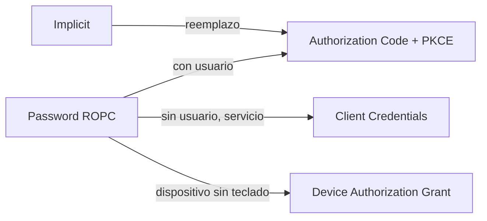

# OAuth 2.0 - flujos obsoletos (Implicit y Password)

Parte de: [[OAuth 2.0]]

> [!info] Cómo avanzar
> `progreso`: **pendiente** → **viendo** (estudiando) → **visto** (contestaste la autoevaluación sin abrir las respuestas) → **dominado** (hiciste el laboratorio o lo aplicaste de verdad).

## Contenido

### Qué es
Dos flujos de la especificación original de OAuth 2.0 (RFC 6749) que hoy están **desaconsejados** por la *Best Current Practice* de seguridad (RFC 9700) y **eliminados** en el borrador de OAuth 2.1:
- **Implicit** (`response_type=token`): el servidor de autorización devuelve el **token de acceso directamente en la URL** de redirección, sin paso de canje. Se creó para SPAs cuando los navegadores no permitían CORS.
- **Resource Owner Password Credentials** (ROPC, `grant_type=password`): la app **recibe la contraseña del usuario** y la manda al servidor de autorización para obtener un token.

Los encontrarás en sistemas viejos y en tutoriales antiguos; conviene reconocerlos y saber migrarlos.

### Cómo funciona
**Implicit.**

```text
https://app.itzamna.mx/callback#access_token=eyJ...&token_type=Bearer&expires_in=3600&state=xyz
```

Problemas:
- El token queda en el **fragmento de la URL**: puede terminar en el historial del navegador, en extensiones que leen URLs, en logs si alguna redirección lo convierte en query y, en ciertos casos, en el header `Referer`.
- **No hay forma de vincular el token al cliente** (no hay PKCE ni autenticación del cliente): si un atacante inyecta un token robado en el callback, la app lo acepta (*token injection*).
- No permite refresh tokens de forma segura, así que se renovaba con iframes ocultos, que hoy fallan por las restricciones a cookies de terceros.
- La razón original (no había CORS) ya no existe: hoy una SPA puede hacer el canje del código con `fetch`.

**Resource Owner Password Credentials.**

```http
POST /connect/token
grant_type=password&username=ana@ejemplo.mx&password=Secreta123&client_id=app-vieja
```

Problemas:
- **La app ve la contraseña.** Rompe el propósito de OAuth: delegar sin compartir credenciales.
- **Impide MFA, passkeys, SSO y acceso condicional**, porque el usuario no pasa por la página del IdP.
- **Entrena a los usuarios** a escribir su contraseña en cualquier formulario que se parezca al login, lo que favorece el phishing.
- No hay consentimiento ni la posibilidad de detectar riesgo en la interacción.



### Ejemplo
**Migrar una SPA con Implicit a Authorization Code + PKCE.** Supón una versión vieja de Itzamna.Clio con `oidc-client` antiguo configurado así:

```ts
// Antes (Implicit)
const config = {
  authority: "https://id.xolotl.mx",
  client_id: "itzamna-clio",
  redirect_uri: "https://app.itzamna.mx/callback",
  response_type: "id_token token",   // Implicit
  scope: "openid profile pedidos.leer"
};
```

Pasos:
1. **En el IdP**: habilita `authorization_code` para el cliente, exige PKCE y deshabilita Implicit. En Entra ID, registra la plataforma como **SPA** (no "Web" con Implicit), lo que habilita el canje del código con CORS.
2. **En el front**: cambia a una librería actual (por ejemplo `oidc-client-ts`, o MSAL.js 2 o posterior si usas Entra ID) con `response_type: "code"`. PKCE va integrado.

```ts
// Después (Authorization Code + PKCE) con oidc-client-ts
import { UserManager } from "oidc-client-ts";

export const userManager = new UserManager({
  authority: "https://id.xolotl.mx",
  client_id: "itzamna-clio",
  redirect_uri: "https://app.itzamna.mx/callback",
  response_type: "code",                 // PKCE automático (S256)
  scope: "openid profile pedidos.leer"
});
```

3. **Tokens**: deja de guardarlos en `localStorage`; manténlos en memoria o, mejor, migra a un BFF (ver [[Cookies vs localStorage vs sessionStorage]]).
4. **Renovación**: reemplaza el *silent renew* por refresh tokens rotativos o por el BFF.
5. **Prueba** en Safari y Firefox, y retira la configuración de Implicit cuando nadie la use.

**Migrar ROPC.** Una app de escritorio interna que pedía usuario y contraseña: cámbiala a Authorization Code + PKCE abriendo el navegador del sistema y recibiendo la redirección en `http://localhost:<puerto>`, o al Device Authorization Grant si no hay navegador. Si en realidad era un servicio sin usuario que usaba una "cuenta técnica" con contraseña, eso es Client Credentials.

### Cuándo usarlo y cuándo no
- **Implicit**: en ningún caso nuevo. Mantenlo solo mientras migras.
- **ROPC**: la BCP lo prohíbe. Aparece a veces en pruebas automatizadas heredadas o migraciones de sistemas muy viejos donde el IdP y la app son del mismo dueño; incluso ahí es mejor alternativa usar cuentas de prueba con flujos reales o Client Credentials.

### Errores comunes
1. **Copiar tutoriales viejos** con `response_type=token`. Revisa la fecha y usa Authorization Code + PKCE.
2. **Creer que una SPA "no puede" usar Authorization Code.** Con CORS y PKCE, sí, y es lo recomendado.
3. **Usar ROPC "porque el login propio se ve mejor".** Pierdes MFA, SSO y protección contra phishing; personaliza la página del IdP.
4. **Migrar el flujo pero seguir guardando tokens en `localStorage`.** Resuelves un problema y dejas otro.
5. **Dejar Implicit habilitado en el IdP** después de migrar. Deshabilítalo para cerrar la puerta.

### Para profundizar
- [RFC 9700: Best Current Practice for OAuth 2.0 Security (secciones sobre Implicit y Password)](https://www.rfc-editor.org/rfc/rfc9700)
- [Borrador OAuth 2.1](https://datatracker.ietf.org/doc/draft-ietf-oauth-v2-1/)
- [Microsoft Learn: migrar una SPA de Implicit a Authorization Code](https://learn.microsoft.com/entra/identity-platform/migrate-spa-implicit-to-auth-code)

## Autoevaluación

Contesta primero en voz alta o en papel; luego despliega la respuesta.

> [!question]- ¿Por qué se desaconseja el flujo Implicit?
> Devuelve el token de acceso en el fragmento de la URL: puede filtrarse (historial, `Referer`, extensiones) y no hay forma de vincularlo al cliente. Se reemplaza por Authorization Code con PKCE.

> [!question]- ¿Por qué se desaconseja Resource Owner Password Credentials?
> La app recibe la contraseña del usuario, lo que rompe el propósito de OAuth, impide MFA y SSO y entrena a los usuarios a dar su contraseña a terceros.

> [!question]- Tienes una SPA vieja con Implicit. ¿Cómo migras?
> Cambiar a `response_type=code` con PKCE (las librerías actuales como MSAL.js 2+ u oidc-client-ts lo soportan) y registrar la app como SPA en el proveedor.

