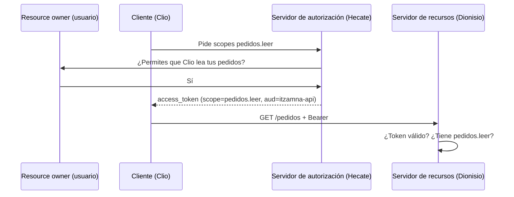

# OAuth 2.0 - roles y scopes

Parte de: [[OAuth 2.0]]

> [!info] Cómo avanzar
> `progreso`: **pendiente** → **viendo** (estudiando) → **visto** (contestaste la autoevaluación sin abrir las respuestas) → **dominado** (hiciste el laboratorio o lo aplicaste de verdad).

## Contenido

### Qué es
OAuth 2.0 define **cuatro roles** que participan en cualquier flujo y usa **scopes** para expresar qué permisos se piden y conceden. Tener claros los roles evita la confusión más común ("¿quién valida qué?") y los scopes son la herramienta para dar el mínimo privilegio a cada aplicación.

### Cómo funciona
**Los cuatro roles:**

| Rol | Qué es | En tu ecosistema |
|---|---|---|
| **Resource owner** | Quien puede conceder acceso al recurso; normalmente el usuario | El cliente final de Itzamna |
| **Cliente** | La aplicación que quiere acceder en su nombre | Itzamna.Clio, la app móvil de Hermes |
| **Servidor de autorización** | Autentica al usuario, obtiene su consentimiento y **emite tokens** | Xolotl.Hecate, Entra ID |
| **Servidor de recursos** | El API que **acepta y valida** los tokens | Itzamna.Dionisio |



"Cliente" en OAuth es la **aplicación**, no la persona. Y el cliente puede ser **confidencial** (puede guardar un secreto: un backend) o **público** (no puede: SPA, app móvil, escritorio).

**Scopes.** Un scope es un **permiso con nombre** que el cliente solicita en el parámetro `scope` (separados por espacio): `pedidos.leer pedidos.escribir`. El servidor de autorización decide cuáles conceder (puede conceder menos de los pedidos) y el token resultante los lleva, normalmente en el claim `scope` o `scp` (Entra ID). El API comprueba que el token tenga el scope requerido para cada operación.

Ejemplos reales: `calendar.readonly` en Google, `User.Read` y `Mail.Send` en Microsoft Graph, `openid profile email` en OIDC.

**Scopes vs roles.** Responden preguntas diferentes:
- **Scopes**: ¿qué puede hacer **esta app** en nombre del usuario? Limitan a la aplicación.
- **Roles**: ¿qué puede hacer **este usuario** en el sistema? Describen al usuario.

El acceso efectivo es la **intersección**. Si una usuaria es *Administradora* pero entró con una app a la que solo le concedió `pedidos.leer`, esa app no puede borrar pedidos aunque ella sí podría. Y si una app tiene `pedidos.escribir` pero el usuario es de solo lectura, tampoco. Un API serio verifica ambos.

### Ejemplo
Diseño de scopes para Itzamna.Dionisio y su verificación con policies:

| Scope | Permite |
|---|---|
| `pedidos.leer` | Consultar pedidos |
| `pedidos.escribir` | Crear y modificar pedidos |
| `reportes.generar` | Lanzar reportes (para Wee.Reporteria) |

```csharp
builder.Services.AddAuthorization(o =>
{
    o.AddPolicy("PedidosEscribir", p => p
        .RequireAuthenticatedUser()
        .RequireAssertion(ctx => TieneScope(ctx.User, "pedidos.escribir")) // la app
        .RequireRole("Vendedor", "Administrador"));                          // el usuario
});

static bool TieneScope(ClaimsPrincipal u, string scope) =>
    u.FindAll("scope").SelectMany(c => c.Value.Split(' ')).Contains(scope);
```

```csharp
[HttpPost]
[Authorize(Policy = "PedidosEscribir")]
public Task<IActionResult> Crear(CrearPedido cmd, CancellationToken ct) => ...;
```

Petición de autorización de Clio con los scopes:

```text
GET https://id.xolotl.mx/connect/authorize?response_type=code&client_id=itzamna-clio
  &redirect_uri=https%3A%2F%2Fapp.itzamna.mx%2Fcallback
  &scope=openid%20profile%20pedidos.leer%20pedidos.escribir
  &state=af0ifjsldkj&code_challenge=...&code_challenge_method=S256
```

### Cuándo usarlo y cuándo no
- **Scopes**: para limitar lo que cada app cliente puede hacer, sobre todo con apps de terceros o apps con distintos niveles de confianza.
- **Roles o permisos del usuario**: para reglas de negocio sobre personas (ver [[Roles, claims y policies]]).
- No modeles todo con scopes: no sirven para "este usuario solo ve su sucursal"; eso es autorización del dominio.

### Errores comunes
1. **Confundir cliente con usuario.** El cliente es la app; sus permisos (scopes) no son los del usuario.
2. **Scopes gigantes** (`api.todo`). Pierdes la capacidad de limitar apps. Separa por recurso y operación.
3. **Verificar solo scopes** y olvidar roles o la pertenencia del recurso (IDOR).
4. **Diferencias de claim**: Entra ID usa `scp` para scopes delegados y `roles` para permisos de aplicación. Revisa qué emite tu IdP.
5. **Pedir scopes "por si acaso".** Aumenta lo que se pierde si el token se filtra y asusta al usuario en la pantalla de consentimiento.

### Para profundizar
- [RFC 6749, sección 1.1 (roles) y 3.3 (scope)](https://www.rfc-editor.org/rfc/rfc6749#section-1.1)
- [Microsoft Learn: scopes y permisos en la plataforma de identidad](https://learn.microsoft.com/entra/identity-platform/scopes-oidc)
- [oauth.net: Scopes](https://oauth.net/2/scope/)

## Autoevaluación

Contesta primero en voz alta o en papel; luego despliega la respuesta.

> [!question]- ¿Cuáles son los cuatro roles de OAuth 2.0?
> **Resource owner** (usuario), **cliente** (la app), **servidor de autorización** (emite tokens) y **servidor de recursos** (el API que acepta los tokens).

> [!question]- ¿Qué es un scope?
> Un permiso con nombre que el cliente solicita (`pedidos.leer`, `calendar.readonly`). El token concedido lleva los scopes aprobados y el API los verifica.

> [!question]- ¿Qué diferencia hay entre scopes y roles?
> Los **scopes** limitan lo que la **app** puede hacer en nombre del usuario; los **roles** describen lo que el **usuario** puede hacer. Un API serio verifica ambos.

## Práctica

- [[Lab 2 - Authorization Code con PKCE contra un proveedor de prueba]]

