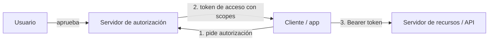

# OAuth 2.0

Parte de: [[02-Fundamentos/05 Autenticación y autorización/_Índice Autenticación y autorización|Autenticación y autorización]]

> [!info] Cómo avanzar
> `progreso`: **pendiente** → **viendo** (estudiando) → **visto** (contestaste la autoevaluación sin abrir las respuestas) → **dominado** (hiciste el laboratorio o lo aplicaste de verdad).

## Contenido

### Qué es
**OAuth 2.0** (RFC 6749) es un marco de **autorización delegada**: permite que una aplicación obtenga acceso **limitado** a recursos de un usuario en otro servicio **sin conocer su contraseña**. En lugar de compartir credenciales, el usuario aprueba ante un servidor de autorización y la app recibe un **token de acceso** con alcance (scopes) y caducidad.

El ejemplo clásico: una app de reportes quiere leer tu calendario de Google. Sin OAuth, le darías tu contraseña de Google (y podría hacer todo con tu cuenta). Con OAuth, Google te pregunta "¿Permitir que Reportes lea tu calendario?" y le entrega a la app un token que **solo** sirve para leer el calendario y caduca.

### Cómo funciona
OAuth define **roles**, **scopes** y **flujos** (grants). El detalle de cada pieza está en sus subtemas:
- [[OAuth 2.0 - roles y scopes]]: quién es quién (usuario, cliente, servidor de autorización, API) y cómo se expresan los permisos.
- [[OAuth 2.0 - Authorization Code con PKCE]]: el flujo recomendado para cualquier app con usuario.
- [[OAuth 2.0 - Client Credentials]]: servicio a servicio, sin usuario.
- [[OAuth 2.0 - Device Authorization Grant]]: televisores, CLIs y dispositivos sin teclado.
- [[OAuth 2.0 - flujos obsoletos (Implicit y Password)]]: lo que ya no se debe usar y por qué.



**Qué flujo usar hoy** (según la BCP de seguridad, RFC 9700, y el borrador de OAuth 2.1):

| Situación | Flujo |
|---|---|
| App con usuario: web con backend, SPA, móvil, escritorio | **Authorization Code + PKCE** |
| Servicio o job sin usuario | **Client Credentials** |
| Dispositivo sin navegador o con entrada limitada | **Device Authorization Grant** |
| Renovar tokens | **Refresh token** con rotación (ver [[Refresh tokens]]) |
| ~~Implicit~~ y ~~Resource Owner Password~~ | Desaconsejados |

**OAuth no es autenticación.** El token de acceso está pensado para el **API**, no para que la app cliente sepa quién inició sesión; OAuth no define un formato estándar para eso. Usar "tengo un access token, entonces el usuario es X" lleva a ataques (un token emitido para otra app podría usarse para entrar a la tuya). Para identidad existe **OpenID Connect**, una capa encima de OAuth que agrega el ID token (ver [[OpenID Connect]]).

**El parámetro `state`.** En los flujos con redirección, la app genera un valor aleatorio `state`, lo guarda (cookie o `sessionStorage`) y lo envía al servidor de autorización, que lo devuelve intacto en el callback. La app compara. Si no se valida, un atacante puede hacer que la víctima complete un callback con **el código del atacante**: la víctima queda conectada a la cuenta del atacante (por ejemplo, sube sus documentos a la nube del atacante). Es CSRF en el callback. `state` y PKCE lo evitan; además `state` sirve para recordar a qué página volver.

### Ejemplo
Itzamna.Clio (SPA) necesita llamar a Itzamna.Dionisio en nombre del usuario, y Wee.Reporteria necesita generar reportes nocturnos. Con Xolotl.Hecate como servidor de autorización:

- **Clio**: Authorization Code + PKCE. Pide `scope=openid profile pedidos.leer`. Recibe ID token (para saber quién es) y access token con `aud=itzamna-api`.
- **Reporteria**: Client Credentials con su `client_id` y certificado. Pide `scope=reportes.generar`. No hay usuario.
- **Dionisio**: valida `iss`, `aud`, `exp`, firma y scopes en cada petición.

Registro de clientes en el IdP (conceptual):

```json
[
  { "client_id": "itzamna-clio", "tipo": "public", "grant_types": ["authorization_code", "refresh_token"],
    "redirect_uris": ["https://app.itzamna.mx/callback"], "require_pkce": true,
    "scopes": ["openid", "profile", "pedidos.leer", "pedidos.escribir"] },
  { "client_id": "wee-reporteria", "tipo": "confidential", "grant_types": ["client_credentials"],
    "auth_method": "private_key_jwt", "scopes": ["reportes.generar"] }
]
```

Fíjate en las **redirect URIs exactas**: el servidor de autorización solo devuelve códigos a URIs registradas, comparadas de forma exacta. Comodines o comparaciones por prefijo han causado robos de códigos.

### Cuándo usarlo y cuándo no
- **Sí**: cuando una app necesita acceso a un API en nombre de un usuario, cuando varias apps y APIs comparten un IdP, o para integraciones con terceros (Google, Microsoft Graph).
- **Con OIDC**: siempre que además necesites saber quién es el usuario (login).
- **No hace falta**: una app monolítica con su propio login y su propia base de usuarios puede usar simplemente cookie de sesión. OAuth agrega complejidad que solo vale cuando hay delegación o varios sistemas.

### Errores comunes
1. **Usar OAuth como login** sin OIDC. Valida un ID token, no un access token.
2. **No validar `state`.** CSRF en el callback.
3. **Redirect URIs con comodines.** Permiten enviar el código a un dominio del atacante.
4. **Scopes demasiado amplios** ("todo"). Pide lo mínimo y separa lectura de escritura.
5. **Seguir usando Implicit o Password.** Migra a Authorization Code + PKCE.

### Para profundizar
- [RFC 6749: The OAuth 2.0 Authorization Framework](https://www.rfc-editor.org/rfc/rfc6749)
- [RFC 9700: Best Current Practice for OAuth 2.0 Security](https://www.rfc-editor.org/rfc/rfc9700)
- [Borrador OAuth 2.1](https://datatracker.ietf.org/doc/draft-ietf-oauth-v2-1/)
- [oauth.net: OAuth 2.0](https://oauth.net/2/)

## Subtemas

- [[OAuth 2.0 - roles y scopes]]
- [[OAuth 2.0 - Client Credentials]]
- [[OAuth 2.0 - Device Authorization Grant]]
- [[OAuth 2.0 - flujos obsoletos (Implicit y Password)]]

## Autoevaluación

Contesta primero en voz alta o en papel; luego despliega la respuesta.

> [!question]- ¿Qué problema resuelve OAuth 2.0?
> **Autorización delegada**: que una app obtenga acceso limitado a recursos de un usuario en otro servicio sin conocer su contraseña, mediante tokens con alcance y caducidad.

> [!question]- ¿OAuth 2.0 sirve para autenticar usuarios?
> No por sí solo: el token de acceso no dice a la app cliente quién inició sesión de forma estándar. Para eso está **OpenID Connect**, encima de OAuth 2.0.

> [!question]- ¿Qué flujos (grants) se recomiendan hoy?
> **Authorization Code con PKCE** para apps con usuario (web, SPA, móvil), **Client Credentials** para servicio a servicio y **Device Authorization** para dispositivos sin teclado. Implicit y Password están desaconsejados (OAuth 2.1 y la BCP de seguridad).

> [!question]- Error común: no validar el parámetro `state`. ¿Qué riesgo hay?
> CSRF en el callback: un atacante inyecta su propio código de autorización y la víctima queda conectada a la cuenta del atacante. `state` (y PKCE) lo evitan.

## Práctica

- [[Lab 2 - Authorization Code con PKCE contra un proveedor de prueba]]

## Progreso de los subtemas

```base
filters:
  and:
    - file.inFolder("02-Fundamentos/05 Autenticación y autorización/OAuth 2.0")
    - file.name != "OAuth 2.0"
views:
  - type: table
    name: Progreso
    order:
      - file.name
      - progreso
      - nivel
```
