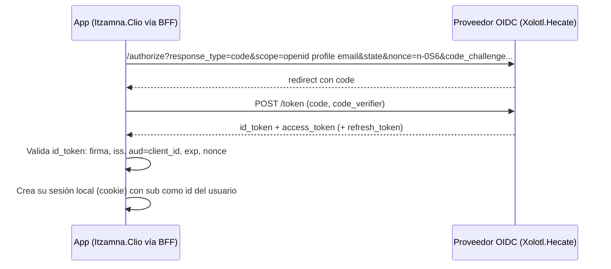

# OpenID Connect

Parte de: [[02-Fundamentos/05 Autenticación y autorización/_Índice Autenticación y autorización|Autenticación y autorización]]

> [!info] Cómo avanzar
> `progreso`: **pendiente** → **viendo** (estudiando) → **visto** (contestaste la autoevaluación sin abrir las respuestas) → **dominado** (hiciste el laboratorio o lo aplicaste de verdad).

## Contenido

### Qué es
**OpenID Connect (OIDC)** es una capa de **identidad** encima de OAuth 2.0. OAuth resuelve "esta app puede acceder a este API"; OIDC agrega "y este es el usuario que inició sesión, autenticado por este proveedor, en este momento". Es el protocolo detrás de "Iniciar sesión con Google/Microsoft" y de casi todos los SSO modernos.

Lo que agrega:
- El scope **`openid`**, que convierte una petición OAuth en una petición OIDC.
- El **ID token**: un JWT firmado con los datos de la autenticación.
- El endpoint **`userinfo`**, que devuelve claims del usuario con el access token.
- El **documento de descubrimiento** `/.well-known/openid-configuration` con todos los endpoints, llaves (`jwks_uri`) y capacidades del proveedor.
- Scopes estándar (`profile`, `email`, `offline_access`), logout y otras extensiones.

### Cómo funciona
El flujo es Authorization Code + PKCE (ver [[OAuth 2.0 - Authorization Code con PKCE]]) con `scope=openid ...` y un `nonce`:



**ID token vs access token:**

| | ID token | Access token |
|---|---|---|
| Para quién | La **app cliente** | El **API** |
| `aud` | El `client_id` de la app | El identificador del API |
| Qué dice | Quién se autenticó, cuándo y cómo | Qué permisos tiene el portador |
| Formato | Siempre JWT | JWT u opaco |
| Se envía al API | **No** | Sí, como Bearer |

Un ID token decodificado:

```json
{
  "iss": "https://id.xolotl.mx",
  "sub": "248289761001",
  "aud": "itzamna-clio",
  "exp": 1794243600,
  "iat": 1794240000,
  "auth_time": 1794239990,
  "nonce": "n-0S6_WzA2Mj",
  "amr": ["pwd", "otp"],
  "email": "ana@ejemplo.mx",
  "email_verified": true
}
```

- `sub` es el identificador **estable y único** del usuario dentro de ese emisor; úsalo (junto con `iss`) como llave, no el correo.
- `auth_time` y `amr` dicen cuándo y con qué métodos se autenticó (útil para exigir MFA reciente).

**El `nonce`.** La app genera un valor aleatorio, lo guarda (cookie de corta vida) y lo envía en la petición de autorización. El proveedor lo copia dentro del ID token. Al recibirlo, la app verifica que coincida. Así un ID token robado o de otra sesión no puede **reutilizarse** (replay) para iniciar sesión, porque traería otro `nonce`.

**Validación del ID token** (OIDC Core, sección 3.1.3.7): firma con las llaves del `jwks_uri`, `iss` exacto, `aud` contiene tu `client_id`, `exp` vigente, `nonce` igual al enviado y, si lo pediste, `auth_time` reciente.

### Ejemplo
Login OIDC en una app ASP.NET Core (patrón BFF para Itzamna.Clio):

```csharp
builder.Services.AddAuthentication(o =>
{
    o.DefaultScheme = CookieAuthenticationDefaults.AuthenticationScheme;
    o.DefaultChallengeScheme = OpenIdConnectDefaults.AuthenticationScheme;
})
.AddCookie(o => { o.Cookie.Name = "__Host-clio"; o.Cookie.SameSite = SameSiteMode.Lax; })
.AddOpenIdConnect(o =>
{
    o.Authority = "https://id.xolotl.mx";          // lee /.well-known/openid-configuration
    o.ClientId = "itzamna-clio-bff";
    o.ClientSecret = builder.Configuration["Oidc:ClientSecret"]; // desde Key Vault
    o.ResponseType = "code";                        // PKCE activado por defecto
    o.Scope.Add("profile");
    o.Scope.Add("email");
    o.Scope.Add("pedidos.leer");
    o.SaveTokens = true;                            // guarda access/refresh para llamar al API
    o.MapInboundClaims = false;                     // conserva sub, email, etc.
    o.TokenValidationParameters.NameClaimType = "name";
});
```

El handler valida firma, `iss`, `aud`, `exp` y `nonce` por ti, y emite la cookie local. Para llamar a Itzamna.Dionisio, el BFF usa el **access token** guardado (`await HttpContext.GetTokenAsync("access_token")`), nunca el ID token.

Para ver qué publica un proveedor, abre su descubrimiento, por ejemplo `https://accounts.google.com/.well-known/openid-configuration`.

### Cuándo usarlo y cuándo no
- **Sí**: login con un proveedor externo o corporativo, SSO entre varias apps propias, "Iniciar sesión con Google/Microsoft".
- **OAuth sin OIDC**: cuando solo necesitas acceso a un API y no te importa la identidad del usuario en la app (raro).
- **Alternativa empresarial**: SAML 2.0 sigue siendo común en integraciones corporativas viejas (ver [[SSO]]).

### Errores comunes
1. **Mandar el ID token al API** como si fuera access token. Su audiencia es la app.
2. **Identificar usuarios por correo.** Puede cambiar o repetirse entre proveedores; usa `iss` + `sub`.
3. **No validar `nonce`** en flujos donde el ID token viaja por el navegador.
4. **Validar a mano sin fijar algoritmos ni revisar `aud`.** Usa la librería del framework.
5. **Pedir todos los claims en el ID token.** Infla la cookie; pide lo justo y usa `userinfo` si hace falta.

### Para profundizar
- [OpenID Connect Core 1.0](https://openid.net/specs/openid-connect-core-1_0.html)
- [OpenID Connect Discovery 1.0](https://openid.net/specs/openid-connect-discovery-1_0.html)
- [Microsoft Learn: configurar OpenID Connect en ASP.NET Core](https://learn.microsoft.com/aspnet/core/security/authentication/configure-oidc-web-authentication)

## Autoevaluación

Contesta primero en voz alta o en papel; luego despliega la respuesta.

> [!question]- ¿Qué agrega OpenID Connect a OAuth 2.0?
> Una capa de **identidad**: el scope `openid`, el **ID token** (un JWT con quién se autenticó: `sub`, `iss`, `aud`, `nonce`, `auth_time`), el endpoint `userinfo` y el documento de descubrimiento `/.well-known/openid-configuration`.

> [!question]- ¿Qué diferencia hay entre el ID token y el access token?
> El **ID token** es para la app cliente ("quién inició sesión") y su `aud` es el `client_id`. El **access token** es para el API. No envíes el ID token a tus APIs como si fuera access token.

> [!question]- ¿Para qué sirve el `nonce`?
> La app lo genera, lo manda en la petición y verifica que regrese igual dentro del ID token: evita que se reutilice un ID token robado (replay).

## Práctica

- [[Lab 2 - Authorization Code con PKCE contra un proveedor de prueba]]

