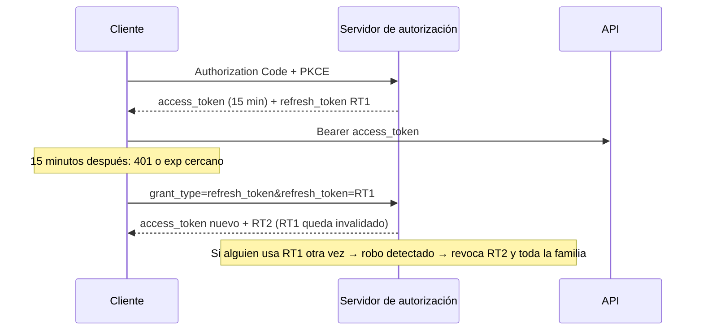

# Refresh tokens

Parte de: [[02-Fundamentos/05 Autenticación y autorización/_Índice Autenticación y autorización|Autenticación y autorización]]

> [!info] Cómo avanzar
> `progreso`: **pendiente** → **viendo** (estudiando) → **visto** (contestaste la autoevaluación sin abrir las respuestas) → **dominado** (hiciste el laboratorio o lo aplicaste de verdad).

## Contenido

### Qué es
Un **refresh token** es una credencial de vida más larga que el cliente usa para obtener **nuevos tokens de acceso** sin volver a pedirle al usuario que inicie sesión. Existe para poder tener tokens de acceso de vida corta (minutos) sin una mala experiencia. Se envía **solo al servidor de autorización** (al endpoint de token), nunca a los APIs.

### Cómo funciona


**Petición de renovación:**

```http
POST /connect/token
Content-Type: application/x-www-form-urlencoded

grant_type=refresh_token&refresh_token=RT1&client_id=itzamna-clio
```

**Rotación.** Cada vez que se usa un refresh token, el servidor entrega uno **nuevo** e invalida el anterior. Todos los tokens derivados del mismo login forman una **familia**. Si llega un refresh token ya usado, significa que dos partes lo tienen (el cliente legítimo y un atacante): el servidor **revoca la familia completa** y obliga a iniciar sesión. La BCP de seguridad de OAuth (RFC 9700) exige, para clientes públicos, rotación o refresh tokens ligados al remitente (sender-constrained, por ejemplo con DPoP).

**Otras protecciones:**
- Vida máxima absoluta (por ejemplo 14 o 30 días) y expiración por inactividad.
- Revocación al cerrar sesión, cambiar contraseña o detectar riesgo (RFC 7009, endpoint de revocación).
- Asociación al `client_id`: un refresh token de una app no sirve para otra.
- Solicitarlo solo cuando hace falta (en OIDC, scope `offline_access`).

**Dónde guardarlo.**
- **App web con backend o BFF**: en el **servidor**, asociado a la sesión. El navegador solo tiene una cookie `HttpOnly`. Es la opción preferida (ver [[Cookies vs localStorage vs sessionStorage]]).
- **SPA pura**: es un cliente público; si debe guardarlo, con rotación, vida corta y nunca en `localStorage` sin esas mitigaciones (un XSS lo roba y lo usa desde fuera hasta que expire).
- **Móvil**: en el almacenamiento seguro del sistema (Keychain en iOS, Keystore en Android).

### Ejemplo
Tabla de refresh tokens en Xolotl.Hecate (SQL Server) con rotación y detección de reutilización. Solo se guarda el **hash** del token:

```sql
-- Tokens/CanjearRefresh.sql (cuerpo de dbo.RefreshToken_Canjear)
DECLARE @familia uniqueidentifier, @usado datetime2, @expira datetime2;

SELECT @familia = FamiliaId, @usado = UsadoUtc, @expira = ExpiraUtc
FROM dbo.RefreshToken WITH (UPDLOCK, HOLDLOCK)
WHERE Hash = @Hash AND ClienteId = @ClienteId;

IF @familia IS NULL OR @expira <= SYSUTCDATETIME()
    THROW 50001, 'refresh_token_invalido', 1;

IF @usado IS NOT NULL
BEGIN
    -- Reutilización: posible robo. Revoca toda la familia.
    UPDATE dbo.RefreshToken SET RevocadoUtc = SYSUTCDATETIME() WHERE FamiliaId = @familia;
    THROW 50002, 'refresh_token_reutilizado', 1;
END

UPDATE dbo.RefreshToken SET UsadoUtc = SYSUTCDATETIME() WHERE Hash = @Hash;
INSERT dbo.RefreshToken (Hash, FamiliaId, ClienteId, UsuarioId, ExpiraUtc)
SELECT @HashNuevo, FamiliaId, ClienteId, UsuarioId, ExpiraUtc  -- conserva el vencimiento absoluto
FROM dbo.RefreshToken WHERE Hash = @Hash;
```

```csharp
// Generar y hashear (el token es aleatorio y largo, SHA-256 basta para el almacenamiento)
var token = Base64Url.EncodeToString(RandomNumberGenerator.GetBytes(32));
var hash = Convert.ToHexString(SHA256.HashData(Encoding.ASCII.GetBytes(token)));
```

`Base64Url` está en `System.Buffers.Text` (paquete `Microsoft.Bcl.Memory` o incluido desde .NET 9). Ambos errores (`50001`, `50002`) se traducen a `400` con `error=invalid_grant`, como pide OAuth.

### Cuándo usarlo y cuándo no
- **Sí**: clientes con usuario que necesitan acceso durante horas o días (web con BFF, móvil, escritorio).
- **No**: Client Credentials (el servicio pide un token nuevo con sus credenciales cuando lo necesita; no hay refresh token).
- **No** en clientes donde no puedas guardarlo con seguridad; ahí usa sesiones cortas y vuelve a autenticar.

### Errores comunes
1. **Enviar el refresh token a los APIs.** Solo va al endpoint de token.
2. **Sin rotación en clientes públicos.** Un refresh token robado vale semanas.
3. **Guardarlos en claro en la base.** Una fuga da acceso a todas las cuentas; guarda el hash.
4. **Rotación que extiende la vida absoluta** en cada uso: la sesión nunca termina. Conserva la fecha original.
5. **No revocar al cambiar contraseña o cerrar sesión.**

### Para profundizar
- [RFC 6749, sección 6 (Refreshing an Access Token)](https://www.rfc-editor.org/rfc/rfc6749#section-6)
- [RFC 9700: Best Current Practice for OAuth 2.0 Security](https://www.rfc-editor.org/rfc/rfc9700)
- [RFC 7009: Token Revocation](https://www.rfc-editor.org/rfc/rfc7009)

## Autoevaluación

Contesta primero en voz alta o en papel; luego despliega la respuesta.

> [!question]- ¿Para qué sirve un refresh token?
> Para obtener un nuevo token de acceso sin volver a pedir credenciales al usuario. Dura más que el token de acceso y solo se envía al servidor de autorización, nunca a los APIs.

> [!question]- ¿Qué es la rotación de refresh tokens?
> Cada uso entrega un refresh token nuevo e invalida el anterior. Si alguien reutiliza uno viejo, se detecta el robo y se revoca toda la familia.

> [!question]- ¿Dónde guardar el refresh token en una app web?
> Idealmente en el servidor (patrón BFF) o en una cookie `HttpOnly` y `Secure`. En una SPA pura, con rotación y vida corta, nunca en `localStorage` sin esas mitigaciones.

## Práctica

- [[Lab 2 - Authorization Code con PKCE contra un proveedor de prueba]]

