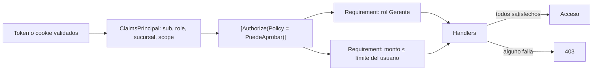

# Roles, claims y policies

Parte de: [[02-Fundamentos/05 Autenticación y autorización/_Índice Autenticación y autorización|Autenticación y autorización]]

> [!info] Cómo avanzar
> `progreso`: **pendiente** → **viendo** (estudiando) → **visto** (contestaste la autoevaluación sin abrir las respuestas) → **dominado** (hiciste el laboratorio o lo aplicaste de verdad).

## Contenido

### Qué es
Son las tres piezas con que ASP.NET Core modela la autorización:
- **Claim**: un dato sobre el usuario emitido por una fuente confiable, como un par tipo-valor: `sub=42`, `email=ana@ejemplo.mx`, `role=Vendedor`, `sucursal=MTY`. Los claims forman el `ClaimsPrincipal` (`HttpContext.User`), que se construye a partir de la cookie o del token validado.
- **Rol**: un tipo especial de claim que agrupa permisos con nombre (`Administrador`, `Soporte`). Se verifica con `[Authorize(Roles = "...")]` o `User.IsInRole`.
- **Policy**: una **regla de autorización con nombre** (`PuedeAprobarPagos`) compuesta de uno o más *requirements*, evaluados por *handlers*. Puede combinar roles, claims, scopes y lógica propia.

### Cómo funciona


**Por qué preferir policies sobre roles en atributos.**
- `[Authorize(Roles = "Admin,Gerente")]` repartido en 40 controllers es difícil de cambiar: si mañana "Supervisor" también puede, hay que editar 40 lugares.
- `[Authorize(Policy = "PuedeAprobar")]` **centraliza** la regla en `Program.cs` o en un handler. Cambia un lugar.
- Las policies pueden expresar lo que un rol no puede: "tiene el claim `departamento=Finanzas`", "tiene el scope `pagos.escribir`", "su cuenta tiene más de 30 días", "MFA reciente".

**Autorización basada en recursos.** Algunas reglas dependen del **dato** y no solo del usuario: "solo el dueño puede editar su pedido". No se pueden evaluar en un atributo porque el pedido aún no se ha cargado. Se resuelve con:
1. Un *requirement* y un `AuthorizationHandler<TRequirement, TRecurso>`.
2. Cargar el recurso en el endpoint.
3. Llamar a `IAuthorizationService.AuthorizeAsync(User, recurso, "EsDueno")`.

Esto evita IDOR (ver [[Autenticación vs autorización]]).

### Ejemplo
Policies y autorización por recurso en Itzamna.Dionisio:

```csharp
// Program.cs
builder.Services.AddAuthorization(o =>
{
    o.AddPolicy("SoloFinanzas", p => p.RequireClaim("departamento", "Finanzas"));
    o.AddPolicy("PuedeAprobar", p => p.RequireRole("Gerente", "Supervisor"));
    o.AddPolicy("EsDuenoDelPedido", p => p.AddRequirements(new EsDuenoRequirement()));
});
builder.Services.AddSingleton<IAuthorizationHandler, EsDuenoHandler>();
```

```csharp
public sealed class EsDuenoRequirement : IAuthorizationRequirement;

public sealed class EsDuenoHandler : AuthorizationHandler<EsDuenoRequirement, PedidoDto>
{
    protected override Task HandleRequirementAsync(
        AuthorizationHandlerContext ctx, EsDuenoRequirement req, PedidoDto pedido)
    {
        var clienteId = ctx.User.FindFirst("cliente_id")?.Value;
        if (clienteId is not null && pedido.ClienteId.ToString() == clienteId)
            ctx.Succeed(req);
        else if (ctx.User.IsInRole("Soporte"))
            ctx.Succeed(req); // soporte puede editar cualquier pedido
        return Task.CompletedTask;
    }
}
```

```csharp
[HttpPut("{id:int}")]
public async Task<IActionResult> Editar(int id, EditarPedido cmd,
    [FromServices] IObtenerPedido obtener, [FromServices] IAuthorizationService authz, CancellationToken ct)
{
    var pedido = await obtener.EjecutarAsync(id, ct);
    if (pedido is null) return NotFound();

    var resultado = await authz.AuthorizeAsync(User, pedido, "EsDuenoDelPedido");
    if (!resultado.Succeeded) return Forbid(); // 403 (o NotFound para no revelar)

    // ...validar con FluentValidation y ejecutar el procedimiento de edición
    return NoContent();
}
```

Si un handler no llama a `Succeed`, el requirement falla; si llama a `Fail`, falla aunque otro handler tenga éxito.

**Origen de los claims.** Vienen del IdP (en el token) o los agregas tú al crear la cookie. Para datos que cambian seguido (permisos finos), es mejor consultarlos en el servidor con caché que meterlos todos en el token; los tokens grandes son lentos y quedan desactualizados.

### Cuándo usarlo y cuándo no
- **Roles**: permisos gruesos y estables (Administrador, Soporte).
- **Claims y policies**: reglas de negocio con nombre, combinaciones, scopes de OAuth (ver [[OAuth 2.0 - roles y scopes]]).
- **Basada en recursos**: cualquier regla que dependa del dato (dueño, sucursal, estado del pedido).
- **Permisos dinámicos** administrados por usuarios finales: guarda permisos en base de datos y evalúalos en un handler.

### Errores comunes
1. **Roles en atributos por todos lados.** Imposible de mantener; usa policies con nombre.
2. **Olvidar la autorización por recurso.** IDOR.
3. **Meter todos los permisos en el token.** Tokens enormes y permisos viejos hasta que expiran.
4. **Nombres de claim cambiados por el mapeo.** `AddJwtBearer` mapea `role` a `ClaimTypes.Role` y `sub` a `NameIdentifier`; usa `MapInboundClaims = false` y ajusta `RoleClaimType` para que `IsInRole` funcione.
5. **Confiar en claims enviados por el cliente** (body o headers). Solo valen los del token o cookie validados.

### Para profundizar
- [Microsoft Learn: autorización basada en políticas](https://learn.microsoft.com/aspnet/core/security/authorization/policies)
- [Microsoft Learn: autorización basada en recursos](https://learn.microsoft.com/aspnet/core/security/authorization/resourcebased)
- [Microsoft Learn: autorización basada en claims](https://learn.microsoft.com/aspnet/core/security/authorization/claims)

## Autoevaluación

Contesta primero en voz alta o en papel; luego despliega la respuesta.

> [!question]- ¿Qué es un claim?
> Un dato sobre el usuario emitido por una fuente confiable: `sub`, `email`, `role`, `departamento`. Viaja en el token o la cookie y forma el `ClaimsPrincipal`.

> [!question]- ¿Qué ventaja tienen las policies sobre `[Authorize(Roles = "Admin")]`?
> Centralizan la regla con nombre (`[Authorize(Policy = "PuedeAprobar")]`) y pueden combinar roles, claims y lógica propia con requirements y handlers; si la regla cambia, se modifica en un lugar.

> [!question]- ¿Cómo autorizas "solo el dueño puede editar su pedido"?
> Con autorización basada en recursos: un `AuthorizationHandler<Requisito, Pedido>` y `IAuthorizationService.AuthorizeAsync(User, pedido, "EsDueno")` después de cargar el pedido.

