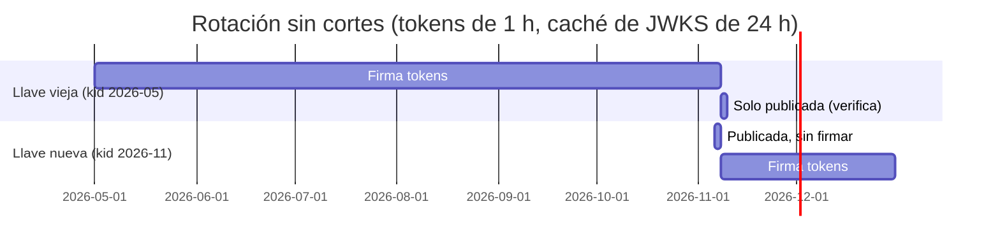

# Rotación de llaves de firma

Parte de: [[02-Fundamentos/05 Autenticación y autorización/_Índice Autenticación y autorización|Autenticación y autorización]]

> [!info] Cómo avanzar
> `progreso`: **pendiente** → **viendo** (estudiando) → **visto** (contestaste la autoevaluación sin abrir las respuestas) → **dominado** (hiciste el laboratorio o lo aplicaste de verdad).

## Contenido

### Qué es
**Rotar** una llave de firma es reemplazar la llave privada con la que un emisor (IdP) firma sus tokens por una nueva, de forma planificada y sin que los usuarios lo noten. Se hace para:
- **Limitar el daño** si la llave se filtró sin que lo sepas: los tokens firmados con ella dejan de aceptarse al retirarla.
- **Cumplir políticas** de seguridad o auditoría que exigen vigencia máxima de llaves.
- **Tener el procedimiento probado**: si algún día hay que rotar de emergencia, ya sabes que funciona.

### Cómo funciona
La clave está en que los validadores eligen la llave por `kid` desde el **JWKS** (ver [[Firmas de JWT (HS256 vs RS256) y JWKS]]), que puede contener varias llaves a la vez.



Fases:
1. **Publicar** la llave nueva en el JWKS **antes** de usarla, con suficiente anticipación para que todos los validadores que cachean el JWKS la descarguen (al menos el tiempo máximo de caché).
2. **Activar**: empezar a firmar con la nueva (nuevo `kid`). Los tokens nuevos traen `kid=2026-11`; los validadores ya la conocen.
3. **Convivencia**: mantener la vieja publicada hasta que **expiren todos los tokens** firmados con ella (vida máxima del token, más tolerancia de reloj). Si firmas también refresh tokens o cookies con esa llave, considera su vida.
4. **Retirar** la vieja del JWKS y destruir su parte privada.

**El escenario del ejercicio.** Un API cachea el JWKS 24 horas y el emisor **rota de golpe** (publica y firma con la nueva al mismo tiempo, y quita la vieja):
- Los tokens con el `kid` nuevo fallan en el API hasta que refresque su caché, porque no encuentra esa llave.
- Los tokens viejos aún vigentes también fallan si la llave vieja se retiró.
- Las librerías como Microsoft.IdentityModel (usada por `AddJwtBearer`) mitigan el primer problema: al encontrar un `kid` desconocido **vuelven a descargar** la configuración, con un intervalo mínimo entre descargas (`RefreshInterval`, por defecto del orden de minutos). Así el fallo dura poco.
- Si el API tiene la llave **configurada a mano** (un certificado en `appsettings`), no hay refresco automático y falla hasta que alguien redepliegue.

### Ejemplo
Xolotl.Hecate guarda sus llaves en **Azure Key Vault** y rota cada 6 meses. Un servicio interno arma el JWKS con las llaves en estado "publicada" o "activa":

```csharp
public sealed record LlaveFirma(string Kid, RsaSecurityKey Publica, EstadoLlave Estado, DateTimeOffset RetirarDespues);
public enum EstadoLlave { Publicada, Activa, Retirada }

public static object ConstruirJwks(IEnumerable<LlaveFirma> llaves) => new
{
    keys = llaves
        .Where(l => l.Estado is EstadoLlave.Publicada or EstadoLlave.Activa)
        .Select(l =>
        {
            var jwk = JsonWebKeyConverter.ConvertFromRSASecurityKey(l.Publica);
            return new { kty = "RSA", use = "sig", alg = "RS256", kid = l.Kid, n = jwk.N, e = jwk.E };
        })
};
```

Runbook de rotación en Azure DevOps (pipeline manual con aprobación):
1. Crear la llave nueva en Key Vault y registrarla como **Publicada**.
2. Esperar al menos 24 h (la caché más larga conocida) o forzar el refresco de los consumidores.
3. Marcarla **Activa**; la anterior pasa a **Publicada** con `RetirarDespues = ahora + vida máxima de tokens + margen`.
4. Un job diario retira las que vencieron.

En el lado de los APIs, no hay que hacer nada si usan `Authority`. Puedes ajustar la caché:

```csharp
.AddJwtBearer(o =>
{
    o.Authority = "https://id.xolotl.mx";
    o.Audience = "itzamna-api";
    o.AutomaticRefreshInterval = TimeSpan.FromHours(12); // refresco periódico del metadata
    o.RefreshInterval = TimeSpan.FromMinutes(5);         // mínimo entre refrescos forzados por kid desconocido
});
```

Si usas **Entra ID**, Microsoft rota sus llaves periódicamente sin aviso previo y espera que tus apps descubran las llaves por metadata; fijarlas a mano rompe la app en la siguiente rotación.

### Cuándo usarlo y cuándo no
- **Rotación programada**: siempre que operes un emisor propio. Calendario fijo (por ejemplo semestral) y automatizado.
- **Rotación de emergencia**: ante sospecha de filtración. Aquí sí se retira la llave vieja de inmediato, aceptando que los tokens vigentes fallen y los usuarios deban renovar.
- **No** necesitas rotar nada en los APIs si validan por metadata; sí en los que tengan llaves fijas.

### Errores comunes
1. **Rotar de golpe.** Publica antes, firma después, retira al final.
2. **Llaves fijas en configuración** de los APIs. Rompen en cada rotación. Usa JWKS.
3. **Retirar la llave vieja demasiado pronto.** Tokens o refresh tokens aún vigentes fallan.
4. **Nunca haber rotado.** El día de la emergencia nadie sabe cómo; prueba el proceso en un entorno de staging.
5. **Llaves privadas en archivos del repo o del servidor.** Guárdalas en Key Vault o un HSM.

### Para profundizar
- [Microsoft Learn: rotación de llaves de firma en Microsoft Entra ID](https://learn.microsoft.com/entra/identity-platform/signing-key-rollover)
- [RFC 7517: JSON Web Key (JWKS y kid)](https://www.rfc-editor.org/rfc/rfc7517)
- [OpenID Connect Core 1.0, sección 10.1.1 (rotación de llaves asimétricas)](https://openid.net/specs/openid-connect-core-1_0.html#RotateSigKeys)

## Autoevaluación

Contesta primero en voz alta o en papel; luego despliega la respuesta.

> [!question]- ¿Por qué rotar llaves de firma?
> Para limitar el daño si se filtran, cumplir políticas y tener el procedimiento probado antes de una emergencia.

> [!question]- ¿Cómo se rota sin cortar sesiones?
> Publicar la llave nueva en el JWKS **antes** de usarla, empezar a firmar con ella (nuevo `kid`), mantener la vieja publicada hasta que expiren todos los tokens que firmó y luego retirarla.

> [!question]- El API cachea el JWKS por 24 h y el emisor rota de golpe. ¿Qué pasa?
> Tokens con el `kid` nuevo fallan hasta que se refresque la caché. Las librerías (como Microsoft.IdentityModel) vuelven a descargar la configuración cuando encuentran un `kid` desconocido, con un límite de frecuencia; con llaves configuradas a mano no ocurre.

## Práctica

- [[Lab 1 - Decodificar y validar un JWT]]

