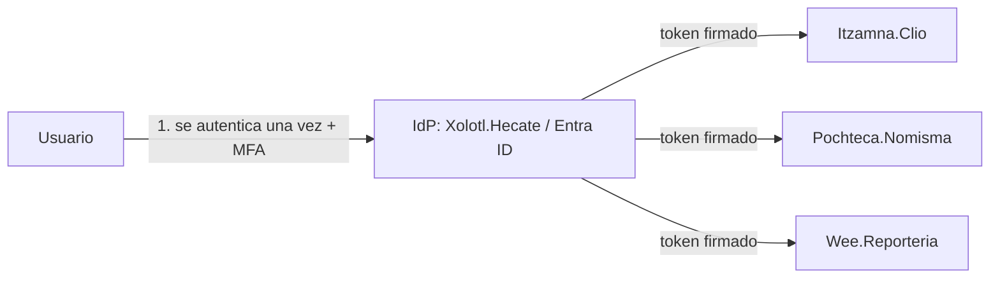

# SSO

Parte de: [[02-Fundamentos/05 Autenticación y autorización/_Índice Autenticación y autorización|Autenticación y autorización]]

> [!info] Cómo avanzar
> `progreso`: **pendiente** → **viendo** (estudiando) → **visto** (contestaste la autoevaluación sin abrir las respuestas) → **dominado** (hiciste el laboratorio o lo aplicaste de verdad).

## Contenido

### Qué es
**SSO** (Single Sign-On, inicio de sesión único) es que el usuario se autentique **una vez** ante un **proveedor de identidad** (IdP) y pueda entrar a **varias aplicaciones** sin volver a escribir su contraseña. Cada aplicación confía en el IdP en lugar de manejar sus propias contraseñas.

Ejemplos: entrar a Outlook, Teams y Azure DevOps con la misma sesión de Microsoft; o, en tu ecosistema, que Itzamna.Clio, Pochteca.Nomisma y Wee.Reporteria usen Xolotl.Hecate.

### Cómo funciona


1. El usuario entra a la app A, que lo redirige al IdP.
2. El IdP lo autentica (contraseña, MFA, passkey) y crea **su propia sesión** (cookie en el dominio del IdP).
3. El IdP entrega a la app A una aserción o token firmado; la app A crea su sesión local.
4. Al entrar a la app B, esta redirige al IdP; el IdP ve que ya hay sesión y responde de inmediato **sin pedir credenciales**.

El detalle de qué cookies intervienen y cómo cerrar sesión bien está en [[Cookies y SSO]].

**Protocolos:**

| Protocolo | Formato | Dónde se usa |
|---|---|---|
| **OpenID Connect** | JSON y JWT sobre OAuth 2.0 | Apps modernas, SPAs, móviles, APIs (ver [[OpenID Connect]]) |
| **SAML 2.0** | Aserciones XML firmadas | Integraciones empresariales, SaaS corporativos, sistemas heredados |
| **Kerberos / Windows Integrated (IWA)** | Tickets Kerberos | Redes corporativas con Active Directory local |
| **WS-Federation** | XML | Sistemas Microsoft antiguos |

Para proyectos nuevos, OIDC es la opción por defecto. SAML aparece cuando un cliente empresarial exige integrarse con su IdP corporativo; Entra ID y la mayoría de IdPs hablan ambos.

**Riesgos y mitigaciones.** SSO concentra la identidad: es un **punto único de compromiso** (si roban la cuenta del IdP, el atacante entra a todo) y un **punto único de falla** (si el IdP cae, nadie entra).
- **MFA fuerte** en el IdP, preferentemente resistente a phishing (passkeys; ver [[MFA]]).
- **Acceso condicional**: exigir MFA o dispositivo administrado según riesgo, ubicación o app sensible.
- **Monitoreo** de inicios de sesión y alertas por patrones anómalos.
- **Sesiones con vida razonable** y reautenticación para acciones críticas (`prompt=login` o `max_age` en OIDC).
- **Alta disponibilidad** del IdP y procedimiento de acceso de emergencia (cuentas *break-glass*).
- **Desprovisionamiento**: al dar de baja a alguien en el IdP pierde acceso a todo, lo cual es una **ventaja** de SSO frente a cuentas sueltas en cada sistema.

### Ejemplo
SSO entre Itzamna.Clio (`app.itzamna.mx`) y Pochteca.Nomisma (`pochteca.com.mx`) con Xolotl.Hecate (`id.xolotl.mx`):

1. Ana entra a Clio → redirección a Hecate → contraseña + TOTP → Clio recibe código, lo canjea y crea su cookie.
2. Ana abre Nomisma → redirección a Hecate → Hecate ve su cookie de sesión → regresa a Nomisma con un código **sin pedir nada**.
3. Nomisma valida el ID token y crea su propia cookie.

Configuración en cada app (ASP.NET Core): `AddCookie` + `AddOpenIdConnect` apuntando al mismo `Authority`, cada una con su `client_id` y sus redirect URIs (ver [[OpenID Connect]]). Para una operación sensible en Nomisma (aprobar un pago), la app puede forzar reautenticación reciente:

```csharp
// Pide al IdP autenticar de nuevo si la última fue hace más de 5 minutos
var props = new OpenIdConnectChallengeProperties
{
    RedirectUri = "/pagos/aprobar",
    MaxAge = TimeSpan.FromMinutes(5) // se envía como max_age=300
};
return Challenge(props, OpenIdConnectDefaults.AuthenticationScheme);
```

Y verifica `auth_time` en el ID token resultante.

### Cuándo usarlo y cuándo no
- **Sí**: varias apps para los mismos usuarios, entornos corporativos, cualquier organización que quiera MFA y bajas centralizadas.
- **Con cuidado**: apps de terceros con datos muy sensibles pueden requerir reautenticación adicional.
- **No hace falta**: una sola app con pocos usuarios puede tener su propio login (aunque usar un IdP desde el inicio facilita crecer).

### Errores comunes
1. **SSO sin MFA en el IdP.** Una contraseña robada abre todas las apps.
2. **Logout solo local** (ver [[Cookies y SSO]]).
3. **Mezclar identificadores**: cada app usa el correo como llave y se rompen al cambiarlo; usa `iss` + `sub`.
4. **No planear la caída del IdP.** Sin acceso de emergencia, un incidente deja fuera a todos, incluidos los administradores.
5. **Cada app con su propia lista de roles desconectada del IdP.** Las bajas no se propagan; usa grupos o roles emitidos por el IdP o provisión automática (SCIM).

### Para profundizar
- [Microsoft Learn: qué es el inicio de sesión único](https://learn.microsoft.com/entra/identity/enterprise-apps/what-is-single-sign-on)
- [OpenID Connect Core 1.0](https://openid.net/specs/openid-connect-core-1_0.html)
- [OASIS: especificaciones SAML 2.0](https://docs.oasis-open.org/security/saml/v2.0/)

## Autoevaluación

Contesta primero en voz alta o en papel; luego despliega la respuesta.

> [!question]- ¿Qué es SSO?
> Single Sign-On: el usuario se autentica una vez ante un proveedor de identidad y accede a varias aplicaciones sin volver a escribir su contraseña.

> [!question]- ¿Qué protocolos se usan para SSO?
> **OpenID Connect** (moderno, JSON/JWT) y **SAML 2.0** (XML, común en empresas). Kerberos/Windows Integrated en redes corporativas.

> [!question]- ¿Qué riesgo introduce SSO y cómo se mitiga?
> Punto único de falla y de compromiso: si roban la cuenta del IdP, entran a todo. Se mitiga con MFA fuerte, políticas de acceso condicional y monitoreo de inicios de sesión.

