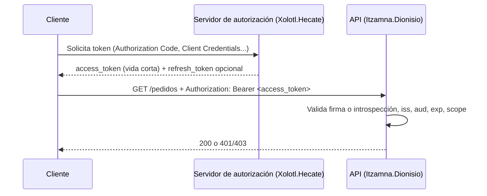

# Tokens de acceso

Parte de: [[02-Fundamentos/05 Autenticación y autorización/_Índice Autenticación y autorización|Autenticación y autorización]]

> [!info] Cómo avanzar
> `progreso`: **pendiente** → **viendo** (estudiando) → **visto** (contestaste la autoevaluación sin abrir las respuestas) → **dominado** (hiciste el laboratorio o lo aplicaste de verdad).

## Contenido

### Qué es
Un **token de acceso** (access token) es una credencial que un cliente presenta a un API para demostrar que tiene **permiso** para hacer algo. Representa una autorización concedida: quién (sujeto), a qué API (audiencia), con qué alcances (scopes), emitido por quién (emisor) y hasta cuándo. Lo emite un servidor de autorización (en OAuth 2.0, ver [[OAuth 2.0]]) y normalmente viaja en `Authorization: Bearer <token>`.

"Bearer" significa **portador**: quien tenga el token puede usarlo, sin probar nada más. Por eso se protege como una contraseña temporal.

### Cómo funciona


Hay dos formatos:

**Opaco.** Una cadena aleatoria sin significado (`8xLOxBtZp8`). El API no puede leerla: debe preguntar al emisor si es válida mediante el endpoint de **introspección** (RFC 7662), que responde `active: true` y sus datos.
- Ventaja: revocable al instante; no expone información.
- Costo: una llamada al emisor por validación (se cachea unos segundos).

**Autocontenido (JWT).** Un token firmado que trae los datos dentro (ver [[JWT y autenticación con Bearer]]): `sub`, `iss`, `aud`, `exp`, `scope`. El API lo valida **localmente** con la llave pública del emisor (ver [[Firmas de JWT (HS256 vs RS256) y JWKS]]).
- Ventaja: sin llamadas de red; escala bien entre muchos APIs.
- Costo: no se puede revocar fácilmente antes de `exp`; sus datos pueden quedar desactualizados (si le quitas un rol al usuario, el token viejo aún lo dice).

**Por qué deben durar poco.** Como son *bearer* y (si son JWT) difíciles de revocar, la vida corta es la principal limitación del daño si se filtran por un log, un proxy o un XSS. Valores típicos: de 5 a 60 minutos. Para no pedir login constantemente, el cliente usa un **refresh token** (ver [[Refresh tokens]]), que sí se puede revocar en el servidor de autorización.

**Qué valida el API:**
1. Firma y algoritmo esperado (o introspección).
2. `iss`: el emisor esperado.
3. `aud`: que el token sea **para este API**, no para otro.
4. `exp` y `nbf`, con poca tolerancia de reloj.
5. `scope` o roles necesarios para la acción.

### Ejemplo
Payload de un access token JWT emitido por Xolotl.Hecate para Itzamna.Dionisio:

```json
{
  "iss": "https://id.xolotl.mx",
  "sub": "42",
  "aud": "itzamna-api",
  "client_id": "itzamna-clio",
  "scope": "pedidos.leer pedidos.escribir",
  "iat": 1794240000,
  "exp": 1794240900
}
```

`exp − iat = 900` segundos: 15 minutos. Validación en el API:

```csharp
builder.Services
    .AddAuthentication(JwtBearerDefaults.AuthenticationScheme)
    .AddJwtBearer(o =>
    {
        o.Authority = "https://id.xolotl.mx";   // descubre JWKS e issuer
        o.Audience = "itzamna-api";             // rechaza tokens para otros APIs
        o.TokenValidationParameters.ClockSkew = TimeSpan.FromMinutes(1);
        o.MapInboundClaims = false;             // conserva nombres como "sub" y "scope"
    });

builder.Services.AddAuthorization(o =>
    o.AddPolicy("PedidosLeer", p => p.RequireAssertion(ctx =>
        ctx.User.FindFirst("scope")?.Value.Split(' ').Contains("pedidos.leer") == true)));
```

El `ClockSkew` por defecto de la librería es de 5 minutos; bajarlo a 1 minuto hace que la vida real del token se acerque a la configurada.

### Cuándo usarlo y cuándo no
- **JWT**: muchos APIs o microservicios que validan sin depender del emisor en cada petición.
- **Opaco con introspección**: cuando la revocación inmediata importa más que la latencia, o el token sale a terceros y no quieres exponer claims.
- **Cookie de sesión en vez de tokens**: tu propia web con su backend (ver [[Cookies vs tokens]]).

### Errores comunes
1. **No validar `aud`.** Un token emitido para otro API (con menos controles) se acepta en el tuyo.
2. **Vidas largas** (días) para "evitar molestias". Usa refresh tokens.
3. **Usar el ID token como access token.** Su `aud` es la app cliente, no el API (ver [[OpenID Connect]]).
4. **Registrar tokens en logs.** Cualquiera con acceso a los logs puede usarlos. Enmascáralos.
5. **Meter datos sensibles en un JWT.** Solo está codificado, no cifrado.

### Para profundizar
- [RFC 6750: Bearer Token Usage](https://www.rfc-editor.org/rfc/rfc6750)
- [RFC 9068: perfil JWT para access tokens](https://www.rfc-editor.org/rfc/rfc9068)
- [RFC 7662: Token Introspection](https://www.rfc-editor.org/rfc/rfc7662)

## Autoevaluación

Contesta primero en voz alta o en papel; luego despliega la respuesta.

> [!question]- ¿Qué es un token de acceso?
> Una credencial que el cliente presenta a un API (normalmente `Authorization: Bearer <token>`) y que representa permisos concedidos: quién, para qué API (audiencia), qué alcances y hasta cuándo.

> [!question]- ¿Qué diferencia hay entre un token opaco y uno autocontenido (JWT)?
> **Opaco**: cadena aleatoria; el API debe consultar al emisor (introspección) para validarlo. **Autocontenido**: trae los datos firmados y el API lo valida localmente con la llave pública, pero no se puede revocar fácilmente antes de que expire.

> [!question]- ¿Por qué los tokens de acceso deben durar poco?
> Porque quien lo tiene lo puede usar (bearer = portador) y normalmente no se revocan. Duraciones cortas (minutos) limitan el daño si se filtra; se renuevan con refresh tokens.

## Práctica

- [[Lab 1 - Decodificar y validar un JWT]]

