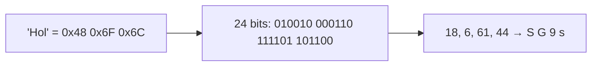

# Base64

Parte de: [[02-Fundamentos/06 Datos y formatos/_Índice Datos y formatos|Datos y formatos]]

> [!info] Cómo avanzar
> `progreso`: **pendiente** → **viendo** (estudiando) → **visto** (contestaste la autoevaluación sin abrir las respuestas) → **dominado** (hiciste el laboratorio o lo aplicaste de verdad).

## Contenido

### Qué es
**Base64** es una **codificación** que representa bytes arbitrarios usando solo **64 caracteres ASCII** seguros (`A–Z`, `a–z`, `0–9`, `+`, `/`, más `=` como relleno). Sirve para transportar datos **binarios** por canales que solo admiten **texto**: adjuntos de correo (MIME), imágenes incrustadas en HTML o CSS (data URIs), archivos dentro de JSON, certificados en formato PEM, y los segmentos de un JWT (en su variante Base64URL).

**Base64 no es cifrado.** No usa llave: cualquiera lo decodifica con un comando. Ocultar una contraseña en Base64 equivale a dejarla en claro.

### Cómo funciona
1. Se toman los bytes de entrada en grupos de **3 bytes** (24 bits).
2. Cada grupo se divide en **4 bloques de 6 bits** (2^6 = 64 valores).
3. Cada bloque se convierte en un carácter del alfabeto.
4. Si al final sobran 1 o 2 bytes, se rellena con ceros y se agrega `=` (uno o dos) para completar 4 caracteres.



Consecuencias de tamaño:
- **Cada 3 bytes se vuelven 4 caracteres**: el tamaño crece alrededor de **33 %**. Un archivo de 3 MB ocupa unos **4 MB** en Base64 (más saltos de línea si es MIME).
- Longitud exacta con relleno: **4 × ⌈n / 3⌉**. Para 10 bytes: 4 × ⌈10/3⌉ = 4 × 4 = **16** caracteres, y los dos últimos son `==` (porque 10 = 3·3 + 1 y sobra 1 byte).

Ejemplos verificados:

| Entrada | Base64 |
|---|---|
| `Hola` (4 bytes) | `SG9sYQ==` |
| `{"alg":"HS256"}` | `eyJhbGciOiJIUzI1NiJ9` |
| `Café` en UTF-8 (5 bytes) | `Q2Fmw6k=` |

Por eso `eyJhbGciOiJIUzI1NiJ9` se reconoce de inmediato: casi todo JWT empieza con `eyJ`, que es `{"` codificado.

**Base64URL** (RFC 4648, sección 5) es la variante segura para URLs y nombres de archivo:
- Cambia `+` por `-` y `/` por `_` (porque `+`, `/` tienen significado en URLs).
- Normalmente **quita el relleno** `=`.
La usan los **JWT** (ver [[JWT y autenticación con Bearer]]) y **PKCE** (ver [[OAuth 2.0 - Authorization Code con PKCE]]). Mezclar las variantes es un error clásico: decodificar un segmento de JWT con Base64 estándar falla por los `-`/`_` o por la falta de relleno.

### Ejemplo
En la terminal (bash; en Windows con Git Bash o WSL):

```bash
echo -n Hola | base64            # SG9sYQ==
echo SG9sYQ== | base64 -d        # Hola
echo eyJhbGciOiJIUzI1NiJ9 | base64 -d   # {"alg":"HS256"} (aquí no faltó relleno)
```

En C# (.NET 9 o posterior trae `Base64Url` en `System.Buffers.Text`):

```csharp
using System.Buffers.Text;
using System.Text;

var bytes = Encoding.UTF8.GetBytes("Hola");
Console.WriteLine(Convert.ToBase64String(bytes));     // SG9sYQ==
Console.WriteLine(Base64Url.EncodeToString(bytes));   // SG9sYQ  (sin relleno)

var header = Encoding.UTF8.GetString(Base64Url.DecodeFromChars("eyJhbGciOiJIUzI1NiJ9"));
Console.WriteLine(header);                            // {"alg":"HS256"}
```

En JavaScript del navegador, `btoa` y `atob` trabajan con cadenas "binarias" (un carácter por byte), así que para texto con acentos hay que pasar por bytes UTF-8:

```js
const bytes = new TextEncoder().encode("Café");
const b64 = btoa(String.fromCharCode(...bytes));            // "Q2Fmw6k="
const texto = new TextDecoder().decode(Uint8Array.from(atob(b64), c => c.charCodeAt(0))); // "Café"
```

Caso práctico: en Wee.Reporteria, un endpoint devuelve un Excel pequeño dentro de JSON (`{"archivo": "UEsDBBQ..."}`). Funciona, pero cuesta 33 % más de tamaño y memoria; para archivos grandes es mejor devolver el binario directamente con `File(stream, "application/vnd.openxmlformats-officedocument.spreadsheetml.sheet")`.

### Cuándo usarlo y cuándo no
- **Sí**: incrustar binarios pequeños en formatos de texto (JSON, XML, correo), data URIs pequeñas, llaves y certificados en PEM, valores de cookies o headers que no admiten bytes arbitrarios.
- **No**: para "proteger" datos (no es cifrado), para archivos grandes en APIs (usa respuestas binarias o `multipart`), ni para guardar binarios en una base de datos que ya soporta `varbinary`.

### Errores comunes
1. **Creer que Base64 oculta algo.** Contraseñas o datos personales en Base64 están en claro.
2. **Confundir Base64 y Base64URL.** Errores al decodificar JWT o PKCE. Usa la variante correcta.
3. **Olvidar el relleno** al decodificar Base64URL con un decodificador estándar. Agrega `=` hasta múltiplo de 4 o usa un decodificador URL.
4. **Usar `btoa` con texto Unicode.** Lanza error con caracteres fuera de Latin-1. Convierte a bytes UTF-8 primero.
5. **Ignorar el crecimiento de 33 %.** Límites de tamaño de petición que se rebasan de forma inesperada.

### Para profundizar
- [RFC 4648: The Base16, Base32, and Base64 Data Encodings](https://www.rfc-editor.org/rfc/rfc4648)
- [MDN: Base64](https://developer.mozilla.org/en-US/docs/Glossary/Base64)
- [Microsoft Learn: clase Base64Url](https://learn.microsoft.com/dotnet/api/system.buffers.text.base64url)

## Ejercicios

Resuélvelos en papel o en la herramienta; la solución está plegada.

> [!question]- Codifica `Hola` en Base64.
> `SG9sYQ==` (`echo -n Hola | base64`).

> [!question]- ¿Qué tamaño aproximado tendrá en Base64 un archivo de 3 MB?
> ≈ **4 MB**: cada 3 bytes se convierten en 4 caracteres (+33 %).

> [!question]- Decodifica `eyJhbGciOiJIUzI1NiJ9`.
> `{"alg":"HS256"}` (es el header de un JWT).

> [!question]- ¿Cuántos caracteres produce Base64 (con relleno) para 10 bytes?
> 4 × ⌈10 / 3⌉ = **16** caracteres (los últimos dos son `==`).

## Autoevaluación

Contesta primero en voz alta o en papel; luego despliega la respuesta.

> [!question]- ¿Qué es Base64 y para qué se usa?
> Una **codificación** que representa bytes con 64 caracteres ASCII. Se usa para transportar binario en texto: adjuntos de correo, data URIs, JSON, JWT (variante Base64URL).

> [!question]- ¿Base64 es cifrado?
> No. Cualquiera lo decodifica sin llave. No protege nada.

> [!question]- ¿Qué diferencia hay entre Base64 y Base64URL?
> Base64URL cambia `+` por `-` y `/` por `_` y normalmente quita el relleno `=`, para poder ir en URLs y nombres de archivo. Lo usan JWT y PKCE.

