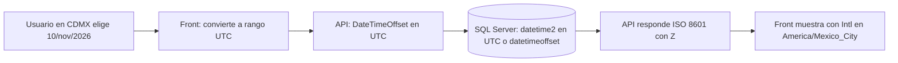

# Fechas, zonas horarias y UTC

Parte de: [[02-Fundamentos/06 Datos y formatos/_Índice Datos y formatos|Datos y formatos]]

> [!info] Cómo avanzar
> `progreso`: **pendiente** → **viendo** (estudiando) → **visto** (contestaste la autoevaluación sin abrir las respuestas) → **dominado** (hiciste el laboratorio o lo aplicaste de verdad).

## Contenido

### Qué es
Manejar fechas bien significa distinguir entre un **instante** (un punto único en la línea del tiempo, igual en todo el mundo) y su **representación local** (lo que marca el reloj en una zona horaria). **UTC** (Tiempo Universal Coordinado) es la referencia sin horario de verano contra la que se expresan todas las zonas. Una **zona horaria** no es solo un desfase como "−6 h": es un conjunto de **reglas históricas** (cuándo hubo horario de verano, cuándo cambió el desfase) que mantiene la base de datos **IANA tz** (`America/Mexico_City`, `America/Tijuana`, `America/Cancun`).

### Cómo funciona
**Regla de oro**: guarda y transmite **instantes en UTC** (o con su desfase explícito) y convierte a la zona del usuario **solo al mostrar**. Si guardas "2026-11-10 08:00" sin zona, nadie puede saber después qué instante fue.

**México y el horario de verano.** Con la *Ley de los Husos Horarios en los Estados Unidos Mexicanos*, México eliminó el horario de verano en casi todo el país a partir del **30 de octubre de 2022**. Desde entonces:
- Centro de México (`America/Mexico_City`): **UTC−6 todo el año**.
- Quintana Roo (`America/Cancun`): UTC−5 todo el año (desde 2015).
- Municipios de la **frontera norte** (por ejemplo `America/Tijuana`, `America/Ciudad_Juarez`, `America/Matamoros`) **conservan** el horario de verano para coincidir con Estados Unidos.
- Antes de 2022, el centro usaba UTC−5 en verano. Por eso el `2022-07-01T12:00:00Z` era las **07:00** en CDMX, y el `2026-03-15T02:30:00Z` es el **14 de marzo de 2026 a las 20:30** (UTC−6).

**Por qué no restar 6 horas a mano**: las reglas cambian (como en 2022), hay fechas históricas con otro desfase y otras zonas del país tienen reglas distintas. Usa la base de datos de zonas del sistema (`TimeZoneInfo`, `zoneinfo`, `Intl`) y mantén actualizado el sistema operativo o el paquete `tzdata`.

**Rangos de "un día local".** Un reporte "del 10 de noviembre de 2026" en hora de CDMX abarca de las 00:00 a las 24:00 **locales**, que en UTC es:

```text
desde 2026-11-10T06:00:00Z (inclusive)  hasta 2026-11-11T06:00:00Z (exclusivo)
```

Usa siempre intervalos **semiabiertos** `[inicio, fin)`: evitan el problema de "¿23:59:59.999 o 23:59:59.9999999?".

**`DateTime` vs `DateTimeOffset` en .NET:**
- `DateTime` tiene una propiedad `Kind` (`Utc`, `Local` o `Unspecified`). Un valor leído de SQL Server llega como `Unspecified`, y métodos como `ToUniversalTime()` lo tratan como hora **local del servidor**: en Azure (UTC) da un resultado y en tu laptop otro.
- `DateTimeOffset` guarda el instante **más su desfase** (`2026-11-10T00:00:00-06:00`). No es ambiguo y es lo recomendable para instantes.
- .NET también tiene `DateOnly` y `TimeOnly` para fechas sin hora (cumpleaños, días festivos) y horas sin fecha (horario de apertura).



### Ejemplo
En Python (verificado):

```python
from datetime import datetime, timezone
from zoneinfo import ZoneInfo

cdmx = ZoneInfo("America/Mexico_City")
ahora = datetime.now(timezone.utc)
print(ahora, ahora.astimezone(cdmx))

print(datetime.fromisoformat("2026-03-15T02:30:00+00:00").astimezone(cdmx))  # 2026-03-14 20:30:00-06:00
print(datetime.fromisoformat("2022-07-01T12:00:00+00:00").astimezone(cdmx))  # 2022-07-01 07:00:00-05:00
```

En Itzamna.Dionisio, el rango UTC de un día local para un reporte:

```csharp
public static (DateTimeOffset Desde, DateTimeOffset Hasta) DiaLocalEnUtc(DateOnly dia, string zonaIana)
{
    var zona = TimeZoneInfo.FindSystemTimeZoneById(zonaIana); // IANA funciona en Windows y Linux desde .NET 6
    var inicioLocal = dia.ToDateTime(TimeOnly.MinValue);
    var finLocal = dia.AddDays(1).ToDateTime(TimeOnly.MinValue);
    return (
        new DateTimeOffset(inicioLocal, zona.GetUtcOffset(inicioLocal)).ToUniversalTime(),
        new DateTimeOffset(finLocal, zona.GetUtcOffset(finLocal)).ToUniversalTime());
}

var (desde, hasta) = DiaLocalEnUtc(new DateOnly(2026, 11, 10), "America/Mexico_City");
// desde = 2026-11-10T06:00:00Z, hasta = 2026-11-11T06:00:00Z
```

```sql
-- Reportes/VentasDelDia.sql
SELECT SUM(Total) AS Total
FROM dbo.Venta
WHERE FechaUtc >= @Desde AND FechaUtc < @Hasta;   -- intervalo semiabierto
```

En el front (TypeScript), para mostrar:

```ts
new Intl.DateTimeFormat("es-MX", { dateStyle: "medium", timeStyle: "short", timeZone: "America/Mexico_City" })
  .format(new Date("2026-11-10T06:00:00Z")); // "10 nov 2026, 12:00 a.m." en Node 22 (el formato exacto varía por navegador)
```

Para pruebas, inyecta `TimeProvider` en lugar de llamar a `DateTime.UtcNow` directamente; así puedes fijar el reloj en tus tests.

### Cuándo usarlo y cuándo no
- **UTC o `DateTimeOffset`**: cualquier instante (creación, pagos, logs, eventos).
- **Zona del usuario + hora local**: eventos futuros definidos por personas ("junta cada lunes a las 9 en CDMX"); ahí guarda la hora local **y** la zona IANA, porque si las reglas cambian, la junta debe seguir a las 9 locales.
- **`DateOnly`**: fechas de calendario sin hora (fecha de nacimiento, fecha de factura).

### Errores comunes
1. **Guardar hora local sin zona.** Imposible reconstruir el instante.
2. **Sumar o restar desfases fijos** (−6 h). Falla con fechas anteriores a 2022 y en la frontera norte.
3. **`DateTime.Now` en servidores.** Depende de la zona de la máquina; usa `UtcNow` o `TimeProvider`.
4. **Filtrar días con `BETWEEN` y 23:59:59.** Pierde registros con fracciones de segundo. Usa `[inicio, fin)`.
5. **Sistemas sin actualizar la base de zonas.** Siguen aplicando horario de verano a México. Mantén actualizados el SO y `tzdata`.

### Para profundizar
- [IANA: Time Zone Database](https://www.iana.org/time-zones)
- [Microsoft Learn: elegir entre DateTime, DateOnly, DateTimeOffset y TimeZoneInfo](https://learn.microsoft.com/dotnet/standard/datetime/choosing-between-datetime)
- [Documentación de Python: zoneinfo](https://docs.python.org/3/library/zoneinfo.html)

## Ejercicios

Resuélvelos en papel o en la herramienta; la solución está plegada.

> [!question]- Convierte `2026-03-15T02:30:00Z` a hora del centro de México.
> `2026-03-14 20:30` (UTC−6, sin horario de verano).

> [!question]- En Python, obtén el instante actual en UTC y en `America/Mexico_City`.
> ```python
> from datetime import datetime, timezone
> from zoneinfo import ZoneInfo
> ahora = datetime.now(timezone.utc)
> print(ahora, ahora.astimezone(ZoneInfo('America/Mexico_City')))
> ```

> [!question]- Un reporte "del día 10 de noviembre de 2026" en hora de CDMX, ¿qué rango UTC debe consultar?
> De `2026-11-10T06:00:00Z` (inclusive) a `2026-11-11T06:00:00Z` (exclusivo).

> [!question]- ¿Qué hora local tenía CDMX el `2022-07-01T12:00:00Z`?
> `07:00` (UTC−5, todavía con horario de verano en 2022).

## Autoevaluación

Contesta primero en voz alta o en papel; luego despliega la respuesta.

> [!question]- ¿Por qué guardar las fechas en UTC?
> UTC no tiene horario de verano ni ambigüedades; se convierte a la zona del usuario solo al mostrar. Si se guarda la hora local sin zona, no se puede saber qué instante fue.

> [!question]- ¿Qué zona IANA usar para la hora del centro de México y qué cambió en 2022?
> `America/Mexico_City` (en Windows, "Central Standard Time (Mexico)"). Desde finales de octubre de 2022 México eliminó el horario de verano en casi todo el país: queda en UTC−6 todo el año (con excepciones en la frontera norte).

> [!question]- ¿Por qué no sumar −6 h "a mano" para convertir a hora de México?
> Las reglas de zona cambian (como en 2022) y hay fechas históricas con horario de verano. Usa la base de datos de zonas: `TimeZoneInfo` / `zoneinfo` / `Intl` y mantén actualizado el sistema.

> [!question]- ¿Qué diferencia hay entre `DateTime` y `DateTimeOffset` en .NET?
> `DateTimeOffset` guarda el instante con su desfase respecto a UTC, sin ambigüedad. `DateTime` depende de `Kind` (`Utc`, `Local`, `Unspecified`), fuente frecuente de errores.

## Práctica

- [[Lab 1 - Expresiones regulares y fechas en Python]]

