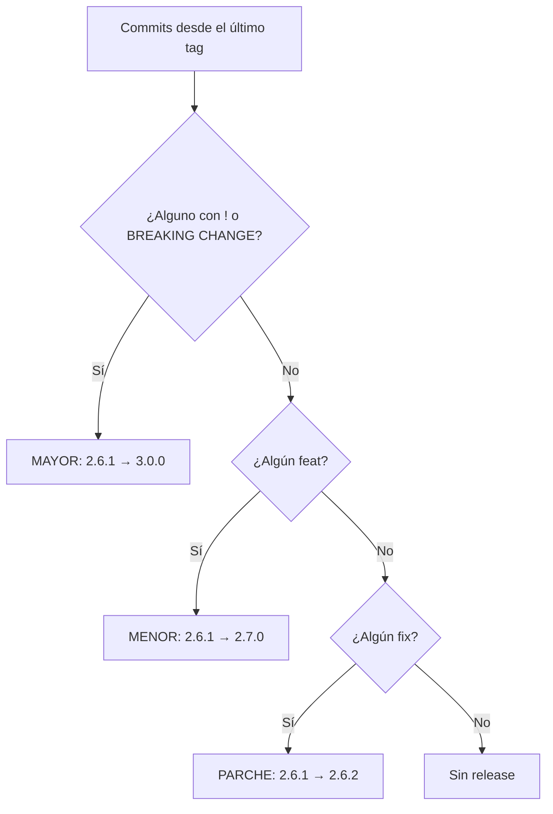

# Conventional Commits

Parte de: [[02-Fundamentos/07 Git/_Índice Git|Git]]

> [!info] Cómo avanzar
> `progreso`: **pendiente** → **viendo** (estudiando) → **visto** (contestaste la autoevaluación sin abrir las respuestas) → **dominado** (hiciste el laboratorio o lo aplicaste de verdad).

## Contenido

### Qué es
**Conventional Commits** (especificación 1.0.0) es una convención ligera para escribir **mensajes de commit con estructura fija**, de modo que tanto personas como herramientas puedan entenderlos. Encaja con [[Git - tags y versionado semántico]]: cada tipo de commit indica si el cambio es corrección, funcionalidad o ruptura, y con eso se puede **calcular la siguiente versión** y **generar el changelog** automáticamente.

### Cómo funciona
Formato:

```text
<tipo>[ámbito opcional][!]: <descripción>

[cuerpo opcional]

[pie(s) opcional(es)]
```

- **tipo**: obligatorio. La especificación define dos con significado especial: `feat` (nueva funcionalidad, equivale a **MENOR**) y `fix` (corrección, equivale a **PARCHE**). Se usan además, por convención (por ejemplo la de Angular/commitlint): `docs`, `style`, `refactor`, `perf`, `test`, `build`, `ci`, `chore`, `revert`. Estos no afectan la versión por sí solos.
- **ámbito** (scope): entre paréntesis, la parte del sistema afectada: `feat(pedidos):`, `fix(auth):`.
- **descripción**: corta, en minúscula y sin punto, describiendo el cambio.
- **cuerpo**: el porqué y el contexto.
- **pies**: con formato `Token: valor`, como `Refs: AB#1532` o `Reviewed-by: ...`.

**Cambio incompatible** (equivale a **MAYOR**) se marca de dos maneras, combinables:
1. Un `!` justo antes de los dos puntos: `feat(api)!: elimina el campo nombreCompleto`.
2. Un pie `BREAKING CHANGE: <explicación>` (o `BREAKING-CHANGE:`).

Cualquier tipo puede ser incompatible: `refactor!:` o `chore!:` también obligan a versión mayor.

**Cómo se calcula la versión:** de todos los commits desde el último release se toma el **efecto más fuerte**: si hay alguno incompatible, sube MAYOR; si no, pero hay algún `feat`, sube MENOR; si solo hay `fix` (y `perf`, según la herramienta), sube PARCHE; si solo hay `docs`/`chore`/`test`, normalmente no se publica versión nueva.



Ojo: mientras la versión sea `0.x`, varias herramientas tratan los cambios incompatibles como MENOR; revisa la configuración de la tuya.

### Ejemplo
Historia de Ocelotl.Hermes desde `v2.6.1`:

```text
docs(readme): explica variables de entorno de la cola
fix(envio): reintenta cuando el SMTP responde 421
feat(plantillas): permite adjuntar PDF generado
```

El más fuerte es `feat`, así que la siguiente es `2.7.0`. Si además hubiera:

```text
feat(api)!: cambia el endpoint /mensajes a /v2/mensajes

BREAKING CHANGE: los clientes deben actualizar la URL; /mensajes responde 410.
Refs: AB#1702
```

la siguiente sería `3.0.0`.

Para validar los mensajes automáticamente se usa **commitlint** con un hook `commit-msg` (vía Husky o pre-commit, ver [[Git - hooks y pre-commit]]) y, en el pipeline, una revisión del título del PR cuando el repo usa squash merge (porque el título del PR se vuelve el mensaje del commit). Herramientas como semantic-release, release-please o GitVersion leen estos mensajes, crean el tag y escriben el `CHANGELOG.md`.

### Cuándo usarlo y cuándo no
**Sirve para:**
- Historial legible y fácil de filtrar (`git log --grep "^fix"`).
- Automatizar versionado y notas de versión.
- Obligarte a pensar si un commit mezcla cosas: si no sabes si es `feat` o `fix`, probablemente son dos commits.

**Cuándo no vale tanto:** en proyectos personales sin releases, o si el equipo hace squash y solo cuida el título del PR (ahí aplica la convención al título, no a cada commit). Si nadie va a consumir la estructura, una buena redacción libre también sirve; lo importante es la consistencia.

### Errores comunes
- **Usar `feat` para todo**: infla versiones menores y el changelog pierde sentido.
- **Olvidar marcar la ruptura**: un `fix` que cambia el contrato de la API genera un PARCHE que rompe a los clientes.
- **Descripciones vagas** (`fix: arreglos`): el formato no sustituye un buen contenido.
- **Ámbitos inventados cada vez**: acuerda una lista corta (por slice o módulo).
- **Validar solo localmente**: los hooks se pueden saltar; valida también en CI.

### Para profundizar
- [Especificación Conventional Commits 1.0.0 (español)](https://www.conventionalcommits.org/es/v1.0.0/)
- [commitlint](https://commitlint.js.org/)
- [Versionado Semántico 2.0.0](https://semver.org/lang/es/)

## Ejercicios

Resuélvelos en papel o en la herramienta; la solución está plegada.

> [!question]- Escribe el mensaje para: corregir un bug en el login que no aceptaba correos con mayúsculas.
> `fix(auth): acepta correos con mayúsculas en el login`

> [!question]- Versión actual 1.4.2. Commits desde el último release: `fix`, `feat`, `docs`. ¿Siguiente versión?
> **1.5.0** (hay un `feat`).

> [!question]- Versión actual 1.4.2 y un commit `refactor!: cambia formato de respuesta`. ¿Siguiente versión?
> **2.0.0**.

## Autoevaluación

Contesta primero en voz alta o en papel; luego despliega la respuesta.

> [!question]- ¿Qué formato propone Conventional Commits?
> `tipo(alcance opcional): descripción`, por ejemplo `feat(pedidos): agrega cancelación` o `fix: corrige redondeo de IVA`. Tipos comunes: `feat`, `fix`, `docs`, `refactor`, `test`, `chore`, `ci`, `perf`.

> [!question]- ¿Cómo se marca un cambio incompatible?
> Con `!` después del tipo (`feat!: elimina endpoint v1`) o un pie `BREAKING CHANGE: ...`.

> [!question]- ¿Para qué sirve seguirlo?
> Para generar changelogs y calcular la siguiente versión semántica automáticamente: `fix` → patch, `feat` → minor, breaking → major.

