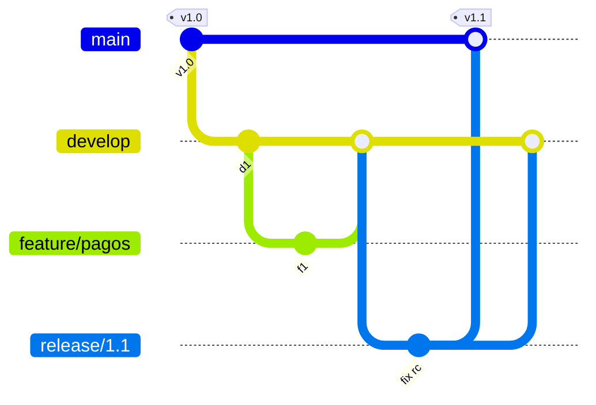

# Estrategias de ramas (GitFlow y trunk-based)

Parte de: [[02-Fundamentos/07 Git/_Índice Git|Git]]

> [!info] Cómo avanzar
> `progreso`: **pendiente** → **viendo** (estudiando) → **visto** (contestaste la autoevaluación sin abrir las respuestas) → **dominado** (hiciste el laboratorio o lo aplicaste de verdad).

## Contenido

### Qué es
Una **estrategia de ramas** es el acuerdo del equipo sobre **qué ramas existen, cuánto viven y cómo fluye el código** de la computadora del desarrollador a producción. Las dos más conocidas son **GitFlow** (varias ramas de larga vida y releases planeados) y **trunk-based development** (una sola rama principal que siempre está lista para desplegarse). Elegir bien reduce conflictos, acelera la entrega y simplifica los pipelines.

### Cómo funciona
**GitFlow** (propuesto por Vincent Driessen en 2010):

- `main` (o `master`): solo código liberado; cada merge se etiqueta con la versión.
- `develop`: integración del trabajo para el próximo release.
- `feature/*`: salen de `develop` y regresan a `develop`.
- `release/*`: salen de `develop` cuando se congela un release; ahí solo se corrigen bugs; al terminar se integran a `main` (con tag) **y** de vuelta a `develop`.
- `hotfix/*`: salen de `main` para corregir producción y se integran a `main` y a `develop`.

El propio autor agregó en 2020 una nota aclarando que, para software que se entrega continuamente (como apps web), recomienda algo más simple como GitHub Flow.

**Trunk-based development:**

- Hay **una rama principal** (`main`, el "tronco").
- Los desarrolladores integran a `main` **al menos una vez al día**, ya sea directamente (equipos pequeños y muy disciplinados) o mediante **ramas de vida muy corta** (horas, uno o dos días) con PR.
- `main` **siempre compila, pasa pruebas y se puede desplegar**. Cada merge dispara CI y, normalmente, despliegue a un ambiente.
- Lo que no está terminado se oculta con **feature flags** en lugar de esperar en una rama.
- Si se necesitan releases, se cortan ramas `release/*` desde `main` solo para estabilizar, y las correcciones van primero a `main` y se llevan con cherry-pick.

Variantes intermedias: **GitHub Flow** (ramas cortas + PR a `main` + despliegue) y el **Release Flow** que describe Microsoft para Azure DevOps (trunk-based con ramas de release por sprint).

### Ejemplo
Itzamna.Dionisio + Itzamna.Clio, desplegadas en Azure App Service con [[Azure Pipelines]]:

1. Rama `feature/AB1540-filtro-fechas` desde `main`; vive uno o dos días.
2. PR a `main` con políticas: build verde, pruebas, un revisor, work item ligado.
3. Al completar (squash), el pipeline despliega a **dev** automáticamente; a **QA** y **producción** con aprobación de ambiente.
4. Una funcionalidad grande (nuevo módulo de cobranza) se integra en partes detrás de un flag `Cobranza:Habilitada` en configuración, desactivado en producción hasta que esté listo.
5. Un bug en producción se corrige en `main` con un PR normal; el siguiente despliegue lo lleva.

Wee.Reporteria, si se distribuyera como instalador a clientes con varias versiones soportadas a la vez, justificaría ramas `release/2.x` de larga vida, más cercano a GitFlow.

### Cuándo usarlo y cuándo no
| Situación | Mejor opción |
|---|---|
| App web o API con despliegue continuo | Trunk-based / GitHub Flow |
| Varias versiones en producción con soporte simultáneo (software instalado, librerías, apps móviles con revisión de tienda) | GitFlow o ramas de release |
| Equipo que aún no tiene pruebas automatizadas confiables | Ramas cortas con PR; trabaja en mejorar CI antes de integrar directo |
| Equipo grande en un monorepo | Trunk-based con PR obligatorios y flags |

Trunk-based exige **buena automatización** (CI rápido, pruebas, despliegue reproducible) y disciplina para dividir el trabajo en partes pequeñas. GitFlow tolera menos automatización pero acumula riesgo: ramas largas, merges grandes y retrasos entre escribir el código y verlo en producción.

### Errores comunes
- **Usar GitFlow por costumbre en una API que se despliega diario**: dobles merges, `develop` y `main` que divergen, hotfix olvidados en `develop`.
- **"Trunk-based" con ramas que viven semanas**: no es trunk-based; los beneficios vienen de integrar seguido.
- **Feature flags sin limpieza**: se acumulan y complican el código; ponles fecha de retiro.
- **Corregir en la rama de release y no en `main`**: el bug regresa en el siguiente release.
- **No proteger `main`**: sin políticas de rama cualquiera puede romper el tronco (ver [[Git - pull requests]]).

### Para profundizar
- [Trunk Based Development (sitio de referencia)](https://trunkbaseddevelopment.com/)
- [A successful Git branching model (artículo original de GitFlow, con la nota de 2020)](https://nvie.com/posts/a-successful-git-branching-model/)
- [Adoptar una estrategia de ramas en Azure Repos](https://learn.microsoft.com/azure/devops/repos/git/git-branching-guidance)
- [Release Flow: cómo trabaja Microsoft con Git](https://learn.microsoft.com/devops/develop/how-microsoft-develops-devops)

## Autoevaluación

Contesta primero en voz alta o en papel; luego despliega la respuesta.

> [!question]- ¿Cómo funciona GitFlow?
> Ramas de larga vida `main` (producción) y `develop` (integración), más `feature/*`, `release/*` y `hotfix/*`. Encaja con releases planeados y varias versiones en soporte.

> [!question]- ¿Qué es trunk-based development?
> Todos integran a `main` con frecuencia (al menos diario) mediante ramas muy cortas o directo, apoyados en CI fuerte y **feature flags** para ocultar trabajo incompleto.

> [!question]- ¿Qué estrategia elegirías para una app web con despliegue continuo?
> Trunk-based (o GitHub Flow: ramas cortas + PR a `main`). GitFlow agrega ramas y merges que retrasan la integración y no aportan si se despliega varias veces al día.

