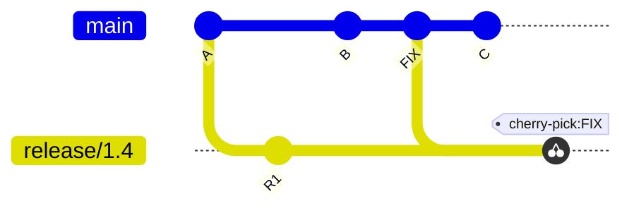

# Git - cherry-pick

Parte de: [[02-Fundamentos/07 Git/_Índice Git|Git]]

> [!info] Cómo avanzar
> `progreso`: **pendiente** → **viendo** (estudiando) → **visto** (contestaste la autoevaluación sin abrir las respuestas) → **dominado** (hiciste el laboratorio o lo aplicaste de verdad).

## Contenido

### Qué es
`git cherry-pick <hash>` toma **el cambio introducido por un commit específico** y lo aplica como un **commit nuevo** en la rama actual. No trae la rama completa ni la historia anterior; solo el diff de ese commit respecto a su padre. El commit nuevo tiene otro hash, aunque el contenido sea el mismo.

### Cómo funciona
1. Git calcula la diferencia entre el commit indicado y su padre.
2. Intenta aplicar esa diferencia sobre tu HEAD (usando un merge de tres vías internamente).
3. Si aplica limpio, crea un commit con el mismo mensaje y autor original (el committer eres tú).
4. Si hay conflicto, se detiene: resuelves, `git add` y `git cherry-pick --continue`, o `--abort` para cancelar.



Opciones útiles:

```bash
git cherry-pick a1b2c3d                 # un commit
git cherry-pick a1b2c3d e4f5a6b         # varios, en ese orden
git cherry-pick a1b2c3d^..e4f5a6b       # un rango (incluye a1b2c3d)
git cherry-pick -x a1b2c3d              # agrega "(cherry picked from commit ...)" al mensaje
git cherry-pick -n a1b2c3d              # aplica sin hacer commit (para combinar o ajustar)
git cherry-pick -m 1 <merge>            # si el commit es un merge, indica respecto a qué padre
```

`-x` es muy recomendable cuando copias entre ramas de larga vida: deja rastro de dónde vino el cambio.

### Ejemplo
Wee.Reporteria tiene en producción la rama `release/2.3`. En `main` ya se corrigió un bug en la exportación a Excel (commit `7c1e9a2`), pero `main` también tiene funcionalidades que aún no deben salir. Llevas solo la corrección:

```bash
git switch release/2.3
git pull --ff-only
git cherry-pick -x 7c1e9a2
dotnet build && dotnet test
git push
git tag -a v2.3.1 -m "Corrige formato de fechas en exportación" && git push origin v2.3.1
```

En Azure DevOps también existe el botón **Cherry-pick** en un PR completado, que crea una rama y un PR hacia la rama destino; así la corrección pasa por las mismas políticas de revisión.

### Cuándo usarlo y cuándo no
**Útil para:**
- **Hotfix hacia ramas de release o soporte**: corriges en `main` y llevas la corrección a la versión en producción (o al revés, si arreglaste en la release y debes llevarla a `main`).
- **Rescatar un commit** hecho en la rama equivocada.
- **Recuperar** un commit de una rama abandonada o desde el reflog.

**No lo uses para:**
- **Sustituir merges** de forma rutinaria. Si copias muchos commits entre ramas, termina habiendo el "mismo" cambio con hashes distintos en ambos lados; Git no sabe que son equivalentes y al unir las ramas aparecen conflictos y duplicados en el log. También se pierde la trazabilidad de qué entró dónde.
- Llevar un commit que **depende de otros** que no copias: compila en `main` pero falla en la release.

Si necesitas llevar una funcionalidad completa, integra la rama con [[Git - merge]]; si la estrategia del equipo depende mucho de cherry-picks, revisa [[Estrategias de ramas (GitFlow y trunk-based)]].

### Errores comunes
- **No usar `-x`**: después nadie sabe si la corrección ya está en ambas ramas.
- **Olvidar dependencias**: el commit usa un método creado en otro commit anterior. Revisa con `git show <hash>` y compila antes de publicar.
- **Cherry-pick de merges sin `-m`**: Git falla porque no sabe qué lado del merge tomar.
- **Corregir solo en la release**: en el siguiente release el bug "regresa" porque nunca llegó a `main`. Regla práctica: corrige primero en `main` y baja a la release, o asegúrate de subirlo.
- **Duplicados al integrar**: si después haces merge de la release a `main`, Git a veces detecta que el cambio ya existe y a veces genera conflicto; resuelve con cuidado.

### Para profundizar
- [Referencia de git cherry-pick](https://git-scm.com/docs/git-cherry-pick)
- [Cherry-pick en Azure Repos](https://learn.microsoft.com/azure/devops/repos/git/cherry-pick)
- [Pro Git: mantener un proyecto (aplicar cambios)](https://git-scm.com/book/es/v2/Git-en-entornos-distribuidos-Manteniendo-un-proyecto)

## Autoevaluación

Contesta primero en voz alta o en papel; luego despliega la respuesta.

> [!question]- ¿Qué hace `git cherry-pick <hash>`?
> Aplica los cambios de ese commit como un **commit nuevo** en la rama actual.

> [!question]- ¿Cuándo es útil?
> Para llevar una corrección puntual a una rama de release o hotfix sin traer todo lo demás de la rama donde se hizo.

> [!question]- ¿Qué riesgo tiene abusar de cherry-pick?
> Commits duplicados con hashes distintos en varias ramas: después puede haber conflictos al hacer merge y cuesta saber qué rama tiene qué. Usa `-x` para anotar el commit original en el mensaje.

## Práctica

- [[Lab 1 - Ramas, merge, rebase y conflictos en Git]]

