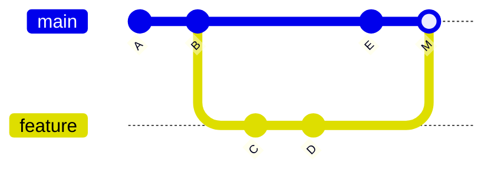

# Git - merge

Parte de: [[02-Fundamentos/07 Git/_Índice Git|Git]]

> [!info] Cómo avanzar
> `progreso`: **pendiente** → **viendo** (estudiando) → **visto** (contestaste la autoevaluación sin abrir las respuestas) → **dominado** (hiciste el laboratorio o lo aplicaste de verdad).

## Contenido

### Qué es
**Merge** integra la historia de una rama en otra. `git merge feature` estando en `main` trae a `main` todos los commits de `feature` que aún no tiene. Es la forma no destructiva de juntar trabajo: no reescribe commits existentes, solo agrega (o mueve un apuntador).

### Cómo funciona
Git busca el **ancestro común** (merge base) de las dos ramas y decide entre dos casos:

**1. Fast-forward.** Si `main` no avanzó desde que nació `feature`, no hay nada que combinar: Git solo **mueve el apuntador** de `main` hasta la punta de `feature`. No se crea commit nuevo y la historia queda lineal.

**2. Merge de tres vías.** Si ambas ramas tienen commits propios, Git compara tres versiones: la base común, la punta de `main` y la punta de `feature`. Combina los cambios de ambos lados y crea un **commit de merge** con **dos padres**. Si las dos ramas cambiaron las mismas líneas, hay conflicto (ver [[Git - resolver conflictos]]).



`M` tiene como padres a `E` y a `D`.

Variantes importantes:

- **`git merge --no-ff feature`**: obliga a crear el commit de merge aunque se pudiera hacer fast-forward. Sirve para que la historia muestre explícitamente "aquí entró la funcionalidad X" como un bloque, y para poder revertir toda la funcionalidad con un solo `git revert -m 1 <merge>`.
- **`git merge --ff-only`**: solo acepta fast-forward; si no se puede, falla. Útil para actualizar `main` local sin crear merges accidentales.
- **`git merge --squash feature`**: toma todos los cambios de la rama y los deja en staging como **un solo cambio**; tú haces un commit normal (con un padre). La rama original no queda ligada en la historia. En Azure DevOps y GitHub es una opción al completar el PR ("Squash commit").
- **`git merge --abort`**: cancela un merge con conflictos y regresa al estado anterior.

### Ejemplo
Integrar localmente una rama de Itzamna.Dionisio y comparar estrategias:

```bash
git switch main
git pull --ff-only
git merge --no-ff feature/AB1532-pedido-duplicado -m "Merge: evita pedidos duplicados (AB#1532)"
git log --oneline --graph -8
```

Salida típica:

```text
*   9f1c2ab Merge: evita pedidos duplicados (AB#1532)
|\
| * 51d0e77 test(pedidos): prueba de folio repetido
| * 3a8b4c1 fix(pedidos): valida folio en usp_Pedido_Insertar
|/
* 7e2d9f0 feat(clientes): consulta por RFC
```

Con squash, en cambio, verías un solo commit `fix(pedidos): evita pedidos duplicados (#123)` sin las dos líneas internas.

Cómo elegir en un PR:
- **Merge (no fast-forward)**: conserva todos los commits y la estructura; historia más ruidosa pero completa.
- **Squash**: un commit por PR; `main` queda limpio y cada commit corresponde a un cambio revisado. Pierdes el detalle intermedio (sigue en el PR).
- **Rebase y fast-forward**: historia lineal conservando commits individuales; exige que esos commits estén bien hechos. Ver [[Git - rebase]].

### Cuándo usarlo y cuándo no
- Merge es seguro para ramas **compartidas**: no reescribe nada que otros tengan.
- Para traer `main` a tu rama personal, puedes usar merge o rebase; con rebase evitas commits "Merge branch 'main' into feature" repetidos.
- Squash conviene cuando los commits del PR son ruidosos ("arreglo", "otra vez"); no conviene si cada commit tiene valor propio o si después vas a seguir trabajando sobre la misma rama (Git ya no reconoce esos commits como integrados).

### Errores comunes
- **Merges accidentales al hacer `git pull`** con cambios locales: configura `git config --global pull.ff only` o `pull.rebase true`.
- **Seguir trabajando en una rama después de un squash merge**: al hacer el siguiente PR aparecen otra vez los cambios viejos o conflictos raros. Crea una rama nueva desde `main` actualizado.
- **Resolver conflictos "aceptando todo lo mío"** sin entender el otro lado: puedes deshacer el trabajo de un compañero. Compila y corre pruebas tras resolver.
- **Revertir un merge sin `-m 1`**: Git no sabe respecto a qué padre revertir y falla.

### Para profundizar
- [Pro Git: procedimientos básicos de ramificación y fusión](https://git-scm.com/book/es/v2/Ramificaciones-en-Git-Procedimientos-B%C3%A1sicos-para-Ramificar-y-Fusionar)
- [Referencia de git merge](https://git-scm.com/docs/git-merge)
- [Tipos de merge al completar un PR en Azure Repos](https://learn.microsoft.com/azure/devops/repos/git/merging-with-squash)

## Autoevaluación

Contesta primero en voz alta o en papel; luego despliega la respuesta.

> [!question]- ¿Qué diferencia hay entre un merge fast-forward y un merge de tres vías?
> **Fast-forward**: la rama destino no avanzó; Git solo mueve el apuntador. **Tres vías**: ambas avanzaron; Git combina usando el ancestro común y crea un **commit de merge** con dos padres.

> [!question]- ¿Para qué sirve `git merge --no-ff`?
> Para forzar un commit de merge aunque se pudiera hacer fast-forward, y conservar en la historia que esos commits llegaron juntos desde una rama.

> [!question]- ¿Qué es un squash merge?
> Combina todos los cambios de la rama en **un solo** commit nuevo en el destino; la historia queda limpia pero se pierden los commits individuales (y la rama original no queda marcada como integrada).

## Práctica

- [[Lab 1 - Ramas, merge, rebase y conflictos en Git]]

