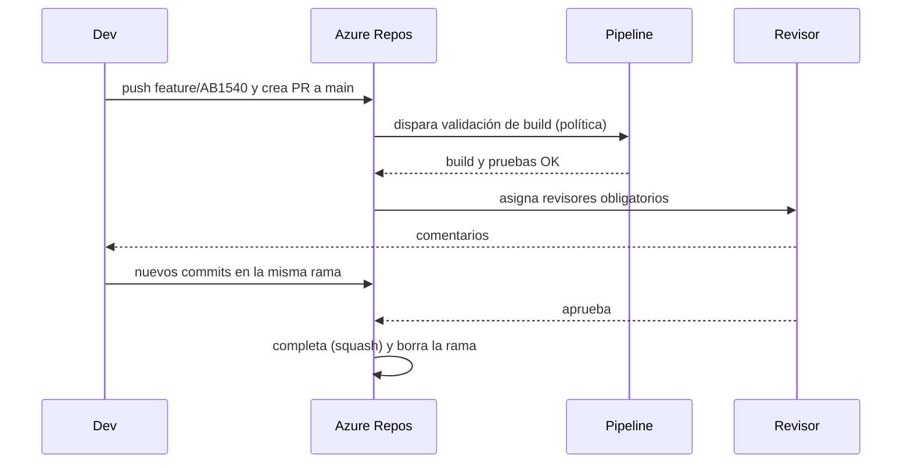

# Git - pull requests

Parte de: [[02-Fundamentos/07 Git/_Índice Git|Git]]

> [!info] Cómo avanzar
> `progreso`: **pendiente** → **viendo** (estudiando) → **visto** (contestaste la autoevaluación sin abrir las respuestas) → **dominado** (hiciste el laboratorio o lo aplicaste de verdad).

## Contenido

### Qué es
Un **pull request (PR)** es una solicitud para **integrar los cambios de una rama en otra** (normalmente a `main`), con un espacio para **revisarlos antes** de que entren: diff, comentarios por línea, discusión, aprobaciones y resultados automáticos (build, pruebas, análisis). No es una función de Git en sí, sino de la plataforma: Azure Repos, GitHub, GitLab (que los llama *merge requests*). Es el punto donde se combinan calidad, conocimiento compartido y trazabilidad.

### Cómo funciona


El PR se actualiza solo cuando subes más commits a la rama. Al completarlo eliges el tipo de integración (merge, squash, rebase; ver [[Git - merge]]).

**Políticas de rama (branch protection).** Reglas que la plataforma aplica a una rama protegida para que **nadie integre sin cumplirlas**. En Azure Repos se configuran por rama y las más comunes son:
- Número mínimo de **revisores** (y si el autor puede aprobar su propio PR).
- **Validación de build**: un pipeline debe pasar.
- **Work items vinculados** obligatorios.
- **Resolución de comentarios**: todos los hilos deben estar resueltos.
- **Tipos de merge permitidos** (por ejemplo, solo squash).
- **Revisores automáticos** por ruta (quien cuida `src/Sql/` revisa cambios de SQL).
Con una política activa ya no se puede hacer `push` directo a la rama; todo pasa por PR.

### Ejemplo
Descripción de un PR en Itzamna.Dionisio:

```markdown
 ## Qué cambia
Agrega el endpoint `GET /api/clientes/{rfc}/saldos` (slice Saldos).

 ## Por qué
Clio necesita mostrar saldos vencidos en la ficha del cliente (AB#1560).

 ## Cómo se hizo
- `ObtenerSaldos.sql` + `IObtenerSaldosQuery` con Dapper.
- Validación del RFC con FluentValidation; error 400 con ProblemDetails y `codigo = RFC_INVALIDO`.
- Índice nuevo `IX_Movimientos_ClienteId_Fecha` (script en `db/migrations/0042.sql`).

 ## Cómo probar
1. `dotnet test`
2. `curl -H "Authorization: Bearer $TOKEN" https://localhost:5001/api/clientes/XAXX010101000/saldos`

 ## Riesgos
El índice se crea ONLINE; tarda ~1 min en QA.
```

Qué hace un **buen PR**:
- **Pequeño y enfocado**: idealmente unas cuantas centenas de líneas y un solo propósito. Los PR enormes se revisan peor y tardan más.
- **Descripción** con qué, por qué, cómo probar y riesgos; capturas si hay cambios visuales en Clio.
- **Historia limpia** o squash al completar; sin archivos de depuración ni cambios de formato ajenos.
- **Build verde antes de pedir revisión**; si aún no está listo, ábrelo como **borrador** (draft).
- **Responder a cada comentario**: corregir o explicar, y resolver los hilos.

Como revisor: revisa primero el diseño y la intención, después el detalle; distingue lo obligatorio de lo opcional ("nit:"); pide pruebas en lugar de suponer.

### Cuándo usarlo y cuándo no
- En equipo, **siempre** para ramas compartidas (`main`, `release/*`). También ayuda trabajando solo: el pipeline valida y queda registro.
- Si el equipo hace trunk-based, los PR deben ser **muy cortos** y revisarse en horas, no días ([[Estrategias de ramas (GitFlow y trunk-based)]]).
- Alternativas: programación en pareja (la revisión ocurre al escribir), o commits directos al tronco en equipos pequeños con CI muy confiable.

### Errores comunes
- **PR gigantes** ("refactor de todo + funcionalidad nueva"): divídelos; refactor primero, funcionalidad después.
- **Aprobar sin leer** ("LGTM") para no frenar: la política se cumple pero la revisión no sirve.
- **Discutir estilo a mano**: automatízalo con `dotnet format`, ESLint y Prettier en el pipeline.
- **Ramas que viven semanas** esperando revisión: generan conflictos; acuerda tiempos de respuesta.
- **Saltarse políticas** con permisos de administrador "solo esta vez": deja un hueco sin revisión ni build.

### Para profundizar
- [Acerca de las solicitudes de incorporación de cambios en Azure Repos](https://learn.microsoft.com/azure/devops/repos/git/pull-requests)
- [Directivas y configuración de ramas en Azure Repos](https://learn.microsoft.com/azure/devops/repos/git/branch-policies)
- [Google Engineering Practices: guía de revisión de código](https://google.github.io/eng-practices/review/)

## Autoevaluación

Contesta primero en voz alta o en papel; luego despliega la respuesta.

> [!question]- ¿Qué es un pull request?
> Una solicitud en la plataforma (GitHub, Azure DevOps, GitLab) para integrar una rama en otra, con diff, revisión, comentarios y validaciones automáticas (CI) antes del merge.

> [!question]- ¿Qué hace un buen PR?
> Pequeño y enfocado en un cambio, descripción con el qué y el porqué, cómo probarlo, capturas si hay UI y enlace a la tarea. Pruebas y CI en verde.

> [!question]- ¿Qué son las políticas de rama (branch protection)?
> Reglas en la rama destino: exigir PR, revisores mínimos, checks de CI aprobados, conversaciones resueltas y prohibir push directo o force push.

