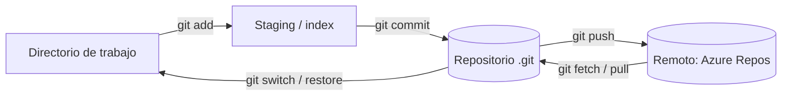

# Git - qué es y cómo funciona

Parte de: [[02-Fundamentos/07 Git/_Índice Git|Git]]

> [!info] Cómo avanzar
> `progreso`: **pendiente** → **viendo** (estudiando) → **visto** (contestaste la autoevaluación sin abrir las respuestas) → **dominado** (hiciste el laboratorio o lo aplicaste de verdad).

## Contenido

### Qué es
Git es un **sistema de control de versiones distribuido**: guarda la historia completa de un proyecto como una serie de "fotos" (commits) y permite volver a cualquiera de ellas, comparar cambios y trabajar en paralelo con ramas. "Distribuido" significa que **cada clon es un repositorio completo**, con toda la historia; puedes hacer commits, ver el log, crear ramas o comparar versiones sin red. En un sistema **centralizado** (SVN, TFVC de Azure DevOps) la historia vive en un servidor y casi toda operación necesita conexión; si el servidor cae, nadie puede hacer commit.

En Git el servidor (Azure Repos, GitHub) es solo **un remoto más** con el que sincronizas usando `fetch`, `pull` y `push`. Eso hace que las operaciones locales sean muy rápidas y que cualquier clon sirva de respaldo.

### Cómo funciona
Localmente trabajas con **tres áreas**:

1. **Directorio de trabajo** (working tree): los archivos que ves y editas.
2. **Área de preparación** (staging o *index*): lo que irá en el siguiente commit. `git add` copia ahí el estado actual de un archivo.
3. **Repositorio** (carpeta `.git`): la base de datos con todos los commits. `git commit` toma lo que hay en staging y lo guarda como una foto nueva.



Por dentro, Git es una **base de datos de objetos direccionada por contenido**. Cada objeto se identifica por el hash (SHA-1, con soporte experimental para SHA-256) de su contenido. Hay cuatro tipos:

- **blob**: el contenido de un archivo (sin nombre).
- **tree**: un directorio; lista nombres, permisos y apunta a blobs y otros trees.
- **commit**: apunta a un tree raíz (la foto completa), a su(s) commit(s) padre, y guarda autor, fecha y mensaje.
- **tag anotado**: un objeto con nombre, autor y mensaje que apunta a un commit.

Git **no guarda diferencias** entre versiones como modelo principal: guarda fotos completas, pero si un archivo no cambió, el tree nuevo apunta al mismo blob, así que no se duplica. (Internamente los *packfiles* sí comprimen con deltas, pero eso es una optimización de almacenamiento.) Las **ramas** y `HEAD` son simples referencias: archivos que contienen el hash de un commit.

### Ejemplo
Arrancar un repositorio para Itzamna.Dionisio y ver los objetos:

```bash
mkdir Itzamna.Dionisio && cd Itzamna.Dionisio
git init -b main
dotnet new webapi -n Itzamna.Dionisio.Api --use-controllers
git status                      # todo aparece como "untracked"
git add .
git commit -m "chore: estructura inicial de la API"

git log --oneline               # el commit recién creado
git cat-file -p HEAD            # muestra tree, author y mensaje
git cat-file -p HEAD^{tree}     # lista blobs y trees del directorio raíz
git remote add origin https://dev.azure.com/org/Itzamna/_git/Itzamna.Dionisio
git push -u origin main
```

`git cat-file -p` te deja ver que un commit es solo texto con punteros: `tree <hash>`, `parent <hash>` (si no es el primero), autor y mensaje.

### Cuándo usarlo y cuándo no
- Úsalo para **todo código fuente**, scripts SQL, pipelines YAML, documentación en Markdown e infraestructura como código.
- Git maneja mal **binarios grandes** (videos, PSD, modelos 3D, datasets): cada versión se guarda completa y el repo crece para siempre. Para eso existe Git LFS o almacenamiento aparte.
- No es un respaldo de secretos ni un lugar para configuraciones con contraseñas: ver [[Git - .gitignore]].
- Un sistema centralizado puede tener sentido cuando se requiere bloqueo exclusivo de archivos binarios (algunos estudios de videojuegos), pero para desarrollo .NET/React, Git es el estándar.

### Errores comunes
- **Pensar que `git add` es solo "para archivos nuevos"**: también hay que hacerlo para archivos modificados; si no, el cambio no entra al commit. Revisa siempre `git status` antes de confirmar.
- **Confundir `fetch` con `pull`**: `fetch` solo descarga; `pull` descarga y además integra (merge o rebase) en tu rama.
- **Creer que hacer commit ya respalda el trabajo**: el commit es local hasta que haces `push`.
- **Editar archivos dentro de `.git`** a mano: puede corromper el repositorio; usa siempre comandos.
- **Commits gigantes** con todo mezclado: dificultan revisar y revertir; ver [[Git - commit]].

### Para profundizar
- [Pro Git en español, capítulo 1 "Inicio"](https://git-scm.com/book/es/v2)
- [Git Internals: objetos de Git (Pro Git, cap. 10)](https://git-scm.com/book/en/v2/Git-Internals-Git-Objects)
- [Documentación de referencia de Git](https://git-scm.com/docs)

## Autoevaluación

Contesta primero en voz alta o en papel; luego despliega la respuesta.

> [!question]- ¿Qué es Git y en qué se diferencia de un sistema centralizado?
> Un control de versiones **distribuido**: cada clon tiene la historia completa y se puede trabajar sin conexión. En un sistema centralizado (SVN, TFVC) la historia vive en el servidor.

> [!question]- ¿Cuáles son las tres áreas de trabajo locales?
> **Directorio de trabajo** (archivos), **staging/índice** (lo que irá en el próximo commit, con `git add`) y el **repositorio** (`.git`, commits).

> [!question]- ¿Qué guarda Git internamente?
> Objetos identificados por hash: **blobs** (contenido), **trees** (directorios), **commits** (árbol + padres + autor + mensaje) y tags. Las ramas son solo referencias a un commit.

## Práctica

- [[Lab 1 - Ramas, merge, rebase y conflictos en Git]]

