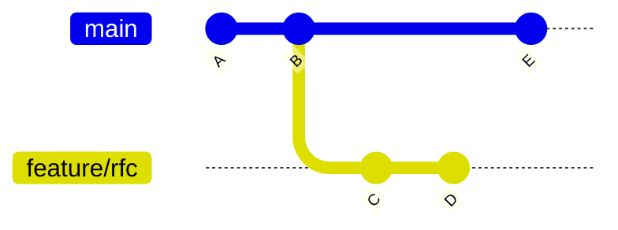

# Git - ramas

Parte de: [[02-Fundamentos/07 Git/_Índice Git|Git]]

> [!info] Cómo avanzar
> `progreso`: **pendiente** → **viendo** (estudiando) → **visto** (contestaste la autoevaluación sin abrir las respuestas) → **dominado** (hiciste el laboratorio o lo aplicaste de verdad).

## Contenido

### Qué es
Una **rama** en Git es simplemente un **apuntador móvil a un commit**: un archivo pequeño (en `.git/refs/heads/`) que contiene un hash. Cuando haces commit estando en una rama, el apuntador avanza al commit nuevo. Crear una rama es instantáneo y barato porque no copia archivos; por eso en Git se usan ramas para cada funcionalidad, corrección o experimento.

**HEAD** es otra referencia que indica "dónde estás": normalmente apunta a una rama (`ref: refs/heads/main`), y la rama a su vez apunta a un commit.

### Cómo funciona


Aquí `main` apunta a E y `feature/rfc` a D; ambas comparten A y B. Cuando cambias de rama, Git reescribe tu directorio de trabajo para que refleje el commit al que apunta la nueva rama.

Comandos esenciales (desde Git 2.23 existe `git switch`, más claro que `checkout` para cambiar de rama):

```bash
git branch                         # lista ramas locales (* marca la actual)
git branch -a                      # incluye las remotas (origin/...)
git switch -c feature/rfc          # crea y cambia (equivale a checkout -b)
git switch main                    # cambia a una rama existente
git branch -d feature/rfc          # borra si ya está integrada
git branch -D feature/rfc          # fuerza el borrado aunque no esté integrada
git push -u origin feature/rfc     # publica y configura el upstream
git push origin --delete feature/rfc   # borra la rama remota
git fetch --prune                  # limpia referencias remotas que ya no existen
```

Las **ramas remotas** (`origin/main`) son copias locales de solo lectura de dónde estaba la rama en el servidor la última vez que hiciste `fetch`. Tu `main` local y `origin/main` pueden divergir; `git status` te dice si vas "adelante" o "atrás".

**Detached HEAD** ocurre cuando HEAD apunta directamente a un commit y no a una rama, por ejemplo al hacer `git switch --detach v1.2.0` o `git checkout a1b2c3d`. Puedes mirar y compilar, pero si haces commits ahí, ninguna rama los apunta; al cambiar de rama quedan "huérfanos" y solo se recuperan con `git reflog`. Si quieres conservarlos, crea una rama en ese momento: `git switch -c hotfix/desde-tag`.

### Ejemplo
Flujo diario en Itzamna.Clio con Azure Repos:

```bash
git switch main
git pull --ff-only                      # actualiza sin crear merges accidentales
git switch -c feature/AB1540-filtro-fechas
 # ... cambios en src/features/reportes/FiltroFechas.tsx
git add -p
git commit -m "feat(reportes): agrega filtro por rango de fechas"
git push -u origin feature/AB1540-filtro-fechas
 # Abres el PR hacia main en Azure DevOps
```

Nombrar con prefijo (`feature/`, `fix/`, `hotfix/`) y el número del work item ayuda a encontrar ramas y a que las políticas de rama del repositorio las reconozcan. Cómo se integran luego se ve en [[Git - merge]] y [[Git - rebase]]; la organización del equipo, en [[Estrategias de ramas (GitFlow y trunk-based)]].

### Cuándo usarlo y cuándo no
- Una rama por unidad de trabajo revisable (una historia, un bug). Ramas **cortas** (horas o pocos días) dan menos conflictos.
- No mantengas ramas de larga vida "por si acaso": divergen y el merge final duele.
- Para cambiar rápido de contexto sin crear rama, a veces basta [[Git - stash]]; para trabajar en dos ramas a la vez, `git worktree add ../otra-carpeta rama` evita estar cambiando.

### Errores comunes
- **Crear la rama desde un `main` desactualizado**: luego llegan conflictos evitables. Haz `git pull` antes de `switch -c`.
- **Hacer commits en detached HEAD** sin darte cuenta: Git lo avisa; lee el mensaje y crea una rama si vas a trabajar.
- **Borrar con `-D` sin revisar**: pierdes commits no integrados (recuperables por reflog un tiempo, pero no para siempre).
- **Acumular ramas remotas muertas**: configura que el PR borre la rama al completarse y usa `git fetch --prune`.
- **Cambiar de rama con cambios sin guardar** que chocan: Git se niega; haz commit o stash primero.

### Para profundizar
- [Pro Git: ramificaciones en Git](https://git-scm.com/book/es/v2/Ramificaciones-en-Git-%C2%BFQu%C3%A9-es-una-rama%3F)
- [Referencia de git switch](https://git-scm.com/docs/git-switch)
- [Guía de ramas en Azure Repos](https://learn.microsoft.com/azure/devops/repos/git/git-branching-guidance)

## Autoevaluación

Contesta primero en voz alta o en papel; luego despliega la respuesta.

> [!question]- ¿Qué es una rama en Git?
> Un apuntador móvil a un commit. Crear una rama es barato (un archivo con un hash). `HEAD` indica en qué rama estás.

> [!question]- ¿Qué comandos usas para crear, cambiar y borrar ramas?
> `git switch -c feature/x` (crear y cambiar), `git switch main`, `git branch -d feature/x` (borra si ya está integrada; `-D` fuerza). `git branch -vv` muestra el seguimiento remoto.

> [!question]- ¿Qué es "detached HEAD"?
> `HEAD` apunta a un commit, no a una rama (por ejemplo tras `git checkout <hash>`). Los commits que hagas ahí quedan huérfanos al cambiarte si no creas una rama (`git switch -c rescate`).

## Práctica

- [[Lab 1 - Ramas, merge, rebase y conflictos en Git]]

