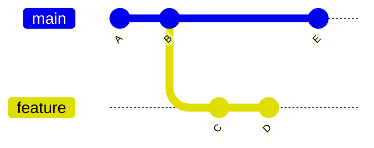

# Git - rebase

Parte de: [[02-Fundamentos/07 Git/_Índice Git|Git]]

> [!info] Cómo avanzar
> `progreso`: **pendiente** → **viendo** (estudiando) → **visto** (contestaste la autoevaluación sin abrir las respuestas) → **dominado** (hiciste el laboratorio o lo aplicaste de verdad).

## Contenido

### Qué es
**Rebase** mueve una serie de commits para que partan de otra base. `git rebase main` estando en `feature` toma tus commits que `main` no tiene y los **reaplica uno por uno encima de la punta actual de `main`**. El resultado es una historia lineal, como si hubieras empezado tu trabajo hoy. Como cada commit se vuelve a crear, todos obtienen **hashes nuevos**: rebase **reescribe historia**.

### Cómo funciona


Tras `git rebase main` en `feature`, la historia queda `A - B - E - C' - D'`. `C'` y `D'` tienen el mismo cambio que `C` y `D` pero otro padre y otro hash. Los originales siguen existiendo un tiempo (los ves en el reflog) hasta que el recolector de basura los limpia.

Pasos internos: Git calcula los commits de `feature` que no están en `main`, guarda la posición anterior en `ORIG_HEAD`, mueve tu rama a `main` y aplica cada parche. Si uno choca, se detiene para que resuelvas: editas, `git add` y `git rebase --continue`; o `git rebase --skip` para descartar ese commit, o `git rebase --abort` para volver a como estabas.

**La regla de oro:** no hagas rebase de commits que otras personas ya tienen (ramas compartidas como `main` o `develop`). Si reescribes historia publicada, los demás tendrán commits duplicados y conflictos absurdos. En tu rama personal sí puedes, y para publicarla usa `git push --force-with-lease`: a diferencia de `--force`, falla si el remoto tiene commits que tú no habías visto.

**`git pull --rebase`** hace `fetch` y luego rebase de tus commits locales sobre la rama remota, en lugar de merge. Evita los commits "Merge branch 'main' of ..." que no aportan nada. Puedes dejarlo por defecto con `git config --global pull.rebase true`.

**Rebase interactivo** (`git rebase -i HEAD~4`) abre una lista para reordenar, unir (`squash`/`fixup`), editar o borrar commits antes del PR. Combinado con `git commit --fixup <hash>` y `git rebase -i --autosquash`, sirve para dejar una serie limpia.

### Ejemplo
Tu rama de Itzamna.Clio se quedó atrás de `main`:

```bash
git switch feature/AB1540-filtro-fechas
git fetch origin
git rebase origin/main
 # Conflicto en src/features/reportes/api.ts
code src/features/reportes/api.ts   # resuelves
git add src/features/reportes/api.ts
git rebase --continue
npm run build && npm test           # verifica que todo siga bien
git push --force-with-lease
```

Si algo salió mal y ya terminaste el rebase:

```bash
git reflog                          # busca la línea "rebase (start)" y la anterior
git reset --hard ORIG_HEAD          # justo después del rebase
 # o bien
git reset --hard HEAD@{5}           # la posición que viste en el reflog
```

`reflog` registra cada movimiento de HEAD durante (por defecto) 90 días para entradas alcanzables, así que casi todo error local se puede deshacer.

### Cuándo usarlo y cuándo no
- **Sí**: actualizar tu rama personal con `main` antes del PR; limpiar commits locales; `pull --rebase` para cambios locales no publicados.
- **No**: en ramas compartidas o ya integradas; cuando el equipo prefiere conservar la historia real con merges; cuando no entiendes bien qué va a reescribir (empieza con `git log --oneline main..HEAD` para ver qué commits se moverán).
- Alternativa: [[Git - merge]] de `main` en tu rama. Más seguro, historia menos lineal.

### Errores comunes
- **`git push --force` tras rebase** en una rama donde otro también sube: borras su trabajo. Usa `--force-with-lease`.
- **Resolver el mismo conflicto varias veces**: en un rebase cada commit se aplica por separado. Activa `git config --global rerere.enabled true` para que Git recuerde resoluciones.
- **Confundir `--ours` y `--theirs` durante un rebase**: se invierten respecto a un merge (ver [[Git - resolver conflictos]]).
- **No compilar después**: un rebase sin conflictos textuales puede romper el build (por ejemplo, alguien renombró un método que tú usas).
- **Rebase de una rama ya mergeada con squash**: genera conflictos inútiles; mejor crea rama nueva.

### Para profundizar
- [Pro Git: reorganizar el trabajo (rebase)](https://git-scm.com/book/es/v2/Ramificaciones-en-Git-Reorganizar-el-Trabajo-Realizado)
- [Referencia de git rebase](https://git-scm.com/docs/git-rebase)
- [Referencia de git reflog](https://git-scm.com/docs/git-reflog)

## Autoevaluación

Contesta primero en voz alta o en papel; luego despliega la respuesta.

> [!question]- ¿Qué hace `git rebase main` estando en `feature`?
> Toma los commits de `feature` que no están en `main` y los **vuelve a aplicar** encima de la punta de `main`, creando commits nuevos (otros hashes). La historia queda lineal.

> [!question]- ¿Cuál es la regla de oro del rebase?
> No reescribas commits que otros ya tienen (ramas compartidas publicadas). Si hay que publicar tras un rebase de tu rama personal, usa `git push --force-with-lease`, que falla si alguien más subió algo.

> [!question]- ¿Qué hace `git pull --rebase`?
> Trae los cambios remotos y reaplica tus commits locales encima, en lugar de crear un commit de merge. Evita merges "Merge branch 'main' of ..." innecesarios.

> [!question]- Te equivocaste en un rebase. ¿Cómo recuperas el estado anterior?
> `git reflog` muestra a dónde apuntaba `HEAD`; `git reset --hard HEAD@{n}` (o `ORIG_HEAD` justo después del rebase) regresa. Durante el rebase, `git rebase --abort`.

## Práctica

- [[Lab 1 - Ramas, merge, rebase y conflictos en Git]]

