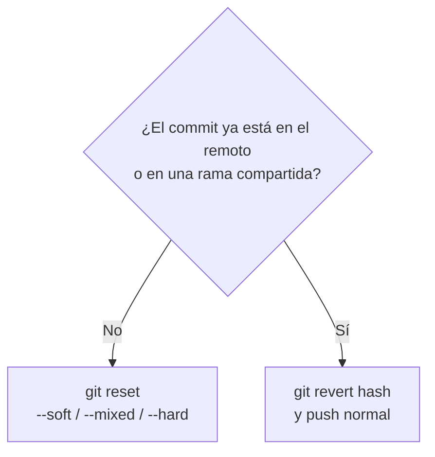

# Git - reset y revert

Parte de: [[02-Fundamentos/07 Git/_Índice Git|Git]]

> [!info] Cómo avanzar
> `progreso`: **pendiente** → **viendo** (estudiando) → **visto** (contestaste la autoevaluación sin abrir las respuestas) → **dominado** (hiciste el laboratorio o lo aplicaste de verdad).

## Contenido

### Qué es
Son las dos formas principales de **deshacer** en Git, y hacen cosas muy distintas:

- **`git reset`** mueve el apuntador de la rama actual a otro commit, y opcionalmente cambia el staging y el directorio de trabajo. **Reescribe historia**: los commits "posteriores" dejan de estar en la rama.
- **`git revert`** crea un **commit nuevo** que aplica el cambio inverso de otro commit. **No reescribe nada**: la historia conserva el error y su corrección.

Regla práctica: `reset` para lo **local** que nadie más tiene; `revert` para lo **publicado** (ramas compartidas como `main`).

### Cómo funciona
`git reset <commit>` tiene tres modos, que se entienden con las tres áreas (repositorio, staging, directorio de trabajo):

| Modo | Mueve la rama | Staging | Directorio de trabajo | Uso típico |
|---|---|---|---|---|
| `--soft` | sí | se conserva (los cambios quedan preparados) | se conserva | rehacer el último commit, juntar commits |
| `--mixed` (por defecto) | sí | se reinicia al commit destino (cambios quedan sin preparar) | se conserva | deshacer commits y volver a elegir qué agregar |
| `--hard` | sí | se reinicia | **se sobrescribe** (pierdes cambios no confirmados) | descartar todo y volver a un punto |

Con una ruta, `reset` no mueve la rama: solo saca el archivo del staging. Hoy se recomienda el comando más explícito `git restore --staged <archivo>`.

`git revert <hash>` calcula el diff de ese commit y aplica el contrario. Si el commit es un merge, debes indicar el padre principal: `git revert -m 1 <hash-merge>`.



### Ejemplo
Situaciones reales en Itzamna.Dionisio:

```bash
 # 1. Deshacer el último commit local, conservando los cambios preparados
git reset --soft HEAD~1

 # 2. Sacar un archivo del staging sin perder sus cambios
git restore --staged appsettings.Development.json
 #    (equivalente clásico: git reset appsettings.Development.json)

 # 3. Juntar tus últimos 3 commits locales en uno
git reset --soft HEAD~3
git commit -m "feat(saldos): endpoint de consulta de saldos"

 # 4. Deshacer en main (ya publicada) el commit a1b2c3d
git switch main && git pull --ff-only
git revert a1b2c3d            # abre el editor con "Revert ..."; explica por qué
git push

 # 5. Descartar todo lo local y quedar igual que el remoto
git fetch origin
git reset --hard origin/main
```

**¿Se puede recuperar un `reset --hard` hecho por error?** Los **commits** sí, casi siempre: el reflog registra a dónde apuntaba HEAD.

```bash
git reflog
 # 3f2a1b9 HEAD@{0}: reset: moving to HEAD~2
 # 8c7d6e5 HEAD@{1}: commit: test(saldos): casos de saldo negativo
git reset --hard HEAD@{1}     # o ORIG_HEAD, que guarda la posición previa al reset
```

Lo que **no** se recupera son los cambios del directorio de trabajo que nunca entraron en un commit ni en staging. (Lo que sí estuvo en staging deja blobs huérfanos que a veces se rescatan con `git fsck --lost-found`.)

### Cuándo usarlo y cuándo no
- **reset --soft/--mixed**: arreglar commits locales antes de publicar, rehacer la selección de archivos.
- **reset --hard**: solo cuando de verdad quieres tirar cambios; revisa `git status` y `git stash` antes si dudas.
- **revert**: en `main`, ramas de release, o cualquier rama que otros ya tengan. También es la forma limpia de quitar una funcionalidad que salió mal en producción.
- Para descartar cambios de un archivo en el directorio de trabajo: `git restore <archivo>`.

### Errores comunes
- **`reset` en una rama publicada y luego `push --force`**: los demás quedan con historia divergente. Usa `revert`.
- **`--hard` con cambios sin guardar**: se pierden. Haz `git stash -u` primero si no estás seguro.
- **Revertir un merge sin `-m 1`**: falla. Y recuerda que si después quieres volver a integrar esa rama, primero tendrás que revertir el revert.
- **Confundir `HEAD~1` con `HEAD^1`** en merges: `~` sigue al primer padre generación por generación; `^2` elige el segundo padre.
- **No escribir el porqué del revert**: el mensaje por defecto no explica la causa.

### Para profundizar
- [Pro Git: Reiniciar desmitificado](https://git-scm.com/book/es/v2/Herramientas-de-Git-Reiniciar-Desmitificado)
- [Pro Git: deshacer cosas](https://git-scm.com/book/es/v2/Fundamentos-de-Git-Deshacer-Cosas)
- [Referencia de git revert](https://git-scm.com/docs/git-revert)

## Ejercicios

Resuélvelos en papel o en la herramienta; la solución está plegada.

> [!question]- Deshaz el último commit local manteniendo los cambios en staging.
> `git reset --soft HEAD~1`

> [!question]- Saca `config.json` del staging sin perder sus cambios.
> `git restore --staged config.json` (o `git reset config.json`).

> [!question]- Deshaz en `main` (ya publicada) el commit `a1b2c3d`.
> `git revert a1b2c3d` y `git push`.

## Autoevaluación

Contesta primero en voz alta o en papel; luego despliega la respuesta.

> [!question]- ¿Qué diferencia hay entre `reset` y `revert`?
> `git revert <hash>` crea un commit **nuevo** que deshace otro: seguro en ramas compartidas. `git reset` **mueve la rama** hacia atrás reescribiendo historia: solo para trabajo local no publicado.

> [!question]- ¿Qué hacen `--soft`, `--mixed` y `--hard`?
> `--soft`: mueve la rama y deja los cambios en staging. `--mixed` (por defecto): los deja en el directorio, fuera del staging. `--hard`: descarta todo (peligroso).

> [!question]- Hiciste `git reset --hard` por error. ¿Se puede recuperar?
> Los commits sí: búscalos en `git reflog` y vuelve con `git reset --hard <hash>`. Los cambios nunca commiteados ni en stash normalmente se pierden.

## Práctica

- [[Lab 1 - Ramas, merge, rebase y conflictos en Git]]

