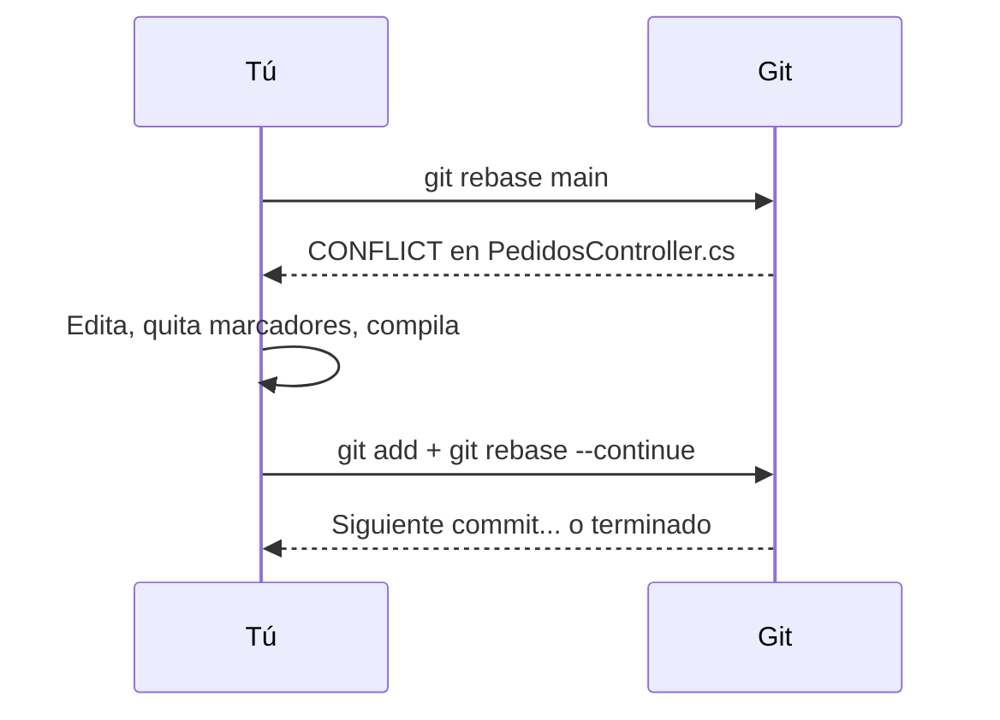

# Git - resolver conflictos

Parte de: [[02-Fundamentos/07 Git/_Índice Git|Git]]

> [!info] Cómo avanzar
> `progreso`: **pendiente** → **viendo** (estudiando) → **visto** (contestaste la autoevaluación sin abrir las respuestas) → **dominado** (hiciste el laboratorio o lo aplicaste de verdad).

## Contenido

### Qué es
Un **conflicto** ocurre cuando Git intenta combinar dos líneas de historia y **no puede decidir solo** qué versión dejar. Pasa en `merge`, `rebase`, `cherry-pick`, `revert` y `stash pop`. No es un error: es Git pidiéndote que decidas.

Ocurre cuando:
- Ambos lados modificaron **las mismas líneas** (o líneas contiguas) de un archivo.
- Un lado **modificó** un archivo y el otro lo **borró** o lo renombró de forma que Git no empata.
- Ambos lados agregaron un archivo con la misma ruta y distinto contenido.

Si los cambios están en partes distintas del archivo, Git los combina automáticamente.

### Cómo funciona
Cuando hay conflicto, Git se detiene, marca los archivos como "both modified" en `git status` y escribe **marcadores** dentro del archivo:

```text
<<<<<<< HEAD
    return Results.Problem(statusCode: 409, title: "Pedido duplicado");
=======
    return Conflict(new ProblemDetails { Title = "Folio repetido" });
>>>>>>> feature/AB1532-pedido-duplicado
```

- Entre `<<<<<<<` y `=======`: la versión del lado actual (HEAD).
- Entre `=======` y `>>>>>>>`: la versión que se está integrando.
- Con `git config --global merge.conflictStyle zdiff3` aparece además una sección `|||||||` con la **base común**, que ayuda muchísimo a entender qué cambió cada quien.

Tu trabajo: editar el archivo para que quede **como debe ser** (a veces una versión, a veces la otra, a menudo una combinación), borrar los marcadores, compilar, y luego:

```bash
git add <archivo>
git merge --continue        # o git rebase --continue / git cherry-pick --continue
```

**`--ours` y `--theirs`.** Puedes tomar una versión completa de un archivo con `git checkout --ours <archivo>` o `--theirs`. Ojo con el significado:
- En un **merge** (estás en `main` y haces `git merge feature`): *ours* = `main` (tu rama), *theirs* = `feature`.
- En un **rebase** de `feature` sobre `main`: Git está reaplicando tus commits encima de `main`, así que *ours* = `main` (la base sobre la que se construye) y *theirs* = **tu commit** que se está aplicando. Es decir, se **invierten** respecto a lo que intuyes.



### Ejemplo
Conflicto en un archivo `.sql` de Itzamna.Dionisio al hacer rebase:

```bash
git rebase origin/main
 # CONFLICT (content): Merge conflict in src/Features/Pedidos/InsertarPedido.sql
git status
git diff                         # muestra el conflicto con contexto
code src/Features/Pedidos/InsertarPedido.sql
 # Decides: conservas la validación de folio (tuya) y la nueva columna Canal (de main)
dotnet build && dotnet test
git add src/Features/Pedidos/InsertarPedido.sql
git rebase --continue
```

Herramientas útiles: VS Code y Visual Studio muestran botones "Accept Current / Incoming / Both" y un editor de merge de tres paneles; `git mergetool` abre la herramienta que configures. `git log --merge -p` muestra los commits que tocaron las líneas en conflicto.

**Si el conflicto se complicó**, no sigas a ciegas:
- `git merge --abort` / `git rebase --abort` / `git cherry-pick --abort` te regresan al estado anterior.
- Pide ayuda a quien hizo el otro cambio; ellos saben la intención.
- Considera integrar en pasos más pequeños (por ejemplo, rebase sobre un commit intermedio) o hacer merge en lugar de rebase para resolver una sola vez.
- Activa `rerere` (`git config --global rerere.enabled true`) para que Git recuerde resoluciones repetidas.

### Cuándo usarlo y cuándo no
Más que "usar", se trata de **prevenir**: ramas cortas, integrar `main` seguido, PR pequeños, no reformatear archivos completos en el mismo PR que la lógica y acordar formato automático (por ejemplo, `dotnet format` y Prettier) para que el estilo no genere conflictos.

### Errores comunes
- **Dejar marcadores** `<<<<<<<` en el código y hacer commit: un hook o el build deberían detectarlo; revisa `git diff --check`.
- **Elegir "todo lo mío"** sin leer el otro lado: deshaces trabajo ajeno.
- **No compilar ni probar** después de resolver: el texto puede quedar sin marcadores y aun así romper la lógica.
- **Confundir ours/theirs en rebase**.
- **Resolver archivos generados** (lock files, migraciones) a mano: suele ser mejor regenerarlos (`npm install`) tras tomar una versión.

### Para profundizar
- [Pro Git: principales conflictos que pueden surgir en las fusiones](https://git-scm.com/book/es/v2/Ramificaciones-en-Git-Procedimientos-B%C3%A1sicos-para-Ramificar-y-Fusionar)
- [Pro Git: fusión avanzada (Advanced Merging)](https://git-scm.com/book/en/v2/Git-Tools-Advanced-Merging)
- [Referencia de git rerere](https://git-scm.com/docs/git-rerere)

## Autoevaluación

Contesta primero en voz alta o en papel; luego despliega la respuesta.

> [!question]- ¿Cuándo ocurre un conflicto?
> Cuando dos ramas cambiaron las mismas líneas (o una borró un archivo que la otra modificó) y Git no puede decidir solo.

> [!question]- ¿Qué significan los marcadores en el archivo?
> ```
> <<<<<<< HEAD
> lo de tu rama actual
> =======
> lo de la rama que integras
> >>>>>>> feature
> ```
> Editas para dejar el resultado correcto, quitas marcadores, `git add` y continúas (`git commit` o `git rebase --continue`).

> [!question]- En un rebase, ¿qué significa `--ours` y `--theirs`?
> Se **invierten** respecto al merge: durante un rebase, `ours` es la rama base sobre la que reaplicas (por ejemplo `main`) y `theirs` es tu commit que se está aplicando.

> [!question]- ¿Qué haces si el conflicto se complicó?
> `git merge --abort` o `git rebase --abort` para volver al estado previo. Para conflictos que se repiten, `git config rerere.enabled true` recuerda resoluciones.

## Práctica

- [[Lab 1 - Ramas, merge, rebase y conflictos en Git]]

